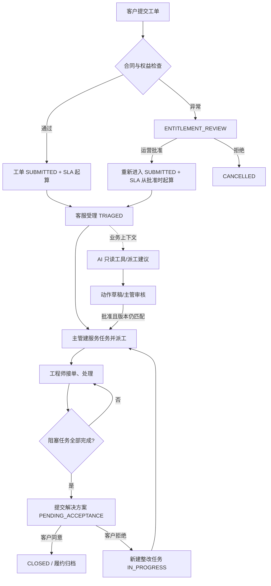
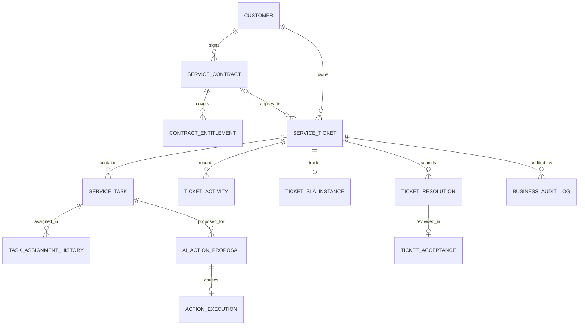
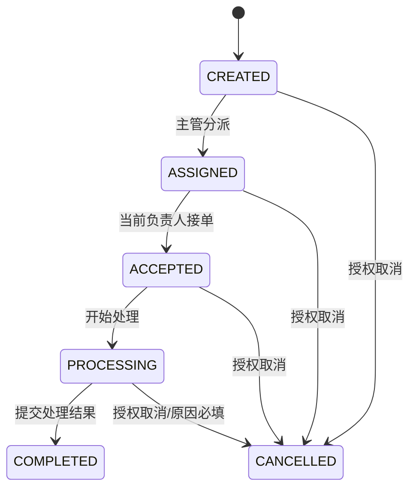
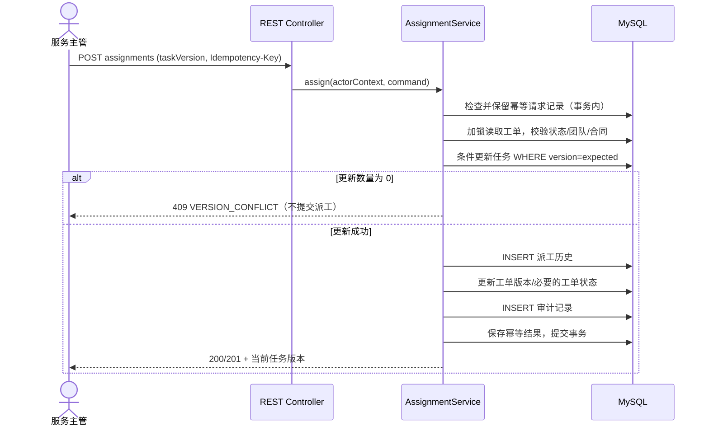
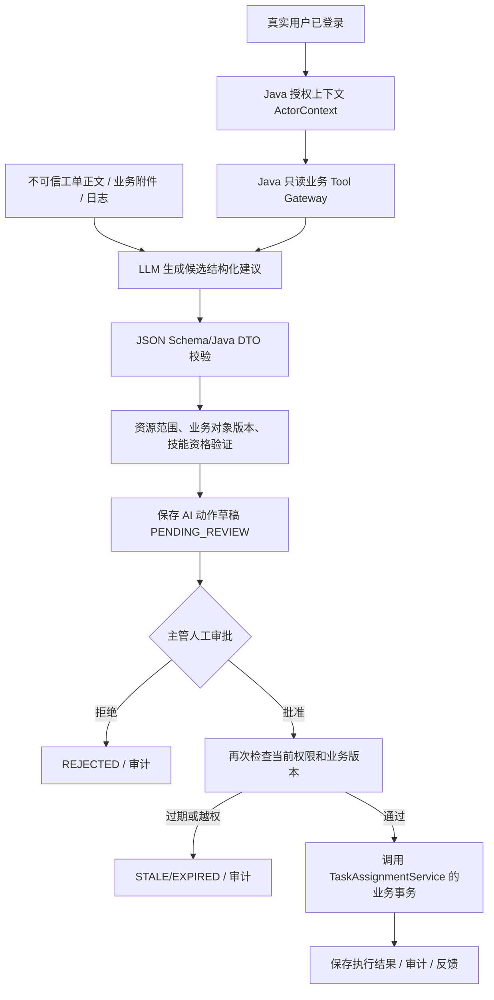
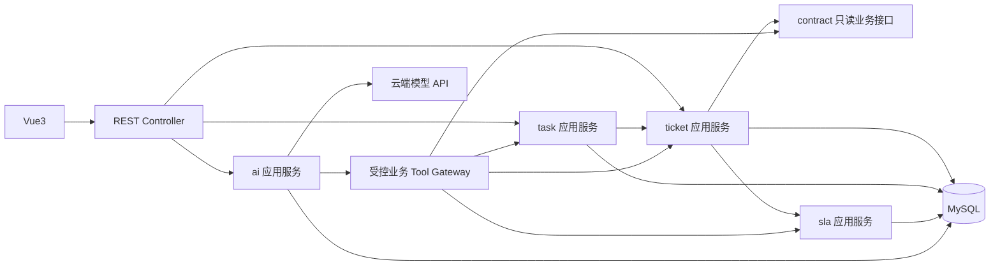

# ServiceFlow AI：企业软件服务履约与 AI 协同执行平台

> **V0.2 / 详细设计草案（未开始开发）**  
> **设计基线：** [V0.1 第一版设计](./ServiceFlow_AI_Design_V0.1.md)  
> **数据库附件：** [P0 核心 DDL 草案](./ServiceFlow_AI_P0_schema_V0.2.sql)  
> **开发条件：** 本地个人电脑，16 GB 内存；Java 后端 + Vue3 前端 + MySQL；AI 通过云端模型 API。  
> **目标：** 独立实现复杂企业履约业务，并使 AI 在授权、审核、并发和故障边界内可靠参与真实操作，而非简单 CRUD + RAG。  
> **状态声明：** 本文是**拟定开发契约**，不等于已实现、已部署或已通过测试。凡称“冻结”，均指本轮推荐作为 **P0 设计基线**，用户评审后才能形成最终开发约束。

---

## 0. 本版要解决的问题与决策摘要

### 0.1 相比 V0.1 的关键改进

| V0.1 的开放问题 | V0.2 建议的 P0 决策 | 原因 |
| --- | --- | --- |
| 工单与任务的职责 | `ServiceTicket` 表示客户问题；`ServiceTask` 表示工程师工作；`ActionExecution` 表示一次已获批准的具体操作 | 避免工单状态、派工与 AI 执行混为一体 |
| SLA 何时启动 | 合同权益通过：从提交时启动；权益例外：从**人工特批生效时**启动 | 防止合同待审期间凭空产生履约义务 |
| 优先级与 SLA 如何绑定 | 提交时使用**确定性影响程度×紧急度矩阵**给出 P0 优先级；AI 只能建议，不直接改 SLA | 解决“工单创建时需启动 SLA，但优先级尚未人工分类”的冲突 |
| 当前派工如何唯一 | `service_task.current_assignee_id` 是当前唯一负责人；`task_assignment_history` 仅保存不可覆盖的历史 | 不依赖 MySQL 不支持的普通部分唯一索引 |
| 多任务何时允许解决 | 至少存在一项阻塞任务，且**所有未取消的阻塞任务**均已完成 | 工单处理完成不等于某个工程师任务完成 |
| 客户拒绝验收 | 工单回到 `IN_PROGRESS`，创建新的**阻塞整改任务**，保留旧任务与 `ticket_resolution` 解决尝试 | 不篡改已完成任务历史 |
| 工单重开与 SLA | 首响指标不重置；解决时钟在 `PENDING_ACCEPTANCE` 暂停，拒绝验收后继续累计有效工作时间 | SLA 既可解释又不会因多次重开而清零 |
| AI 建议的执行 | 草稿存版本 + 权限边界；人工审批时**重新查权限、工单版本、任务版本**，在本地事务内执行 | 避免执行过期或越权模型建议 |
| 事件中间件 | P0 同事务写审计，通知暂不跨服务；P1 采用 Spring Modulith **或**自研 Outbox（二选一） | 避免重复建设两套可靠事件机制 |
| 个人开发规模 | 模块化单体、MySQL、云模型 API、最小 Vue3 页面 | 满足 16 GB 本地环境，优先保证业务正确性 |

### 0.2 已推荐作为 P0 基线的架构决策（ADR）

| 编号 | 决策 | 不采用的方案 |
| --- | --- | --- |
| ADR-001 | 一个 Spring Boot 部署单元，按领域包组织代码 | 一开始拆分 Spring Cloud 微服务 |
| ADR-002 | 业务状态、权限和 SLA 在 Java 中做确定性校验 | 由模型文本直接决定业务真值 |
| ADR-003 | 工单与工程任务分离，当前指派在任务表、历史独立存储 | 工单上只有一个负责人字段 |
| ADR-004 | P0 AI 只能建议派工；审批请求来自已登录真人 | 模型直接调用“确认派工”工具 |
| ADR-005 | SLA 使用不可修改的策略/日历版本和事件轨迹 | 修改合同后直接重写历史 SLA |
| ADR-006 | 数据库本地动作使用单事务 + 条件更新 + 唯一约束 | 用分布式锁掩盖数据库并发问题 |
| ADR-007 | AI 模型故障时人工服务链路可用 | 将所有工单操作绑定到模型服务 |
| ADR-008 | P0 不接真实客户生产环境；P1 仅接可控模拟连接器 | 开放任意 Shell、SQL、HTTP 执行 |

### 0.3 依然需要在编码前复核的事项

- 公司级真实业务 SLA 的合同口径因企业而异；本文选用**自定义演示规则**，并非行业统一标准。
- P0 的优先级矩阵、工作日历、角色权限、审批范围是产品选择，需要在真实代码开工前人工确认。
- Spring Boot、Sa-Token、LangChain4j、MyBatis-Plus 等依赖的**具体版本号**仍需建立兼容性验证清单，文档不捏造已经通过的版本组合。
- 附带 SQL 是 **MySQL 8 的拟定迁移脚本**，目前未接入 MySQL 运行，也未做性能压测。

---

# 1. 产品与用户：明确做什么、不做什么

## 1.1 一句话定义

ServiceFlow AI 是面向**一家 ToB 软件服务商**的企业服务履约平台，围绕客户合同、服务请求、工单、工程师服务任务、SLA、客户验收与审计开展业务；AI 在授权范围内查询真实业务信息、提出处理或派工建议，经过人员确认后由 Java 业务服务执行。

**被服务的客户**可以是不同企业，但第一版不是一套按月收费的 SaaS 租户平台。内部组织只管理一个服务商的团队与人员，外部客户依 `customer_id` 做数据隔离。

## 1.2 五种角色及最常见操作

| 角色 | 主要操作 | 明确禁止或限制 |
| --- | --- | --- |
| 客户联系人 `CUSTOMER_CONTACT` | 提交本人所属企业工单、查看该企业工单、补充信息、对**本人创建的**工单验收 | 不能跨客户访问，不能受理或派工 |
| 客服 `SUPPORT_AGENT` | 受理、确定类别、向客户发送有效响应、协助补充材料 | 无权派工和批准 AI 派工 |
| 服务主管 `SERVICE_MANAGER` | 建任务、派工与转派、审阅 AI 草稿、升级异常 | 必须属于已授权团队范围；不能任意改合同 |
| 工程师 `ENGINEER` | 接单、处理任务、回复客户、提交任务完成记录 | 只能操作自己当前承接或被授权的任务 |
| 运营管理员 `OPS_ADMIN` | 维护客户、合同、权益、日历与 SLA；批准合同例外 | 合同特批必须写理由并审计；不等于 AI 可利用的超级账号 |

**P0 限定：** 同客户下不同联系人可以查看该客户全部工单，但只有工单创建者能进行验收；多联系人代理验收放入 P1。内部人员的数据范围按团队、任务、资源范围进行过滤，而不仅是角色名称。

## 1.3 P0 必须实现的业务闭环



同样的流程在 AI 模型关闭时应当完整可用：客服仍可人工分类，主管仍可人工派工。

## 1.4 明确的非目标

- 不做完整 CRM 销售线索、报价、财务开票、营销和计费。
- 不做通用 Agent 平台、通用 BPMN 建模器、通用 MCP 市场。
- 不做复杂工单渠道集成（邮件、微信等）、移动 App、跨企业 SaaS 计费。
- 不把模型输出直接作为 SLA 计算或权限判定结果。
- 不直接操作真实客户生产服务器；所有演示故障处置仅使用模拟系统。

---

# 2. 核心领域模型与不变量

## 2.1 领域职责

| 领域模块 | 核心实体 | 本模块负责的规则 | 不能绕过 |
| --- | --- | --- | --- |
| 身份组织 `identity` | User / Role / Team / CustomerUser / StaffSkill | 登录身份、角色、客户与团队数据范围 | AI Tool 不得绕过资源级鉴权 |
| 合同 `contract` | Customer / ServiceContract / ContractEntitlement | 合同有效性、服务覆盖、权益例外 | 工单模块不能直接改合同表 |
| 工单 `ticket` | ServiceTicket / TicketResolution / TicketActivity / Acceptance | 客户问题、状态变化、回复、验收 | 任务完成不能直接把工单关闭 |
| 工程任务 `task` | ServiceTask / AssignmentHistory | 任务拆分、当前负责人、接单/完工 | 只有任务领域服务可以改负责人 |
| SLA `sla` | PolicyVersion / CalendarVersion / Instance / Event | 时间规则、累计、暂停、恢复、超时 | AI 只读取 SLA 投影，不能回写 |
| AI 治理 `ai` | ActionProposal / ActionExecution | 工具授权、建议草稿、审批、执行与证据 | 不能直接操作 `Mapper` 或生产系统 |
| 审计 `audit` | BusinessAudit / IdempotencyRecord | 谁做的、为何做、结果如何、请求是否重复 | 审计失败时不能假装操作成功 |

## 2.2 至少保证的业务不变量

1. 一张工单属于**且仅属于**一家客户；若关联合同，合同必须属于该客户。
2. 一张工单可以对应多个服务任务；一个任务只属于一张工单。
3. 一个未取消任务的**当前负责人至多一位**；历史指派不能覆盖或删除。
4. 只有满足状态转移规则和资源权限的操作才能更新业务状态。
5. 任何进入 `PENDING_ACCEPTANCE` 的工单至少有一项阻塞任务，且所有非取消阻塞任务已完成。
6. 工单只有经有权客户联系人对**当前解决轮次**验收才能进入 `CLOSED`；P0 不支持关闭后再打开。
7. SLA 只能引用一份冻结的策略版本和日历版本；合同后续变更不能隐式重算历史。
8. 同一 AI 动作草稿最多产生**一份有效执行记录**；重复审批不能重复派工。
9. AI 草稿中记录的任务/工单版本是**执行前置条件**，不是授权证明。
10. 客户、团队、角色、合同、任务的范围校验发生在**服务端每次业务操作时**。

## 2.3 核心对象关系



完整 SQL 见同目录 `ServiceFlow_AI_P0_schema_V0.2.sql`。该 ER 表达领域关系，不表示图中列出了所有身份表、日历表及实现字段。

---

# 3. 工单、服务任务与验收：状态机冻结草案

## 3.1 工单状态清单

| 状态 | 含义 | 允许承担下一步操作的主要角色 |
| --- | --- | --- |
| `SUBMITTED` | 请求已收，合同覆盖或例外已批准，等待客服受理 | 客服 |
| `ENTITLEMENT_REVIEW` | 合同过期/类别不覆盖，等待例外审核，SLA 尚未启动 | 运营管理员 |
| `TRIAGED` | 分类和处理优先级已确认，可拆任务 | 服务主管 |
| `ASSIGNED` | 至少一个阻塞任务已经派工，等待工程师开展工作 | 工程师 |
| `IN_PROGRESS` | 处理进行中，或验收拒绝后继续整改 | 工程师/主管 |
| `WAITING_CUSTOMER` | 所有仍未完成的阻塞任务都在等待客户材料 | 客户/客服 |
| `PENDING_ACCEPTANCE` | 已提交解决方案，等待客户验收 | 工单创建者 |
| `CLOSED` | 客户已验收，终态 | — |
| `CANCELLED` | 无法承接或在允许阶段取消，终态 | 有权限的操作人员 |

**纠偏：** `REOPENED` 是历史业务事件而不是常驻状态；验收拒绝转回 `IN_PROGRESS`，`reopen_count` 加一；本轮提交的 `ticket_resolution` 保留完整历史。

## 3.2 工单状态转换表（P0 业务契约）

| 命令 | 源状态 | 目标状态 | 强制前置条件 | 写入的事实 |
| --- | --- | --- | --- | --- |
| 客户提交且权益通过 | 新建 | `SUBMITTED` | 本客户、合同有效、服务类别覆盖、SLA 策略唯一匹配 | 工单、初始 SLA、审计 |
| 客户提交权益异常 | 新建 | `ENTITLEMENT_REVIEW` | 合同属于该客户但过期/类别不覆盖 | 工单、特批请求、审计；无 SLA |
| 特批通过 | `ENTITLEMENT_REVIEW` | `SUBMITTED` | `OPS_ADMIN`、理由、选定可用 SLA 策略 | 更新特批结果、启动 SLA、审计 |
| 特批拒绝 | `ENTITLEMENT_REVIEW` | `CANCELLED` | `OPS_ADMIN`、拒绝理由 | 特批决定、取消审计 |
| 客服受理 | `SUBMITTED` | `TRIAGED` | 有权客服、分类有效、数据版本匹配 | 分类、受理事件、版本增加 |
| 首次派工 | `TRIAGED` | `ASSIGNED` | 有阻塞任务、工程师匹配、派工合法 | 任务负责人、派工历史、版本增加 |
| 接单/开始处理 | `ASSIGNED` | `IN_PROGRESS` | 当前指派人接单并实际开始处理 | 任务状态、工单状态、审计 |
| 请求客户材料 | `IN_PROGRESS` | `WAITING_CUSTOMER` | **全部未完成的阻塞任务**均设置 `waiting_on_customer=true` 且有具体请求 | 等待原因、SLA 暂停事件（如允许） |
| 客户补充材料 | `WAITING_CUSTOMER` | `IN_PROGRESS` | 合法客户提交补充信息 | 清除等待标记、恢复 SLA（如已暂停） |
| 提交解决方案 | `IN_PROGRESS` | `PENDING_ACCEPTANCE` | 至少一项阻塞任务，所有非取消阻塞任务完成，处理结果非空 | 新增 `ticket_resolution`、解决轮次加一、SLA 暂停事件、版本增加 |
| 客户验收同意 | `PENDING_ACCEPTANCE` | `CLOSED` | **该工单创建者**、版本匹配、仅能就本次验收周期决定一次 | 关联当前 `ticket_resolution` 的验收记录、关闭时间、SLA 结算 |
| 客户验收拒绝 | `PENDING_ACCEPTANCE` | `IN_PROGRESS` | 创建者、拒绝理由、周期未决策 | 当前解决轮次的验收拒绝、新建整改阻塞任务、恢复 SLA |
| 允许的主动撤销 | `SUBMITTED` / `TRIAGED` | `CANCELLED` | 提交人或获授权客服，未派工，原因必填 | 取消审计、SLA 结算为非正常关闭 |

**特例约束：** 多任务下，工单进入 `IN_PROGRESS` 并不要求所有任务都已分派；但提交解决方案必须检查所有阻塞任务。受理优先级在 P0 由确定性规则生成，客服在 P0 仅确认分类而不随意重设影响 SLA 的优先级；优先级重评和策略迁移留待 P1 专门设计。

## 3.3 服务任务状态转换



- `CREATED`：未指派；`ASSIGNED`：有当前负责人；`ACCEPTED`：负责人确认；`PROCESSING`：实际处理；`COMPLETED`：任务已完成。
- 主管在 `ASSIGNED/ACCEPTED/PROCESSING` 可以执行**有理由的转派**；转派将任务退回 `ASSIGNED` 并递增版本，保留旧处理记录。
- `COMPLETED` 任务不可直接退回 `PROCESSING`。客户拒绝验收时，新建一项整改阻塞任务，完整保留第一次解决尝试。
- `service_task.current_assignee_id` 是唯一当前负责人；`task_assignment_history` 仅做历史追溯，避免 `active` 字段与当前负责人不一致。
- `waiting_on_customer` 是未完结任务的业务阻塞标志，不是独立任务状态。只有所有未完成阻塞任务均标记等待，才允许工单进入 `WAITING_CUSTOMER`。

## 3.4 工单与任务聚合关系

```text
工单 #T-1001  IN_PROGRESS
  ├── 任务 #K-01 数据库排查  COMPLETED   blocking=true
  ├── 任务 #K-02 应用连接池排查 PROCESSING  blocking=true
  └── 任务 #K-03 补充总结    COMPLETED   blocking=false

此时：工单不能提交解决方案，因为 K-02 仍未完成。
```

## 3.5 解决方案轮次（新增 `ticket_resolution`）

- 每次从 `IN_PROGRESS` 提交解决方案，都新增一条 `ticket_resolution`，`cycle_no` 从 1 开始递增，不覆盖之前的方案文本与提交人。
- `service_ticket.current_resolution_cycle_no` 只记录当前轮次。
- 客户的验收必须关联**当前轮次的解决方案 ID**；`ticket_acceptance` 的 `resolution_id` 唯一，确保一次解决提交只会有一次验收结论。
- 如拒绝：该轮次的 `ticket_acceptance` 写 `REJECT`、保留原 `ticket_resolution`、工单回 `IN_PROGRESS`、创建整改阻塞任务；下一次提交解决方案进入新轮次。
- 若同一解决轮次重复提交验收，以数据库唯一约束和状态版本共同拒绝或幂等返回。
- 这是独立的业务历史；`ticket_activity` 仍用于普通客户回复、内部处理记录和时间线。

## 3.6 关键反例及期望响应

| 反例 | 应返回/采取的动作 |
| --- | --- |
| 客户 A 猜到客户 B 工单 ID | 不返回工单内容，服务端判断资源范围 |
| 工单已进入 `CLOSED` 后工程师补充任务处理记录 | 拒绝非法修改，必要时另建补充审计而非篡改历史 |
| 两名主管基于同一任务版本派工 | 一个成功，一个 `VERSION_CONFLICT` |
| 验收拒绝后试图覆盖旧任务结果 | 拒绝；只能新增整改任务和新的处理记录 |
| AI 建议一名不具备要求技能的工程师 | 结构化建议可以存证，但审批执行必须拒绝 |

---

# 4. 合同权益与 SLA：算法与业务口径

## 4.1 合同权益的最小判定模型

合同判断必须由 Java 业务逻辑完成：

```text
validateCustomerMembership(user, customer)
  && contract.customerId == customer.id
  && contract.status == ACTIVE
  && validFrom <= submittedAt < validUntil
  && entitlement(serviceType).enabled == true
```

如果合同权益通过，再独立验证 `exactlyOneSlaPolicy(tier, serviceType, priority)`。**没有匹配或同时匹配多个 SLA 策略是服务端配置错误，不能当成客户合同不覆盖而直接放进权益例外审核**；P0 拒绝提交并提示管理员修复策略配置。

本版采用半开时间区间 `[valid_from, valid_until)`，避免“到期当天是否有效”的二义性；时间按 UTC 存储，显示时转换为服务日历时区。

### P0 例外审批规则

1. 客户必须能提供**属于自身的某份合同**，过期或服务类型不覆盖时可发起特批；完全没有关联服务合同的请求 P0 不允许特批进入正常履约。
2. 申请进入 `ENTITLEMENT_REVIEW`；未经授权不得分派工程师，不建立 SLA 实例。
3. `OPS_ADMIN` 可以批准/拒绝，必须填写独立的 `decision_reason`；批准时需选定适用的服务类型和 SLA 策略版本。
4. **审批生效时间就是 SLA 计时起点**；工单返回 `SUBMITTED`，仍需完成客服受理。
5. 未来正式企业业务的合同例外授权规则可能更复杂，P0 只实现可审计的一次审批。

## 4.2 优先级在提交阶段如何确定？

**问题：** SLA 必须从请求提交时计时，但 AI 与客服分类可能晚于提交。如果优先级尚未确定，无法冻结策略。

**P0 方案：** 客户提交两个结构化字段：影响程度 `impact`、紧急程度 `urgency`；由 Java 中的小型规则矩阵给出**业务初始优先级**，再匹配合同 SLA。

| impact \ urgency | HIGH | MEDIUM | LOW |
| --- | --- | --- | --- |
| HIGH | P1 | P1 | P2 |
| MEDIUM | P1 | P2 | P3 |
| LOW | P2 | P3 | P3 |

- `P1/P2/P3` 是演示业务优先级枚举，不是项目开发阶段的 P0/P1/P2。
- AI 可建议故障类别、建议人工关注优先级误判，但**不得自动改优先级或 SLA**。
- 该矩阵在真实服务商中可能不同，必须作为已审定的业务配置；P1 再实现“授权优先级调整 + 版本化 SLA 重新计划”。

## 4.3 SLA 双时钟定义

| 指标 | 起点 | 终点 | 是否受暂停影响 |
| --- | --- | --- | --- |
| 首次响应 SLA | 合同符合时的提交时刻；特批时为批准时刻 | 第一条**人工发给客户的有效服务答复** | P0 不因等待客户而暂停；AI 自动消息不计数 |
| 解决 SLA | 同一计时起点 | 最终通过验收的解决尝试所累计的服务工作时间 | 允许按合同规则暂停等待客户及等待验收；拒绝后继续累计，不清零 |
| 客户实际关闭时长（统计指标） | 创建工单 | 客户验收关闭 | 不扣除等待时间，单独用于分析，不等同于 SLA |

**第一次“已解决”提交不等于最终达标：** 如果客户拒绝验收，解决 SLA 恢复继续累计；只有客户最终验收才固定 `resolution_met`。这样既保留每次解决尝试，又不允许通过不断提交解决方案重置时钟。

### P0 暂停条件

- `WAITING_CUSTOMER`：仅当所有未完成阻塞任务确实等待客户并写明请求材料时，若冻结的 SLA 策略允许，暂停解决时钟。
- `PENDING_ACCEPTANCE`：待客户验证期间暂停解决时钟（P0 固定策略），拒绝验收后继续；客户验收成功后停止。
- 首次响应时钟不被上述暂停影响，也不能由 AI 自动消息提前完成。

## 4.4 SLA 计算算法（推荐实现）

**基础假设：** 时间统一以 `Instant` / UTC 作为持久化与运算坐标，日历使用 IANA `ZoneId` 转换成当地工作时段。演示日历可用 `Asia/Shanghai`，工作日周一至周五 09:00–18:00，节假日单独覆盖。

```text
businessSecondsBetween(start, end, immutableCalendarVersion):
  1. 将 [start, end) 投影到日历时区
  2. 按日期切分，查找当天工作时间窗口（含节假日覆盖）
  3. 与每个工作窗口求交集
  4. 累加所有交集对应的实际秒数，返回累计工作秒数

advanceByBusinessSeconds(start, targetSeconds, calendar):
  1. 从 start 向前逐个工作窗口推进
  2. 窗口内消耗剩余 targetSeconds
  3. 跳过周末、非工作时段和节假日
  4. 消耗完成时得到截止时刻
```

SLA 状态计算：

```text
创建实例：
  resolution_elapsed_seconds = 0
  resolution_last_started_at = effective_start_at
  resolution_clock_state = RUNNING
  response_due_at = advanceByBusinessSeconds(start, responseTarget * 60)
  resolution_due_at = advanceByBusinessSeconds(start, resolutionTarget * 60)

暂停时：
  elapsed += businessSecondsBetween(last_started_at, pause_at)
  state = PAUSED, last_started_at = null

恢复时：
  state = RUNNING, last_started_at = resume_at
  remaining = max(0, resolutionTarget*60 - elapsed)
  resolution_due_at = advanceByBusinessSeconds(resume_at, remaining)

结算时：
  如 RUNNING，先累计至结算时刻
  response_met 由首次人工响应时的有效工作秒数决定
  resolution_met 由最终验收时累计有效工作秒数决定
```

数据库 `ticket_sla_event` 保留 `START/FIRST_RESPONSE/PAUSE/RESUME/RESOLUTION_PROPOSED/ACCEPTANCE_REJECTED/CLOSED` 事件，`ticket_sla_instance` 保留便于查询的时钟投影和截止时间。**投影与事件应在同一事务更新**，禁止只更新截止时间而不记事件。

## 4.5 固定日期测试案例

| 测试 ID | 输入 | 期望 |
| --- | --- | --- |
| SLA-01 | 周五 17:00 开始；4 工作小时；周一正常上班 | 下周一 12:00 截止 |
| SLA-02 | 周五 17:00 开始；周一设为整天节假日；4 工作小时 | 下周二 12:00 截止 |
| SLA-03 | 非工作日发起请求 | 计时起点为提交时刻，实际有效工作时间从下一个工作窗口累加 |
| SLA-04 | 客服发 AI 自动回复、但未有人类客服答复 | 不认定首次有效响应 |
| SLA-05 | 等客户补材料且策略允许暂停 | 解决时钟暂停，首次响应仍按原口径计算 |
| SLA-06 | 已提交解决方案，客户拒绝 | 保留之前累计时间，重新开始累计，不重置为零 |
| SLA-07 | 合同有效期中途到期 | 本次工单继续使用已冻结的权益与 SLA 版本，除非存在明确撤销规则 |
| SLA-08 | 工单刚好在截止秒完成 | 小于或等于目标工作秒数算达标；超过才算违反 |

**工程约束：** 所有时间由注入的 `Clock` 获取，单元测试使用固定时钟，避免到处调用 `LocalDateTime.now()`。数据库保存 UTC，UI 展示时区和本地时间。预警任务可短周期扫描，但只是触发器，历史事实以数据库持久化记录为准。

---
# 5. 派工、并发与事务：工程核心

## 5.1 为什么不能只有 `ticket.assignee_id`？

真实服务场景可能涉及两位工程师协作：数据库排查与应用排查互不相同。**工单可以包含多个任务，任务各自拥有当前负责人**；工单整体的生命周期则受阻塞任务集合约束。

**唯一当前指派的实现选择：**

- `service_task.current_assignee_id`：存当前事实，任务行由 MySQL 主键唯一确定。
- `task_assignment_history`：只追加“前负责人、新负责人、谁派工、何时、理由”，不再存可能冲突的 `is_active`。
- 变更必须通过 `TaskAssignmentService.assign()`；不允许其他业务模块直接更改任务 Mapper。

这样比在派工历史表上维护“恰好一条 `active=true`”更容易用数据库单行条件更新保证一致性。

## 5.2 一次派工的原子事务



**P0 强制要求：** 工单/任务修改、派工历史、审计与幂等结果共用**同一个 MySQL 事务**。P0 不调用真实外部通知接口，因此不会把不可靠网络调用放进数据库事务。

示例条件更新（仅展示关键判定）：

```sql
UPDATE service_task
SET current_assignee_id = :engineerId,
    status = 'ASSIGNED',
    waiting_on_customer = 0,
    version = version + 1
WHERE id = :taskId
  AND ticket_id = :ticketId
  AND version = :expectedTaskVersion
  AND status IN ('CREATED', 'ASSIGNED', 'ACCEPTED', 'PROCESSING');
```

只有受权限保护且**影响行数恰好为 1**，后续才能写派工历史。转派 `COMPLETED/CANCELLED` 的任务不可执行。派工时还要统一更新对应工单版本，使依赖旧工单快照的 AI 建议失效。

### 关于数据库锁

- 根据**主键**和必要的索引定位待改行，避免大范围扫描产生过多锁。
- 若同一事务需要修改工单与任务，建议统一使用“工单 → 任务 → 审计/幂等”的锁序，降低死锁风险。
- 可采用 `SELECT ... FOR UPDATE` 锁定工单后，再进行任务的乐观锁条件更新；具体锁方案以 MySQL 集成测试和执行计划为准。
- 遇到数据库死锁可以对**整个可重试事务**按有限次数重试，但前提是没有不可逆外部副作用。

MySQL InnoDB 的行锁范围取决于谓词与所使用的索引，不能简单地认为所有 `SELECT FOR UPDATE` 都只锁住一条记录（见文末官方资料）。

## 5.3 幂等：重复按钮不能造成重复派工

建议写入命令使用请求头 `Idempotency-Key`。服务端建立 `idempotency_request`，唯一键为：

```text
(actor_user_id, action_code, idempotency_key)
```

同时保存请求内容的规范化 SHA-256 摘要：

| 情况 | 返回行为 |
| --- | --- |
| 第一次处理 | 在业务事务内持久化幂等记录与最终响应摘要 |
| 相同主体、相同动作、相同键、相同请求内容 | 返回第一次成功结果；不再重复派工 |
| 相同键但参数不同 | `409 IDEMPOTENCY_KEY_REUSED_WITH_DIFFERENT_BODY` |
| 不同请求键但目标任务版本已变化 | `409 VERSION_CONFLICT` |

幂等键不能替代资源版本检查；两者分别防止**网络重试重复执行**和**多人并发修改过期状态**。

## 5.4 审计必须记录什么？

- `actor_user_id`：实际已认证操作人，而不是前端传入的任意 ID。
- `actor_kind`：`HUMAN` / `AI_ASSISTED` / `SYSTEM`。
- `ticket_id`、`task_id`、动作名、请求关联 ID。
- 状态修改前后的允许记录的字段摘要、结果和失败码。
- 若动作源于 AI 建议，审计需关联 `proposal_id` 和审批人。

业务审计应为追加式事实记录，应用服务不提供直接修改/删除既有审计的普通 API。敏感内容脱敏、避免存储 Token、客户机密日志或完整模型提示内容。

---

# 6. AI 业务协作：从模型建议到可靠执行

## 6.1 必须建立的信任边界



工单描述、知识文章、检索结果、工具响应均属于**不可信业务内容**，不能因为它们进入模型上下文就提升为系统指令。工具操作必须受服务器端授权与白名单限制。

## 6.2 P0 的最小 Tool 列表

| 名称 | 输入 | 输出 | 权限与限制 |
| --- | --- | --- | --- |
| `getTicketContext` | ticketId | 授权可见的状态、类别、任务摘要 | 资源范围检查，字段最小化 |
| `checkContractCoverage` | ticketId | 覆盖与否、服务类别、服务等级摘要 | 只读、合同脱敏 |
| `getSlaRisk` | ticketId | 确定性计算的 SLA 风险 | 不允许模型自行修改结果 |
| `listEligibleEngineers` | taskId | 规则过滤后候选工程师及有限负载信息 | 团队/技能/状态过滤 |
| `proposeTaskAssignment` | taskId, engineerId, reason | 草稿 ID、到期时间 | **只能创建草稿**，不改任务 |

**明确禁止：** `approveProposal` 不暴露为 LLM 可调用的 Tool；没有通用 `executeSql`、`runShell`、`fetchAnyUrl` 或生产环境服务器操作工具。

### 安全实现边界

- `ActorContext` 来源于后端会话与服务端权限计算，**不接受模型传来的 userId 作为操作者身份**。
- 读取工具自身再执行资源级授权，不能仅依赖 AI 会话建立时的一次授权。
- 对模型只返回最小必要业务字段：工程师负载可返回区间或数量，不发送邮箱、手机号、客户凭证。
- 当模型给出不存在的工程师、跨团队 ID 或非法状态时，拒绝保存可执行草稿；可以保存无敏感信息的校验失败审计。
- 模型输出 JSON 即使格式合法，也不能代替业务资格校验。

## 6.3 建议草稿的数据契约

模型建议可以产生以下 JSON 结构，服务端会使用自己的当前业务快照补齐/校验业务版本：

```json
{
  "actionType": "ASSIGN_SERVICE_TASK",
  "ticketId": 10086,
  "taskId": 20001,
  "proposedEngineerId": 501,
  "reason": "具备数据库排查技能，当前任务负载低",
  "evidenceRefs": ["ticket:10086", "sla:10086", "engineer:501"]
}
```

**不要信任模型自填的 `expectedVersion`。** P0 草稿在 Java 校验并读取最新工单/任务快照后，由 Java 持久化：

```text
proposalId                 服务端生成
initiatedBy                当前登录用户
expectedTicketVersion      Java 读取并固定
expectedTaskVersion        Java 读取并固定
proposedAssigneeId         必须属于合法候选集合
proposalStatus             PENDING_REVIEW
expiresAt                  createdAt + 15 分钟（演示默认）
modelName/templateVersion  记录模型及提示模板版本
reason/evidenceRefs        经长度、来源与敏感信息检查
```

十五分钟只是建议的演示阈值，可作为配置项；不同企业的真实审批时效可能不同。

## 6.4 审批状态与执行状态必须分离

**建议审批：**

```text
PENDING_REVIEW → APPROVED
               → REJECTED
               → STALE
               → EXPIRED
```

**动作执行：**

```text
P0（仅本地 MySQL 内部派工）：
  APPROVED（建议） + SUCCEEDED（执行）在同一事务内持久化。
  若版本失效：建议标记 STALE，且不创建成功执行记录。

P1（模拟外部系统调用）：
  PENDING → EXECUTING → SUCCEEDED | FAILED | UNKNOWN
  UNKNOWN 必须核对外部副作用，不能自动无条件重试。
```

P0 不需要构建通用异步 Agent Runtime。审批内的派工属于**同一数据库内的短事务**，可以原子完成；P1 的外部 API 调用需要独立的持久化执行生命周期，不能把远程网络请求放在长时间占用的数据库事务内。

## 6.5 一次 AI 派工审批的事务步骤

1. 用户打开已保存的草稿；前端显示模型理由、证据、目标任务及当前状态。
2. 主管点击批准，携带 `Idempotency-Key`，服务端从会话识别主管身份。
3. 服务端事务内读取建议、工单、任务；按约定锁顺序序列化竞争操作。
4. 校验草稿仍为 `PENDING_REVIEW`，没有过期，主管仍具备团队派工权限。
5. 对比 `expectedTicketVersion` / `expectedTaskVersion` 与当前版本，重新检查工程师技能、团队资格和任务状态。
6. 若不满足：将建议变为 `STALE` 或 `EXPIRED`，写入审批/审计原因后**正常提交状态变更**，不执行派工。
7. 若满足：同事务调用 `TaskAssignmentService` 完成派工，写入历史、工单版本、建议 `APPROVED`、唯一 `ActionExecution(SUCCEEDED)`、审计和幂等响应。
8. 客户端收到明确的成功或冲突结果；即使重复请求也不会生成第二次派工。

**事务易错点：** 如果把“过期建议”作为普通未捕获异常直接抛出并导致整个事务回滚，那么 `STALE` 状态也会被回滚。P0 应把预期业务拒绝作为明确的业务结果路径并提交其状态与审计；真正数据库故障才整笔回滚。

## 6.6 两个核心并发时序

**场景 A：人工派工抢先修改任务**

```text
10:00 AI 生成建议：任务 T 的 version=2，拟派给 E1
10:02 主管 B 手动派给 E2：任务 version=3，工单 version 也递增
10:03 主管 A 批准 AI 建议
      → Java 发现工单/任务版本不匹配
      → 建议 STALE，实际派工保持为 E2
```

**场景 B：两名主管同时批准同一草稿**

```text
主管 A、B 同时提交 approve(proposalId)
      → 数据库锁与 proposal 状态条件判定
      → 首个有效审批成功，写入唯一 action_execution
      → 后续请求返回原结果或“草稿已处理”
      → 不产生第二条派工业务变更
```

`action_execution.proposal_id` 唯一约束可构成最后一道数据库防线，但真正的状态与权限校验仍由 Java 执行。

## 6.7 AI 出错时系统怎么办？

| 故障 | P0 行为 | 是否影响人工工单业务 |
| --- | --- | --- |
| 模型 API 超时 | 返回 `AI_UPSTREAM_UNAVAILABLE`，可提示重试 | 不影响 |
| 模型返回非法 JSON | 拒绝转换为动作草稿，记录安全审计 | 不影响 |
| 模型凭空构造工程师 ID | 技能和人员可用性校验拒绝 | 不影响 |
| 提示词注入诱导调用隐藏工具 | 服务器根本不注册该工具给模型 | 不影响 |
| 非授权员工试图审批 | 权限检查拒绝 | 不影响 |
| 客户请求包含敏感信息 | 模型上下文进行字段最小化和脱敏 | 不影响 |
| 已批准动作在执行前变更 | 以事务内最新版本为准，拒绝过期指令 | 人工可重新派工 |

## 6.8 AI 效果评价与审计

不要只用“AI 回答流畅”评价效果。准备至少 30 条人工标注的模拟服务请求，分出数据库、网络、应用、账号权限、配置错误等类别：

- 分类建议与审核标签的匹配度；展示混淆情况而非杜撰准确率。
- 工程师建议是否满足**所有硬约束**；此项必须由 Java 规则保证。
- 草稿建议采纳率、人工修改率、拒绝原因。
- 非法 ID / 过期版本 / 越权工具调用的拦截情况。
- 人工审批和执行是否有完整的 actor、proposal、task、audit 关联链。

**数据隐私约束：** AI 测试仅使用合成数据或明确授权的脱敏业务内容。日志不得泄漏 API Key、密码、客户访问令牌及敏感合同全文。

---

# 7. MySQL DDL、核心索引和一致性约束

## 7.1 建表附件与定位

附带独立 SQL 文件：**`ServiceFlow_AI_P0_schema_V0.2.sql`**。建议经评审后复制为 Flyway 的 `V1__serviceflow_p0_core.sql`。由于尚未连接 MySQL 实际执行，**DDL 是设计提案，不宣称可直接在任意环境无修改运行**。

主要表按领域归类：

| 领域 | 主要表 |
| --- | --- |
| 用户/团队 | `app_user`, `app_role`, `user_role`, `customer_user`, `service_team`, `team_member`, `staff_skill` |
| 客户合同 | `customer`, `service_contract`, `contract_entitlement`, `ticket_entitlement_review` |
| 工单任务 | `service_ticket`, `service_task`, `task_assignment_history`, `ticket_activity`, `ticket_resolution`, `ticket_acceptance` |
| SLA | `service_calendar_version`, `sla_policy_version`, `ticket_sla_instance`, `ticket_sla_event` |
| AI 治理 | `ai_action_proposal`, `action_execution` |
| 审计与幂等 | `business_audit_log`, `idempotency_request` |

## 7.2 关键约束及数据库边界

| 约束 | 采用方式 | 说明 |
| --- | --- | --- |
| 一人一个当前负责人 | `service_task.current_assignee_id` 单字段 + 版本条件更新 | 派工历史仅追加，不存第二个“当前” |
| 每工单最多一个当前 SLA 实例 | `UNIQUE(ticket_id)` | 策略变更须版本化；P0 不允许任意重建 |
| 每个 AI 建议最多一个动作执行 | `UNIQUE(proposal_id)` | 防重复审批执行 |
| 请求重复提交 | `(actor_id, action_code, idempotency_key)` 唯一索引 | 要校验原请求 SHA-256 |
| 验收周期仅能决定一次 | `ticket_resolution` 和 `ticket_acceptance` 各有 `(ticket_id, cycle_no)` 唯一约束，验收还唯一关联 `resolution_id` | 拒绝验收进入下一处理周期 |
| 日历及策略版本唯一 | `(calendar_code, version_no)` / `(policy_code, version_no)` | 已使用的版本不可再修改 |
| 合同属于工单的客户 | 应用服务校验、集成测试 | 单个简单外键不足以保证跨表一致性 |
| AI 建议的 task 属于 ticket | 应用服务校验、集成测试 | 必须验证目标对象之间的业务关系 |

### 7.3 索引与性能关注点

- 工单列表：`(customer_id, created_at)` 与 `(status, updated_at)`。
- 工程师工作台：`(current_assignee_id, status)`。
- 工单审计时间线：`(ticket_id, occurred_at)`。
- AI 审核箱：`(proposal_status, expires_at)`。
- SLA 超时监控未来可增 `resolution_due_at` 和 `clock_state` 联合索引；是否必需由实际 SQL 执行计划决定。

上线或演示性能优化不能只写“使用 Redis 提升查询速度”，而应先用 `EXPLAIN` 确认实际慢查询与索引命中。

## 7.4 DDL 尚需运行验证的项目

1. MySQL 8 实际建表执行及外键创建顺序。
2. 飞行迁移脚本是否支持重复从空数据库重建（Flyway 正常只执行一次，不依赖手工调整）。
3. 状态字段、时间精度、JSON 字段与 Java DTO 的映射。
4. 数据插入顺序、重建后的种子数据引用关系。
5. 两个独立事务并发派工时条件更新影响行数与锁等待行为。
6. 不允许删除被工单或审计引用的关键历史记录。

---

# 8. Java 工程结构、模块交互与接口

## 8.1 推荐目录（P0）

第一版使用一个 Maven/Spring Boot 应用，**按领域包**而非按 Controller/Service/Mapper 平铺所有代码。前后端两个独立工程，后端不需要 10 个 Maven 模块才能叫模块化。

```text
serviceflow-ai/
├── backend/
│   ├── pom.xml
│   └── src/main/java/com/example/serviceflow/
│       ├── app/                      # 启动、HTTP、安全配置、DTO 编排
│       ├── identity/                 # 登录、角色与数据范围、人员技能
│       ├── contract/                 # 合同权益与例外审批
│       ├── ticket/                   # 工单状态、活动、验收
│       ├── task/                     # 服务任务与派工事务
│       ├── sla/                      # 工作日历、时钟及 SLA 事件
│       ├── ai/                       # LLM 接入、只读工具、草稿、审批执行
│       ├── audit/                    # 审计、幂等
│       └── common/                   # 明确限制的通用异常/接口类型
├── frontend/
│   ├── src/api/
│   ├── src/views/customer/
│   ├── src/views/support/
│   ├── src/views/manager/
│   ├── src/views/engineer/
│   ├── src/views/ai/
│   └── src/router/
├── demo-data/                         # 合成客户、工单、模型样例
├── deploy/                            # 最小 MySQL Compose + env 模板
├── docs/                              # ADR、API、设计、测试记录
└── README.md
```

**逻辑分层示例：** `ticket/api`（对外 DTO）→ `ticket/application`（用例编排）→ `ticket/domain`（规则）→ `ticket/infrastructure`（MyBatis 实现）。模块自己的 Mapper 不跨模块公开。

## 8.2 模块调用方向



- **模块内领域对象可以自由实现**，但跨模块只能调用明确暴露的应用接口。
- 任务创建与工单汇总同处一个数据库事务时，优先由业务用例服务编排相关领域服务；避免循环注入与双向 Mapper 修改。
- AI 模块不能通过 MyBatis 操作合同、工单或任务表。
- 对需要的数据范围，服务端必须在查询入口和变更入口分别做鉴权。

## 8.3 核心 Java 领域服务接口（伪代码）

```java
interface TicketLifecycleService {
    TicketResult create(CreateTicketCommand command, ActorContext actor);
    TicketResult triage(TriageCommand command, ActorContext actor);
    TicketResult submitResolution(ResolveCommand command, ActorContext actor);
    TicketResult decideAcceptance(AcceptanceCommand command, ActorContext actor);
}

interface TaskAssignmentService {
    AssignmentResult assign(AssignTaskCommand command, ActorContext actor);
}

interface SlaTimeCalculator {
    long businessSecondsBetween(Instant from, Instant to, CalendarVersion calendar);
    Instant advanceByBusinessSeconds(Instant start, long seconds, CalendarVersion calendar);
}

interface AiProposalService {
    ProposalResult suggestAssignment(long taskId, ActorContext actor);
    ApprovalResult approve(long proposalId, ActorContext actor, String idempotencyKey);
}
```

示例接口用于**说明职责**，不是已编译或已经实现的源码。

## 8.4 API 约定

| 项目 | 设计建议 |
| --- | --- |
| API 前缀 | `/api/v1` |
| 登录身份 | Spring Security/Sa-Token 中的服务端会话主体；接口不接受任意 `actorUserId` |
| 资源更新 | 请求 JSON 使用 `expectedVersion`（P0 统一），后续可考虑 HTTP ETag |
| 幂等请求 | 写操作支持/要求 `Idempotency-Key`；审批与派工为必需 |
| 时间格式 | ISO 8601 带时区偏移；持久化转 UTC |
| 错误响应 | `code`、`message`、`requestId`、可选 `details`；不返回堆栈或敏感信息 |
| 状态码 | 400 请求无效；401 未登录；403 无权执行；404 资源不可见；409 状态/版本冲突；422 业务规则不满足；503 AI 不可用 |

## 8.5 关键 REST API 清单（P0）

| Method | Path | 调用者 | 用途 |
| --- | --- | --- | --- |
| `POST` | `/api/v1/tickets` | 客户 | 创建工单、启动合同校验与 SLA |
| `GET` | `/api/v1/tickets/{id}` | 授权用户 | 工单详情、任务、合同和 SLA 摘要 |
| `POST` | `/api/v1/tickets/{id}/triage` | 客服 | 受理与分类 |
| `POST` | `/api/v1/tickets/{id}/tasks` | 主管 | 新建服务任务 |
| `POST` | `/api/v1/tasks/{id}/assignments` | 主管 | 派工/转派 |
| `POST` | `/api/v1/tasks/{id}/accept` | 当前工程师 | 接单 |
| `POST` | `/api/v1/tasks/{id}/start` | 当前工程师 | 开始处理 |
| `POST` | `/api/v1/tasks/{id}/complete` | 当前工程师 | 提交处理结果 |
| `POST` | `/api/v1/tickets/{id}/activities` | 授权用户 | 客户可见回复/内部备注/材料补充 |
| `POST` | `/api/v1/tickets/{id}/wait-customer` | 主管/授权工程师 | 标记等待客户并校验阻塞任务 |
| `POST` | `/api/v1/tickets/{id}/resolution` | 主管 | 保存一条 `ticket_resolution` 并进入待验收 |
| `POST` | `/api/v1/tickets/{id}/acceptance` | 创建工单的客户联系人 | 验收通过/拒绝 |
| `GET` | `/api/v1/tickets/{id}/sla` | 授权用户 | SLA 时间线、余额与风险 |
| `POST` | `/api/v1/tickets/{id}/entitlement-review` | 运营管理员 | 权益特批/拒绝 |
| `POST` | `/api/v1/ai/tickets/{id}/suggest-triage` | 客服 | AI 受理建议 |
| `POST` | `/api/v1/ai/tasks/{id}/suggest-assignment` | 主管/授权客服 | AI 派工建议草稿 |
| `GET` | `/api/v1/ai/proposals/{id}` | 授权用户 | 草稿与证据详情 |
| `POST` | `/api/v1/ai/proposals/{id}/approve` | 服务主管 | **仅人工调用**的审批与受控执行 |
| `POST` | `/api/v1/ai/proposals/{id}/reject` | 服务主管 | 拒绝建议 |
| `GET` | `/api/v1/ai/proposals/{id}/execution` | 授权用户 | 实际动作结果与审计链 |

## 8.6 具体接口请求/响应示例

**创建工单**

```http
POST /api/v1/tickets
Idempotency-Key: create-ticket-8ac8d2
Content-Type: application/json
```

```json
{
  "customerId": 11,
  "contractId": 301,
  "title": "生产环境数据库连接频繁超时",
  "description": "最近两小时偶发连接超时，请协助排查",
  "serviceType": "DATABASE_SUPPORT",
  "impact": "HIGH",
  "urgency": "HIGH"
}
```

**示例成功响应（非真实运行结果）：**

```json
{
  "ticketId": 10086,
  "status": "SUBMITTED",
  "priority": "P1",
  "version": 0,
  "slaStarted": true,
  "requestId": "req-demo-001"
}
```

**人工派工**

```http
POST /api/v1/tasks/20001/assignments
Idempotency-Key: assign-task-20001-first
Content-Type: application/json
```

```json
{
  "expectedTaskVersion": 2,
  "expectedTicketVersion": 3,
  "engineerId": 501,
  "reason": "DBA 值班且具备数据库故障排查能力"
}
```

**人工批准 AI 建议**

```http
POST /api/v1/ai/proposals/9001/approve
Idempotency-Key: approve-proposal-9001
Content-Type: application/json
```

```json
{
  "expectedProposalVersion": 0,
  "decisionNote": "已核对工程师资格与处理优先级"
}
```

```json
{
  "proposalId": 9001,
  "proposalStatus": "APPROVED",
  "execution": {
    "status": "SUCCEEDED",
    "actionType": "ASSIGN_SERVICE_TASK",
    "taskId": 20001,
    "assigneeId": 501
  }
}
```

**版本冲突响应（示例）：**

```json
{
  "code": "PROPOSAL_STALE",
  "message": "工单或任务已经变化，建议重新生成派工建议",
  "requestId": "req-demo-002",
  "details": {"proposalId": 9001}
}
```

## 8.7 错误码与前端处理

| 业务码 | HTTP | 前端行为 |
| --- | --- | --- |
| `VERSION_CONFLICT` | 409 | 刷新任务状态，重新进行操作 |
| `ILLEGAL_TICKET_STATE` | 409 | 展示当前工单状态与允许动作 |
| `CONTRACT_ID_REQUIRED` | 422 | P0 必须提供一份属于该客户的既有合同；不能无合同申请例外 |
| `SLA_POLICY_NOT_UNIQUE` | 422 | 通知运营管理员修复配置；拒绝默认乱选 |
| `TASK_SKILL_NOT_ELIGIBLE` | 422 | 不允许派工，显示合法候选人 |
| `PROPOSAL_STALE` | 409 | 标记 AI 建议不可执行，提供重新建议入口 |
| `PROPOSAL_EXPIRED` | 409 | 草稿超时后不能批准 |
| `IDEMPOTENCY_KEY_REUSED_WITH_DIFFERENT_BODY` | 409 | 明确提示重复键参数冲突 |
| `RESOURCE_OUT_OF_SCOPE` | 403/404 | 不展示敏感内容或存在性信息 |
| `AI_UPSTREAM_UNAVAILABLE` | 503 | 降级为人工派工，不阻断业务 |

---
# 9. Vue3 产品页面：先把业务用起来

## 9.1 最小信息架构

```text
ServiceFlow AI
├── 客户门户（CUSTOMER_CONTACT）
│   ├── 工单列表 / 新建工单
│   ├── 工单详情（处理进度、可见回复、SLA）
│   └── 待验收工单 / 验收决定
├── 服务控制台
│   ├── 客服受理工作台（SUBMITTED）
│   ├── 主管派工工作台（TRIAGED、ASSIGNED）
│   ├── 工程师任务工作台（ASSIGNED、ACCEPTED、PROCESSING）
│   ├── SLA 风险与工单时间线
│   ├── AI 建议审批箱（PENDING_REVIEW）
│   └── 客户、合同、权益与日历配置
└── 系统管理
    ├── 人员、团队、技能、角色
    └── 操作审计（限授权人员）
```

## 9.2 第一版重点页面与组件

| 页面 | 必需交互 | 需要展示的业务信息 | 应拦截的错误 |
| --- | --- | --- | --- |
| 客户新建工单 | 选择合同、填写故障、影响与紧急程度 | 服务权益与创建结果 | 越权合同、超出服务范围 |
| 客服受理列表 | 分类、提交对客答复、查看 AI 分类建议 | 待受理工单、合同摘要、首响倒计时 | 版本变化、无权受理 |
| 主管派工 | 建任务、查看合法工程师、派工/转派 | 任务状态、工程师技能、当前负载 | 过期版本、无效工程师 |
| 工程师任务详情 | 接单、开始处理、日志/记录、完成任务 | 当前任务、工单背景、SLA、处理活动 | 非本人任务、已关闭任务 |
| **工单详情中心** | 查看任务、活动、SLA、AI 与审批时间线 | 工单主状态、合同权益、任务、审计 | 客户跨范围访问 |
| **AI 审批箱** | 阅读证据、批准/拒绝草稿 | 建议来源、版本、到期时间、实际执行结果 | 建议已过期、版本失效、越权 |
| 客户验收 | 同意/拒绝并填理由 | 解决方案、历史处理记录、验收周期 | 已重复验收、非创建者 |
| 合同和 SLA 设置 | 维护版本、工作日历和服务权益 | 对应的工单策略快照关系 | 禁止直接修改已引用的冻结版本 |

P0 不开发完整可拖拽流程编辑器。**工单详情中心**是主要集成页面：一屏展示“这个工单为什么出现当前状态、谁处理过、SLA 还剩多久、AI 建议如何执行”。

## 9.3 重要 UI 交互规范

- 前端按钮隐藏只是体验优化，后端始终独立鉴权。
- 版本冲突后要求用户刷新业务对象，不盲目后台自动重试派工。
- AI 建议需要清晰区分：**AI 建议**、**人工审批**、**系统执行结果**。
- 暂停 SLA 时必须展示暂停原因、暂停起点、适用规则；不能只显示一条“暂停中”。
- 顾客验收拒绝后，要能看到上一轮解决内容和新创建的整改任务。
- 带身份凭证的请求应使用标准鉴权方式，不在浏览器日志中暴露 Token。

---

# 10. 测试设计与验收门槛

## 10.1 测试金字塔与验证方式

| 测试层 | 重点 | 推荐工具 |
| --- | --- | --- |
| Java 单元测试 | 状态转换、优先级矩阵、SLA 日历、权限纯规则 | JUnit 5 + 固定 `Clock` |
| MySQL 集成测试 | 乐观锁、行级并发、幂等、唯一约束、事务回滚 | Testcontainers MySQL + JUnit |
| REST 端到端 | 客户报障至验收、角色范围与异常码 | Spring Boot Test + HTTP 客户端 |
| AI Tool 测试 | 非法结构、越权、过期、模型超时、工具白名单 | Mock LLM + 应用服务测试 |
| AI 真人/模型评估 | 结构化输出有效率、分类建议、工程师建议采纳 | 固定人工标注样例 + 实际模型 API |
| 演示验收 | 前端角色串行操作，全流程数据可追溯 | 浏览器 + 初始化演示数据 |

Testcontainers 是一次性测试依赖容器的工具，不应在个人电脑上始终同时启动多份数据库。并发测试必须真实使用不同数据库连接/事务，不能仅在内存中 `mock` Mapper 后宣称验证了数据库并发。

## 10.2 业务规则验收用例

| 编号 | 前置/动作 | 必须观察的结果 |
| --- | --- | --- |
| B-01 | 客户提交有效合同工单 | 工单 `SUBMITTED`；唯一 SLA 实例从提交时起算 |
| B-02 | 过期合同提交工单 | `ENTITLEMENT_REVIEW`；尚无 SLA，不可正常派工 |
| B-03 | 运营批准合同例外 | 回 `SUBMITTED`；从批准时刻固定 SLA，不倒填提交时间 |
| B-04 | 合同属于客户 B，客户 A 发起创建 | 后端拒绝，不创建可见工单 |
| B-05 | 一工单两项阻塞任务，一项未完成 | 禁止进入 `PENDING_ACCEPTANCE` |
| B-06 | 只有完成任务但未有客户验收 | 禁止进入 `CLOSED` |
| B-07 | 客户拒绝验收 | 工单回 `IN_PROGRESS`、新建整改任务、原任务保留 |
| B-08 | 客户 A 读取客户 B 的工单 | 不泄露信息和敏感错误详情 |
| B-09 | 工作日历跨周末、节假日 | 截止时刻符合冻结日历版本 |
| B-10 | AI 自动回复但没有有效人工答复 | 首响 SLA 仍在计时 |
| B-11 | 等待客户时只有部分阻塞任务停滞 | 不允许整个工单暂停解决时钟 |
| B-12 | 客户拒绝验收后再次处理 | 解决时长不清零、计算轨迹可复核 |

## 10.3 并发/幂等验收用例

| 编号 | 测试 | 必须观察的结果 |
| --- | --- | --- |
| C-01 | 两个事务基于任务 `version=3` 同时派不同工程师 | 只有一个成功；另一个返回冲突 |
| C-02 | 同一个 `Idempotency-Key` 重复请求 | 返回相同结果，无第二次业务变更 |
| C-03 | 重复键、参数内容不同 | 返回明确 409，不能混淆两个请求 |
| C-04 | 工程师任务已 `COMPLETED`，主管再次派工 | 拒绝非法状态，原负责人和历史不变 |
| C-05 | 数据库在派工历史插入时报错 | 当前负责人、任务版本、工单版本和幂等成功结果全部回滚 |
| C-06 | 客户同时重复提交验收请求 | 同一验收周期仅持久化一次决定 |

## 10.4 AI 治理验收用例

| 编号 | 测试 | 必须观察的结果 |
| --- | --- | --- |
| AI-01 | 模型输出不存在的工程师 | Java 拒绝创建可执行草稿 |
| AI-02 | 工单正文诱导模型忽略审批规则 | 服务器没有自动审批工具，不能越权派工 |
| AI-03 | 客户 A 使用工具访问客户 B 的工单 | Tool 层拒绝且不泄露跨客户数据 |
| AI-04 | AI 创建派工草稿但未审批 | 任务负责人没有变化 |
| AI-05 | 草稿创建后手动改派任务 | 草稿在人工批准时标记 `STALE`，不执行旧派工 |
| AI-06 | 两人同时批准同一草稿 | 只出现一条有效 `action_execution` 和实际派工 |
| AI-07 | 客服直接调用主管审批 API | 403 或安全等价响应，结果不变 |
| AI-08 | 模型 API 离线或超时 | 能继续人工受理与派工 |
| AI-09 | 模型建议合法 JSON 但非法业务规则 | Java 拒绝，不以“格式正确”当成“可执行” |
| AI-10 | AI 建议理由引用不存在的证据 | 拒绝该证据并提示重新生成/审核 |

**成功条件：** 上述用例在真正的应用代码和数据库上通过，且能从审计记录解释结果。此处尚未执行任何测试，不预填成功率。

## 10.5 可复现的演示数据集

| 数据 | 规模建议 | 必须包含的异常 |
| --- | --- | --- |
| 客户企业 | 3 家 | 不同客户数据隔离 |
| 合同 | 4–6 份 | 有效、过期、服务类别不覆盖 |
| 服务团队 | 2 个 | 不同技能与可管理范围 |
| 工程师 | 5–8 位 | 技能不匹配、已分配多任务 |
| 客服/主管/管理员 | 各 1–2 位 | 同时派工、越权审批 |
| 工单 | 30 条 | 普通、紧急、等待客户、重开、取消 |
| SLA 日历 | 2 类 | 工作日 09:00–18:00、7×24 |
| AI 标注案例 | 30 条 | 数据库、网络、应用、权限、配置异常 |

这些是**合成演示集**，不代表真实企业的生产数据规模，也不预先说明模型效果。

---

# 11. 16 GB 本地开发环境与版本策略

## 11.1 最小运行拓扑

```text
浏览器
  │
  ├── Vue3 / Vite (开发端口，例如 5173)
  │
  └── Spring Boot 单体 (例如 8080)
             │
             ├── MySQL 8 (本地服务或单 Docker 容器)
             │
             └── LangChain4j → 云模型 API
```

**P0 不要求：** 本地部署 LLM、独立向量数据库、Redis、MQ、Nacos、Gateway、完整监控集群。第一版用 Java 只读工具取真实工单、合同、SLA 数据，已经足以证明 AI 与企业业务结合。

## 11.2 版本策略与兼容性提醒

| 组件 | 首选版本线 | 需要验证什么 |
| --- | --- | --- |
| Java | JDK 21 LTS | 开发 IDE、编译器、测试运行一致 |
| Spring Boot | 3.5.x 稳定维护版本 | 与 MyBatis-Plus、Sa-Token、LangChain4j 的兼容性 |
| Vue | Vue 3 + TS + Vite | Node.js 版本符合 Vite 要求 |
| MySQL | 8.0/8.4 系列，统一镜像标签 | DDL、字符集、时区、事务和锁 |
| Flyway | Spring Boot 选定 BOM 兼容版本 | MySQL 模块依赖与建表迁移 |
| LangChain4j | 与 Spring Boot 及所选模型 API 相容的版本 | 工具调用、结构化输出、超时重试 |
| Spring Modulith（P1） | 若用 Boot 3.5，优先验证 **Modulith 1.4.x** | **不要因为 Modulith 2.x 是最新稳定线就直接与 Boot 3.5 混配** |

Spring 官方兼容矩阵标示 Spring Modulith 1.4 对齐 Spring Boot 3.5，而 Modulith 2.x 面向 Spring Boot 4.x。最终以项目初始化时的官方兼容矩阵和最小集成测试为准。

## 11.3 内存控制建议（初始试配，非实测）

| 程序 | 推荐初始策略 |
| --- | --- |
| IDEA / VS Code | 控制打开的工程和后台扩展，监控真实用量 |
| Spring Boot | 先以 `-Xmx768m` 至 `-Xmx1g` 测试是否足够，再按实际调整 |
| MySQL | 单实例，不同时打开第二个同类数据库 |
| Vue3 | 仅一个开发服务，生产打包时关闭不必要进程 |
| Docker Desktop / WSL2 | 只开必要容器，按实际内存限制 WSL2 可用额度 |
| Testcontainers | 在执行集成测试时再启动，用完清理 |
| AI | 模型远程调用，控制并发与调用额度，不部署本地权重 |

这里的 Java 堆大小只是一种本地试配起点，不能替代启动日志和真实占用监控。

## 11.4 最小本地运行顺序

```text
1. 准备 JDK21、Maven、Node.js、MySQL、Git。
2. 初始化 Flyway schema，在空库执行迁移。
3. 通过后端 MockAI 提供固定建议，跑通业务规则与数据库测试。
4. 启动 Vue3，完成客户/主管/工程师跨角色操作。
5. 配置真实云模型 API，验证结构化输出与只读 Tools。
6. 加入人工审批与 Java 受控派工，执行并发/安全测试。
7. 制作 Docker Compose + demo-data 的可重复演示入口。
```

API Key 与密码用环境变量/安全配置，不写进 Git 或前端代码。云模型使用合成数据；如果未来测试真实业务资料，需先确认数据授权与提供方隐私政策。

---

# 12. 研发任务分解与阶段门禁

## 12.1 阶段 0：设计验证（动工前）

**产出：** 最终状态转换表、角色数据权限表、合同与 SLA 日历样例、AI 提案契约、DDL 初始化测试。  
**门禁：** 可以回答“任何一个状态为何允许转换、谁有权执行、状态改变影响哪些表、异常如何处理”。

## 12.2 阶段 1：最小业务骨架

- 身份、角色、客户/团队关系。
- 客户合同、服务类别、权益判断。
- 工单创建、受理、基本查询；客户范围隔离。
- Flyway 迁移、演示数据、基础 Vue 页面。

**门禁：** 有合同与无权益的客户请求走不同且明确的业务路径；客户不能访问其他公司的工单。

## 12.3 阶段 2：任务、派工与验收

- 创建阻塞/非阻塞任务、派工与转派、接单、处理、完成。
- 并发版本与请求幂等；派工历史和审计。
- 工单提交解决方案、客户验收与拒绝整改任务。

**门禁：** 能通过真实 MySQL 测试复现两个主管抢派同一任务，最终只留下一个有效当前负责人；客户拒绝后不能覆盖已完成任务及原 `ticket_resolution` 历史。

## 12.4 阶段 3：SLA 确定性计算

- 工作日历、时区、节假日、双时钟。
- 有效人工首响、客户等待/验收等待暂停、重开后累计。
- SLA 时间线和跨周末边界测试。

**门禁：** 固定时钟测试通过；每个 SLA 结算结果能由事件轨迹复算，而非仅凭一张截止时间字段。

## 12.5 阶段 4：AI 受控业务闭环

- LangChain4j 结构化分类建议与业务只读 Tools。
- `ASSIGN_SERVICE_TASK` 动作草稿、15 分钟演示有效期、主管审批。
- 批准时最新版本检查、原子派工、结果记录与安全审计。
- 模型超时降级、错误结构拒绝、提示词注入/越权测试。

**门禁：** 只有主管点击审批后任务才能改变；已过期建议和并发冲突建议均不能执行；关闭 AI 后人工链路正常。

## 12.6 阶段 5：全栈交付与工程证据

- 工单详情中心、SLA 风险、AI 审批箱、完整客户门户。
- Docker Compose、环境变量示例、可重复种子数据。
- README（使用、架构、运行）、API 文档、自动化测试报告。

**门禁：** 全新环境从迁移/初始化到客户报障、AI 建议、人工审批、工程师处理、客户验收完整演示；所有展示指标来自真实测量。

### P1 延伸（不作为 P0 开发阻塞）

1. **可靠事件与通知：** Spring Modulith 1.4.x 或独立 Outbox **二选一**，实现派工后通知失败重试和消费者幂等。
2. **Flowable：** 只有出现多层长期人工审批/撤回/超时业务需求，才接入流程引擎；普通工单状态不迁入通用引擎。
3. **模拟外部执行：** 建立 `demo-system`，验证审批后 HTTP 工具调用、未知结果核对、人工补偿，拒绝直接操作生产系统。
4. **RAG：** 有足够的审核知识文档和检索质量基线时，增加文档版本、引用和向量检索；否则只用业务 Tools 与小型规则知识。
5. **可观测性：** 真实定位慢查询、AI 调用耗时与失败率后按需增加更多组件。

---

# 13. 项目价值与求职展示的证据设计

| 希望展示的能力 | 项目中可独立讲述的设计 | 需要真实证据 |
| --- | --- | --- |
| Java 领域建模 | 工单/工程任务/动作执行三者分离 | ER 图、业务状态和代码模块 |
| Spring 事务与 MySQL | 并发派工、历史、幂等与审计原子性 | Testcontainers 集成测试 |
| 状态机与复杂业务规则 | 工单、任务、验收拒绝与恢复 | 规则表、异常路径测试 |
| 时间规则工程 | 首响/解决双 SLA、工作日历、拒绝验收累计 | 固定时钟和边界用例 |
| AI 工程 | Tool Calling、结构化输出、业务权限、人工审批 | 真实 Tool/Proposal/Execution 审计链 |
| AI 安全与可靠性 | 模型无法直接越权、过期建议被拒绝、模型失败能降级 | 对抗/异常用例报告 |
| Vue3 全栈交付 | 客户与企业端完整操作工作流 | 本地部署、演示录像和截图 |

**简历表述原则：** 完成后写“自行设计并实现的领域能力 + 实际测试结果”，不写尚未实现的功能，不虚构高并发 QPS、模型准确率、线上用户量或商业收益。

---

# 14. 后续待确认的范围与未解风险

| 编号 | 问题 | V0.2 暂定处理 | 何时必须明确 |
| --- | --- | --- | --- |
| O-01 | 客户能否由其他联系人代验收 | P0 仅工单创建者；P1 可授权代理 | 设计身份表和验收接口时 |
| O-02 | 是否允许工单关闭后再开启 | P0 不允许；拒绝验收只发生在关闭前 | 冻结状态机时 |
| O-03 | 优先级调整是否改 SLA | P0 优先级在创建时由规则确定，后续不自动改 | 建立 SLA 实例前 |
| O-04 | 客户材料等待是否影响首响 | P0 不影响首响，只允许暂停解决时钟 | SLA 单元测试前 |
| O-05 | 合同过期后已有工单能否继续处理 | P0 沿用创建时已经确认的权益快照 | 合同测试前 |
| O-06 | 服务工程师资格条件 | 技能编码 + 授权团队 + 有效账号；负载仅作为推荐参考 | 派工事务测试前 |
| O-07 | AI 草稿保存哪些模型上下文 | P0 只存脱敏建议、工具引用、模型/模板标识 | AI 日志方案前 |
| O-08 | SLA 策略版本不可变如何落实 | 已被引用版本只读，新增版本代替原地修改 | ORM/应用接口完成前 |
| O-09 | 复杂审批与通知何时引入 | P1 有明确业务事件时才加入 | P0 全链路稳定后 |
| O-10 | 本地工具/版本是否兼容 | 以初始化项目时实际构建与测试为准 | 第一行生产代码之前 |

### 风险与控制

- **产品膨胀**：每个功能必须对应服务履约链条中的明确用户操作，P0 不做通用企业门户或工作流平台。
- **业务逻辑散落**：状态转换统一进入 `TicketLifecycleService` / `TaskAssignmentService`，不在 Controller、AI Tool 和任务调度器中分别写规则。
- **AI 权限膨胀**：模型不拥有系统账号，不直接调用人工批准接口，读取数据时使用当前授权主体作用域。
- **时间计算不可复核**：冻结策略版本、事件轨迹与固定时钟测试，避免“报表显示一个数字但无法解释”问题。
- **数据库与模型过度复杂**：本地先用 MySQL + MockAI 打通 P0，最后才接云模型 API。
- **复制开源项目风险**：只参考商业流程和技术架构，引用依赖遵守许可证；不复制带特殊许可证的源码或改名充当自研。

---

# 15. 参考与外部规范（经 2026-10 检索）

> 本章只列出对**技术可行性与约束**有直接帮助的官方文档；V0.2 的工单、合同和审批业务规则属于本项目的**自拟方案**，并非这些框架的默认行为。

| 来源 | 链接 | 借鉴范围 |
| --- | --- | --- |
| Spring Boot 3.5 系统要求 | https://docs.spring.io/spring-boot/3.5/system-requirements.html | Java 版本与构建工具 |
| Spring Modulith 兼容矩阵 | https://docs.spring.io/spring-modulith/reference/1.4/appendix.html | Boot 3.5 对齐 Modulith 1.4 |
| Spring Modulith 应用事件 | https://docs.spring.io/spring-modulith/reference/events.html | P1 可靠事件登记与重发机制 |
| MySQL InnoDB 锁定读 | https://dev.mysql.com/doc/refman/8.4/en/innodb-locking-reads.html | 派工事务、`FOR UPDATE` 与锁行为 |
| MySQL SQL 加锁细节 | https://dev.mysql.com/doc/refman/8.4/en/innodb-locks-set.html | 索引范围与 UPDATE 锁 |
| Testcontainers Java | https://github.com/testcontainers/testcontainers-java | MySQL 等真实依赖的集成测试 |
| LangChain4j | https://github.com/langchain4j/langchain4j | Java AI 模型调用与 Tool Calling |
| OWASP LLM Top 10 2025 | https://owasp.org/www-project-top-10-for-large-language-model-applications/ | 提示词注入、过度自主权、工具最小权限 |
| CordysCRM | https://github.com/1Panel-dev/CordysCRM | 企业 CRM 业务边界与 Java 架构研究 |
| Astron Agent | https://github.com/iflytek/astron-agent | Agent 执行治理思想 |
| RuoYi AI | https://github.com/ageerle/ruoyi-ai | Java AI 工程的源码参考 |
| Frappe Helpdesk | https://github.com/frappe/helpdesk | 工单受理、派工、SLA 产品形态 |
| Flowable | https://github.com/flowable/flowable-engine | P1 复杂审批与 BPMN |

---

## V0.2 最终结论

**这版设计的核心不是“系统有哪些页面”，而是三个可验证的研发成果：**

1. **复杂的 Java 企业履约核心：** 合同权益、工单与服务任务状态机、SLA 时钟与事件、并发派工、幂等与审计。
2. **受控的 AI 业务操作闭环：** AI 读取经过授权的业务状态、生成结构化派工建议、人工批准时重新校验最新资源状态、Java 原子执行并审计。
3. **个人可以真实交付的系统：** 在 16 GB 本地电脑以单体 Spring Boot + Vue3 + MySQL + 云模型 API 开发；提供完整演示数据、MySQL 集成测试和可重现部署。

**当前还没有做的事情：** 未执行 SQL、未初始化 Java/Vue 仓库、未验证实际依赖冲突、未跑并发/SLA/AI 测试、未连接真实模型。下一步是按阶段 0 的门禁审查本版业务规则和 DDL，然后从最小业务骨架开始开发。
