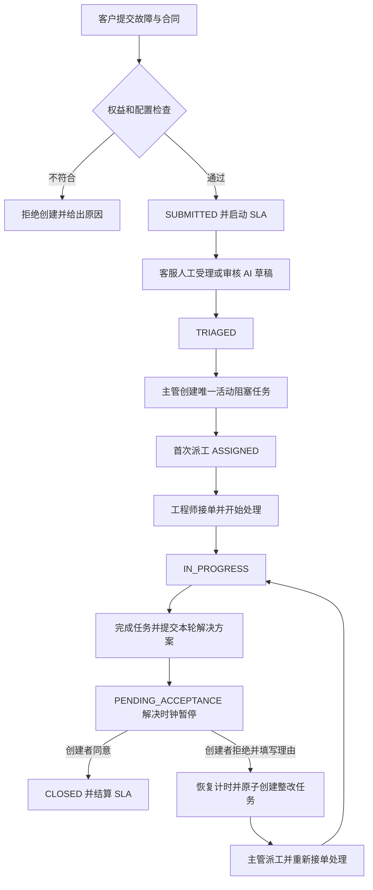

# ServiceFlow AI 开发需求规格说明书

维护日期：2026-10-20。适用范围：ServiceFlow AI 首版 P0 的后端、前端、AI 独立实验及后续业务接入。

本项目面向一家企业软件服务商，管理客户报障、合同权益、工单受理、工程师任务、服务等级协议（SLA）、解决方案和客户验收。Java 负责确定性的权限与业务执行；AI 辅助提取故障事实、提出追问和有证据的排查建议，由客服审核后有限写入受理记录。

本文是持续维护的唯一需求基线，整合原 V0.2、V0.3、V0.3.1 设计，以后续已收敛的 P0 规则处理冲突。需求编号用于开发与验收追踪，后续直接修改本文，不再并行维护带版本号的设计正文。需求描述表示应达到的行为；当前完成情况以 [交接状态](../handoff/CURRENT.md)、源码和验证记录为准。

## 目录

1. [目标与范围](#1-目标与范围)
2. [角色与权限](#2-角色与权限)
3. [领域对象与通用约定](#3-领域对象与通用约定)
4. [合同与工单受理](#4-合同与工单受理)
5. [服务任务与派工](#5-服务任务与派工)
6. [解决方案与客户验收](#6-解决方案与客户验收)
7. [SLA 双时钟](#7-sla-双时钟)
8. [AI 辅助受理](#8-ai-辅助受理)
9. [AI 实验与效果评价](#9-ai-实验与效果评价)
10. [事务并发与审计](#10-事务并发与审计)
11. [接口需求](#11-接口需求)
12. [前端页面与交互](#12-前端页面与交互)
13. [数据与迁移](#13-数据与迁移)
14. [非功能需求与运行约束](#14-非功能需求与运行约束)
15. [验收用例](#15-验收用例)
16. [交付范围与待定细节](#16-交付范围与待定细节)

## 1 目标与范围

### 1.1 首版目标

- `SCOPE-01`：交付可复现的服务履约闭环：有效合同报障 → 客服受理 → 主管创建与分派任务 → 工程师处理 → 提交解决方案 → 客户验收；拒绝验收可进入新整改轮次。
- `SCOPE-02`：用服务端权限、状态机、统一聚合锁、版本、幂等和数据库约束保证正确性，用真实 MySQL 并发与回滚测试证明关键不变量。
- `SCOPE-03`：AI 有独立可复现的规则对照、固定数据与人工评审，能够回答在哪些任务上有收益、失败在哪里、付出多少时间和成本。
- `SCOPE-04`：关闭模型后，人工受理、人工派工和后续履约仍完整可用；模型可用性不成为业务主流程的前提。

### 1.2 首版边界

P0 服务一家服务商及其多个客户企业；外部数据按 `customer_id` 隔离，内部按角色、团队管理范围和任务归属授权。身份、客户、合同、团队、路由、SLA 策略和知识可以通过版本化 SQL 与演示种子配置，不要求为每张表开发管理页面。

P0 不包含通用 CRM、销售与财务计费、多租户 SaaS 运营、合同特批、跨团队转交、并行或非阻塞服务任务、客户等待暂停、工作日历与节假日、关闭后重开、代理验收、复杂审批流、外部渠道集成、真实生产运维写操作、AI 自主派工或多 Agent 编排。这些内容需要独立需求评审，不能作为当前首版的隐含要求。

### 1.3 完整业务流程



## 2 角色与权限

### 2.1 操作与数据范围

| 角色 | 允许的主要行为 | 资源边界 |
| --- | --- | --- |
| 客户联系人 `CUSTOMER_CONTACT` | 提交报障、查看本客户工单、补充消息、对本人创建工单的当前方案验收 | 只能访问所属客户；不能查看内部备注、任务内部详情或内部审计 |
| 客服 `SUPPORT_AGENT` | 查看内部工单、发送公开答复/内部备注、人工受理、发起与审核 AI 受理草稿 | P0 单服务商内具备全工单受理范围；不能派工或修改冻结业务字段 |
| 服务主管 `SERVICE_MANAGER` | 在管理范围内查看工单与任务、创建任务、首次派工、转派、取消未派任务 | 工单 `owner_team_id` 必须在 `team_manager_scope` 中；主管角色不代表管理所有团队 |
| 工程师 `ENGINEER` | 查看授权任务、接单、开始、完成、发送工单消息、提交本轮解决方案 | 写入时检查当前归属；转出后失权；提交方案的已完成任务归属处理见第 6 节 |
| 运营管理员 `OPS_ADMIN` | 通过迁移与种子配置演示基础数据，查看授权内部信息与审计 | 没有隐含的客服受理或主管派工权限；不作为模型可使用的超级账号 |

- `AUTH-01`：P0 每个演示用户分配一个角色；停用账号不得继续执行业务命令。操作者来自后端会话，不接受前端或模型传入的任意 `actorUserId`。
- `AUTH-02`：同一客户下的联系人可以查看该客户工单，但只有工单创建者能验收；客户身份与客户归属要同时检查。
- `AUTH-03`：查询、写入、异步运行查询和幂等重放都检查当前权限；进入事务前的检查不能代替持锁后的检查。
- `AUTH-04`：跨客户、跨团队、旧负责人等不可见资源返回不泄露存在性的 404；已登录但角色不允许的命令可返回 403。错误响应不能包含其他客户的数据。
- `AUTH-05`：内部备注、派工活动与任务处理结果不因在工单时间线中出现就自动对客户公开；公开回复、解决方案和客户可见进度通过明确的可见性规则提供。

### 2.2 工程师派工资格

P0 的确定性条件为：账号有效、角色为 `ENGINEER`、属于工单负责团队。主管的管理权限与候选人的团队资格分别校验，资格在提交期间不得被并发撤销后仍完成派工。当前代码使用对候选账号和成员关系的共享锁保证这一点。

技能匹配、负载推荐与排班不作为当前首版的新增硬门槛；未来启用前需有相应数据、规则和验收用例。

## 3 领域对象与通用约定

### 3.1 核心对象

| 对象 | 职责与关系 |
| --- | --- |
| 客户、用户、客户联系人关系 | 一家客户有多个联系人；用户身份与资源归属分开保存 |
| 服务合同与权益 | 合同属于一家客户，声明服务等级、有效期与覆盖的服务类型 |
| 团队、成员、主管管理范围、服务路由 | 分别表达人员所属团队、可管理团队和新工单的负责团队来源 |
| 工单 `service_ticket` | 聚合根，保存客户原文、冻结业务字段、受理分类、主状态、版本和解决轮次 |
| 服务任务 `service_task` | 一项任务只属于一张工单；历史可以多项，同时最多一项活动阻塞任务 |
| 派工历史与活动 | 保存负责人变更、公开消息、内部备注和处理记录，不能覆盖历史 |
| 解决方案与验收 | 每次解决尝试形成独立方案，每个方案最多一个验收决定 |
| SLA 策略版本、绑定、实例、事件 | 选择规则、冻结规则，记录双时钟当前投影和可复核的事件轨迹 |
| 知识版本、AI 运行、受理草稿、受理记录 | 区分证据、模型执行、未生效建议与人工确认后的业务结果 |
| 审计与幂等记录 | 记录实际操作主体、前后事实、执行结果及重复提交保护 |

### 3.2 字段与枚举

- `DATA-01`：业务 `service_type` 决定权益、路由和 SLA；故障 `category` 只用于受理分类，两者不能互相替代。
- `DATA-02`：故障分类为 `DATABASE_CONNECTION`、`NETWORK`、`APPLICATION`、`ACCOUNT_PERMISSION`、`CONFIGURATION`、`OTHER`，与现有受理 DTO 和实验 Schema 一致。
- `DATA-03`：`impact`、`urgency` 取 `HIGH/MEDIUM/LOW`；业务优先级为 `P1/P2/P3`，与项目实施阶段 P0/P1 的命名含义分开。
- `DATA-04`：时间以 UTC 的 `Instant` 计算并存储，对外使用带时区的 ISO 8601 字符串，页面明确展示时区。数据库当前采用毫秒精度，命令内使用一次统一的时刻。
- `DATA-05`：长整型 ID 在 JSON 响应中使用字符串，版本号使用非负整数。请求中的标识必须是合法正整数表示，不能由浏览器经过浮点运算后生成。

### 3.3 工单不变量

1. 工单属于且只属于一家客户，合同必须属于该客户。
2. 原始故障描述创建后不可覆盖；客户补充和人工补充另行留痕。
3. `customer_id`、`contract_id`、`service_type`、`owner_team_id`、路由版本、优先级和 SLA 策略版本在创建时确定，P0 不开放后续重评或暗中变更。
4. 任一工单最多一项活动阻塞任务；可以暂时没有活动任务，已完成或已取消的历史任务不占名额。
5. 任务完成不等于工单关闭；进入待验收前必须有完成任务且没有活动阻塞任务。
6. 只有当前方案经工单创建者验收通过才能关闭；拒绝验收必须新建整改任务，不能重置旧任务。
7. 业务变更、活动、历史、SLA 投影与事件、审计和幂等成功结果原子提交。

## 4 合同与工单受理

### 4.1 登录与会话

`LOGIN-01`：提供账号密码登录、当前用户查询与注销，密码以 BCrypt 摘要校验，不存储或返回明文。业务接口使用 `Authorization: Bearer <token>` 的服务端会话身份。

当前会话为单进程内存，重启需要重新登录；P0 不为此引入 Redis 或集群会话。页面注销后清除本地登录状态，401 时提示重新登录。

### 4.2 创建工单

`TICKET-01`：客户提交 `customerId`、`contractId`、`title`、`description`、`serviceType`、`impact`、`urgency`，可选 `reportedProductCode` 和 `reportedProductVersion`。当前标题最多 240 字符，描述最多 4000 字符，产品代码与版本各最多 80 字符。

`TICKET-02`：在同一业务事务中依次验证并创建：

1. 当前用户属于请求客户，合同也属于该客户。
2. 合同状态为 `ACTIVE`，且提交时刻满足 `[valid_from, valid_until)`，服务权益已启用。
3. `service_type_routing` 唯一确定负责团队和路由版本。
4. 按以下规则矩阵计算业务优先级。
5. 按合同等级、服务类型、优先级从 `sla_policy_binding` 唯一选择 SLA 版本。
6. 保存 `SUBMITTED` 工单、SLA 实例与起算事件、审计和幂等成功结果。初始工单版本为 0。

| impact \ urgency | HIGH | MEDIUM | LOW |
| --- | --- | --- | --- |
| HIGH | P1 | P1 | P2 |
| MEDIUM | P1 | P2 | P3 |
| LOW | P2 | P3 | P3 |

`TICKET-03`：过期、停用、不覆盖服务或不属于本客户的合同不得创建工单，不进入合同例外审批，不生成无效 SLA。缺路由或 SLA 绑定是配置错误，不能默认为低等级策略或伪装成合同权益不足。

`TICKET-04`：合同在已受理工单处理期间到期、路由或策略绑定发生变更，不追溯改变该工单创建时确认的事实；P0 不包含额外的撤销或迁移契约。

### 4.3 客户补充与消息

- `MSG-01`：有权客户、客服和当前授权工程师可以追加消息；客户消息必须对客户可见，客服/工程师区分公开答复和内部备注。关闭或取消后不能追加处理信息。
- `MSG-02`：消息携带 `expectedTicketVersion` 和幂等键，正文非空且最多 4000 字符；成功追加后工单版本递增，原始描述不变。
- `MSG-03`：只有客户在 `SUBMITTED` 阶段能通过消息显式更新产品/版本申报；客服确认受理和模型输出都不能回写申报字段。
- `MSG-04`：申报字段省略或为 `null` 表示不修改，空字符串表示清空。更换产品而未提供新版本时清空旧版本。合法产品目录当前由 `serviceflow.products` 配置，演示值为 `COMS,IOT`。
- `MSG-05`：结构化申报来源标识为 `CUSTOMER_REPORTED`；普通文本中提及的产品仅作为客户原文，不自动升级为检索过滤用的结构化申报。

### 4.4 人工受理

`TRIAGE-01`：仅客服能将工单从 `SUBMITTED` 受理为 `TRIAGED`，请求携带期望工单版本、幂等键，以及以下允许字段：

| 字段 | 规则 |
| --- | --- |
| `proposalId` | 人工受理为 `null`；AI 接入后必须指向同工单当前有效待审草稿 |
| `confirmedCategory` | 六类故障枚举之一 |
| `confirmedFacts` | 当前最多 20 项；每项包含字段、值、客户原文引文及可选 `sourceMessageId` |
| `confirmedFollowups` | 当前最多 10 项；客服审核后的追问草稿，不自动发送 |
| `confirmedDiagnostics` | 当前最多 8 项；区分 `HYPOTHESIS` 和 `EVIDENCE_BASED`，保留知识引用 |
| `humanNotes` | 当前最多 2000 字符；独立人工备注，不伪装为客户原话 |

`TRIAGE-02`：事实引文必须出现在原始描述或指定的客户补充消息中；不能引用内部备注冒充客户事实。有依据的诊断必须引用已审核且产品/版本适用的知识。引用合法不能代替人工判断其是否支持结论。

`TRIAGE-03`：接口拒绝合同、客户、服务类型、负责团队、优先级、SLA 和原始描述等不允许修改的字段。受理、客户补充并发时，只有符合最新版本的写入能生效。

`TRIAGE-04`：受理记录在 P0 每工单最多一份，保留审核人和来源。受理成功、生成追问草稿或 AI 输出都不自动认定首次人工响应；必须另行发送真人公开答复。

### 4.5 工单状态与主动取消

| 工单状态 | 含义 | 合法的主要后续动作 |
| --- | --- | --- |
| `SUBMITTED` | 权益通过、等待受理 | 客户补充、人工/AI 辅助受理、合法取消 |
| `TRIAGED` | 已人工受理、等待首轮派工 | 创建/取消未派任务、首次派工、无活动任务时取消工单 |
| `ASSIGNED` | 首轮任务已派发、尚未开始 | 接单、开始、转派 |
| `IN_PROGRESS` | 处理或整改进行中 | 当前任务操作、合法转派、符合条件时提交方案 |
| `PENDING_ACCEPTANCE` | 当前解决方案待创建者决定 | 验收通过或拒绝；不新建活动任务 |
| `CLOSED` | 验收通过的终态 | 查询与追溯 |
| `CANCELLED` | 在允许阶段主动取消的终态 | 查询与追溯 |

`CANCEL-01`：工单创建者或获授权客服可在 `SUBMITTED/TRIAGED`、没有活动阻塞任务时主动取消，必须填写原因，递增版本并记录审计；存在 `CREATED` 任务时应先由主管合法取消任务。已派发或处理中工单不可走该取消路径。当前客服权限为所有客户的服务工单；同客户非创建者、主管、工程师和运维均不能代为取消。

取消命令在工单锁内重新检查身份、范围、版本和活动任务，同事务写入 `CANCELLED`、SLA 停止计时、客户可见的取消原因、审计和幂等结果。成功返回取消时间；详情中的 `closedAt` 仅用于验收关闭，取消时保持 null，取消时间与原因由 `TICKET_CANCELLED` 活动和 SLA `CANCELLED` 事件追溯。关闭或取消后不允许新建任务、受理或追加消息。重放仍检查当前授权。

不引入 `ENTITLEMENT_REVIEW`、`WAITING_CUSTOMER` 或独立 `REOPENED` 常驻状态。

## 5 服务任务与派工

### 5.1 创建和单活动任务约束

- `TASK-01`：首轮由有权主管在 `TRIAGED` 创建任务，标题非空且最多 240 字符；新任务为 `CREATED`、版本 0、负责人为空。创建任务不改变工单主状态，但递增工单版本。
- `TASK-02`：P0 所有任务 `is_blocking=1`。`CREATED/ASSIGNED/ACCEPTED/PROCESSING` 算活动，`COMPLETED/CANCELLED` 算历史；同工单活动总数不得超过 1。
- `TASK-03`：任意 `IN_PROGRESS` 工单不能通过普通创建接口新增任务；整改任务只能由客户拒绝验收的内部事务创建，且必须可识别整改来源和对应解决轮次。
- `TASK-04`：仅 `TRIAGED` 下尚未派发的 `CREATED` 任务可由有权主管取消，理由必填。取消后可创建替代任务；P0 不允许直接取消已派发任务或复活已完成任务。

### 5.2 任务状态转换

| 命令 | 任务源状态 | 任务目的状态 | 工单变化与约束 |
| --- | --- | --- | --- |
| 创建 | 无 | `CREATED` | 首轮工单保持 `TRIAGED`；整改创建保持 `IN_PROGRESS` |
| 首次派工 | `CREATED` | `ASSIGNED` | 负责人原为空；首轮工单进入 `ASSIGNED`，整改保持 `IN_PROGRESS` |
| 转派 | `ASSIGNED/ACCEPTED/PROCESSING` | `ASSIGNED` | 新旧负责人不同，工单保持原 `ASSIGNED/IN_PROGRESS` |
| 接单 | `ASSIGNED` | `ACCEPTED` | 仅当前负责人，工单主状态不变 |
| 开始 | `ACCEPTED` | `PROCESSING` | 工单进入或保持 `IN_PROGRESS` |
| 完成 | `PROCESSING` | `COMPLETED` | 仅当前负责人，结果非空且最多 4000 字符，工单仍 `IN_PROGRESS` |
| 取消未派任务 | `CREATED` | `CANCELLED` | 工单为 `TRIAGED`，由有权主管执行 |

终态任务不能转派、重新接单或直接退回处理。写入必须同时检查工单状态，不能只依据任务状态放行。

### 5.3 首次派工与转派

`ASSIGN-01`：首次派工、转派拆成两个命令。首次派工携带 `assigneeId`、原因及工单/任务双版本；转派额外携带 `expectedAssigneeId`。原因非空且最多 500 字符。

`ASSIGN-02`：持工单锁后重新校验主管管理范围、当前状态、双版本、当前负责人和候选人资格；更新负责人、任务状态、双版本，追加派工历史、内部活动、审计与幂等结果。首次历史的前负责人为 `null`。

`ASSIGN-03`：转派保留旧处理记录，任务统一回到 `ASSIGNED`，新负责人必须重新接单再开始；工单已在 `IN_PROGRESS` 时保持该状态，不继承旧工程师的接单事实。

`ASSIGN-04`：旧负责人在转派提交后不能继续接单、开始、完成、发消息或提交关联方案，也不能借旧幂等键重放越权访问。同人转派拒绝，不追加无意义历史。

`ASSIGN-05`：并发转派、首次派工和工程师操作经过同一工单锁序列化；对仍有权限但版本过期的请求返回 409。不能用前端隐藏按钮承担权限控制。

## 6 解决方案与客户验收

### 6.1 提交解决方案

- `RES-01`：仅在 `IN_PROGRESS`、至少一项已完成阻塞任务且没有任何活动阻塞任务时，允许提交非空解决方案。当前轮次整改任务尚未完成时，不能用旧轮次的已完成任务绕过检查。
- `RES-02`：提交人为本轮合法任务负责人，必须重新检查当前归属，已转出的工程师和仅有历史任务的其他工程师无权提交。已完成任务的现任负责人应能完成该动作，不能只复用“存在活动任务”的授权查询。
- `RES-03`：每次提交新增 `ticket_resolution`，`cycle_no` 从 1 递增，工单 `resolution_cycle_no` 指向新轮次。方案、提交人和提交时刻一经保存不覆盖；处理结果与对客解决方案是不同业务对象。
- `RES-04`：同事务完成方案创建、工单转 `PENDING_ACCEPTANCE`、解决时钟暂停、版本递增、事件、活动、审计与幂等结果。不得产生“待验收但仍有活动任务”的最终状态。

本轮归属使用 `service_task.resolution_cycle_no`：首轮为 1；工单处理中的待提交轮次为工单 `resolution_cycle_no + 1`，待验收或关闭时为工单当前轮次。该轮任务的当前负责人可在任务完成后继续读取工单、公开答复及提交方案；拒绝后旧轮次不再授予工单访问和方案提交权限，提交重放也重新检查轮次。内部任务历史查询仍按该任务的当前归属授权。

### 6.2 验收通过

`ACCEPT-01`：仅工单创建者能对当前方案作 `ACCEPT`，必须匹配工单、方案、当前轮次和期望版本。一轮最多一个决定，重复同键同内容返回原结果；不同决定不能覆盖先前记录。

`ACCEPT-02`：同事务写验收、将工单置 `CLOSED`、记录关闭时间、结算 SLA、递增版本并写审计。P0 关闭后不能重开。

### 6.3 拒绝与整改

`REJECT-01`：创建者对当前方案作 `REJECT` 必须填写理由；以下变更必须同事务成功或全部回滚：

1. 新增关联当前方案和轮次的拒绝验收记录。
2. 工单从 `PENDING_ACCEPTANCE` 返回 `IN_PROGRESS`。
3. 恢复解决时钟，保留之前累计时长。
4. 新建一项负责人为空、状态 `CREATED` 的整改阻塞任务，并记录来源方案/轮次。
5. 递增工单版本，记录事件、活动、审计与幂等结果。

`REJECT-02`：新整改任务由主管首次派工，工单保持 `IN_PROGRESS`，工程师仍须接单、开始和完成；旧任务与旧方案保留，下一次提交形成新解决轮次。

`REJECT-03`：同意、拒绝及重复请求竞争时只形成一种决策；数据库 `resolution_id` 与工单轮次唯一约束兜底。不能关闭工单后又创建整改任务。

整改任务的 `source_resolution_id` 指向被拒绝方案，任务 `resolution_cycle_no = 被拒绝方案.cycle_no + 1`。同一方案只能产生一个整改任务，复合外键禁止跨工单引用来源。主管在 `IN_PROGRESS` 首次派工时，必须验证来源方案确有本工单当前轮次的 `REJECT` 记录；普通建任务接口仍仅接受 `TRIAGED`。这些字段由 [V4 迁移](../../backend/src/main/resources/db/migration/V4__resolution_cycles_and_sla_precision.sql) 增加。

## 7 SLA 双时钟

### 7.1 策略与版本

- `SLA-01`：P0 为固定 7×24，`calendar_mode=ALWAYS_ON`；没有客户等待暂停或节假日算法。
- `SLA-02`：`sla_policy_binding` 按 `(service_tier, service_type, priority)` 唯一绑定当前策略版本；创建时冻结其 ID。已发布/已引用版本不原地修改，发布新版本和更新绑定只影响新工单。
- `SLA-03`：两个时钟从权益和配置校验通过后、写入工单时的同一 `created_at/effective_start_at` 起算。目标秒数从冻结策略的分钟数换算。

### 7.2 事件口径

| 事件 | 首次响应时钟 | 解决时钟 |
| --- | --- | --- |
| 创建 | 开始 | `RUNNING` |
| 有权真人客服/工程师发送第一条有效公开答复 | 记录 `first_responded_at` 并判定达标，后续不覆盖 | 不变 |
| 客户补充、内部备注、受理、AI 输出或追问草稿 | 不认定人工首响 | 不暂停 |
| 提交解决方案 | 未首响则继续 | 累加至提交时刻，转 `PAUSED_ACCEPTANCE` |
| 验收拒绝 | 未首响则继续 | 从拒绝时刻恢复 `RUNNING`，累计不清零 |
| 验收同意 | 未曾有效首响则认定首响不达标 | 结算 `resolution_met`，转 `CLOSED` |
| 合法主动取消 | 保留已有首响事实 | 转 `CANCELLED`，不进入正常解决达标率分母，单列数量和原因 |

### 7.3 累计与截止计算

`SLA-04`：通过注入的 `Clock` 在获得工单锁后获取统一时刻，截取到毫秒，按实际经过的 UTC 时间计算。`resolution_elapsed_millis` 是权威累计值，每次暂停累加本段毫秒；兼容字段 `resolution_elapsed_seconds` 仅按累计总毫秒除以 1000 向下取整，不对各段分别取整。运行中当前有效耗时为已累计毫秒加 `now - resolution_last_started_at`，暂停/关闭时为已累计毫秒。恢复时按毫秒计算剩余目标，超期后截止投影为恢复时刻，累计超期事实不清零。旧秒值通过 V4 迁移乘以 1000 回填。

```text
创建：elapsed = 0；last_started_at = start
      response_due_at = start + response_target
      resolution_due_at = start + resolution_target

暂停：elapsed += pause_at - last_started_at
      last_started_at = null；state = PAUSED_ACCEPTANCE

恢复：last_started_at = resume_at；state = RUNNING
      remaining = max(0, resolution_target - elapsed)
      resolution_due_at = resume_at + remaining

结算：如仍 RUNNING，先累计当前运行区间
      resolution_met = elapsed <= resolution_target
```

暂停期间 `resolution_due_at` 可为空，页面显示暂停时刻、原因和累计耗时。超期后再暂停或拒绝不能洗掉既有超期事实；未发生新的计时事实时不通过定时刷新改变历史结论。首响或解决耗时恰好等于目标算达标，超过才算违约。

`SLA-05`：有效人工首响、暂停、恢复、方案提交、验收拒绝、关闭和取消，均通过 SLA 事件与实例投影在业务事务中持久化；不能只改截止时间而没有解释轨迹。首次响应未发生时保留未知结果，关闭时再按上述口径定案。

本段事件为 `RESOLUTION_PROPOSED`（方案提交并暂停）、`ACCEPTANCE_REJECTED`（拒绝并恢复）、`CLOSED`（通过并结算）；与既有 `START`、`FIRST_RESPONSE` 共用实例内顺序号和唯一命令键。一次复合业务命令记录一个能解释其计时变化的事件；方案、验收公开活动不计为人工首响。

主动取消增加 `CANCELLED` 事件及原因，累计计时到取消时刻后清空解决时钟起点和截止投影，`resolution_met` 保持 null；已记录的首响时间/结果保留，未首响时仍为 null，不套用验收关闭的“未首响不达标”规则。取消后不再接受产生首响的消息。后续正常解决达标率应只统计 `CLOSED` 实例，取消数量可通过取消状态筛选单列，不能将 null 结果当作达标。

例：解决目标 4 小时，处理 3 小时后提交方案，等待验收 2 小时，拒绝后再处理 1.5 小时并获验收。有效解决时长为 4.5 小时，不达标；自然历时为 6.5 小时，两种指标分别展示。

## 8 AI 辅助受理

### 8.1 能力与信任边界

`AI-01`：固定流程为“读取授权上下文 → 按客户显式申报过滤知识 → 关键词检索 → 模型结构化生成 → Java 校验 → 客服审核”。模型自主工具调用轮数为 0，不开放执行 SQL、Shell、任意 URL、审批、派工或生产操作能力。

`AI-02`：模型可建议故障分类、提取已明确提供的事实、列出关键未知信息、生成追问、提供带来源和适用前提的排查建议；不得认定合同权益、授权、优先级、SLA 或团队归属。

客户原文、补充消息、知识正文和模型返回都是不可信内容；其中的“忽略规则”“修改角色”等指令不获得系统权限。不能向模型发送凭据、完整合同秘密或未经必要处理的客户日志。

### 8.2 证据与产品适用性

`AI-03`：上下文区分 `CUSTOMER_REPORTED`、`AI_EXTRACTED_CANDIDATE` 和 `SUPPORT_CONFIRMED`。检索过滤只使用客户显式申报的产品/版本；模型从文本猜测的产品只能作为候选或追问。

| 产品信息 | 可使用的审核知识 | 必须降级的行为 |
| --- | --- | --- |
| 产品和版本都明确 | `GENERAL/ALL`；对应产品且精确匹配该版本的条目；该产品 `ALL` 条目 | 不兼容版本不得作为依据 |
| 仅产品明确 | `GENERAL/ALL` 与该产品 `ALL` 条目 | 追问版本，不给版本专属确定结论 |
| 产品未知，即使有版本文本 | 仅 `GENERAL/ALL` | 先追问产品，不能猜测产品后选择专属知识 |
| 没有适用知识 | 可以说明信息不足并追问 | 不编造文献、根因、历史解决记录或配置值 |

`AI-04`：知识状态为 `APPROVED` 才可引用。P0 版本范围只允许 `ALL` 或逗号分隔的完整版本白名单，拆分后精确比较，`1.2` 不匹配 `11.2`；不引入任意 SemVer 范围表达式。

`AI-05`：事实引文必须准确来自允许的客户原文；知识引文必须来自本次检索的特定知识版本。引用 ID 存在、文本来自知识、知识适用、引文实质支持建议是不同检查层次；最后一项需要人工语义评分。适用前提未知时保留假设，不能宣称已确认根因。

### 8.3 输出与受理映射

独立实验的可执行结构以 [output.schema.json](../../experiments/s1-ai/output.schema.json) 为准，不能把原设计示例当成另一份可执行 Schema。

| 实验字段 | 含义 | 业务接入要求 |
| --- | --- | --- |
| `category` | 六类故障候选 | 客服审核后映射为 `confirmedCategory` |
| `facts` | 有原文引文的事实 | 审核并按业务 DTO 长度/来源限制转换为 `confirmedFacts` |
| `hypotheses` | 未证实假设 | 不能直接混入已确认事实 |
| `questions` | 字段化追问 | 审核后进入 `confirmedFollowups`，单独发送才形成客户消息 |
| `suggestions` | 建议、知识 ID、引文、适用前提 | 核验来源与知识版本；不能把实验知识 ID 当业务数据库 ID 直接写入 |
| `evidenceInsufficient/categoryInsufficient` | 证据或分类依据不足 | 展示不足与人工降级，不伪装为高置信结论 |

`AI-06`：严格拒绝未知字段、非法枚举、错误类型、超长、重复或无来源内容。实验限制与业务 DTO 不完全相同，未来适配层须显式验证，不静默截断、改标签或丢弃失败输出。

### 8.4 模型观察快照

`AI-07`：模型请求前，在短事务或一致性读取中固定工单版本、原文与客户补充、产品申报、知识版本、上下文 SHA-256、模型与 Prompt 配置。释放连接与锁后才调用模型。

`AI-08`：模型返回并通过结构校验后，在新的短事务中取工单锁，再核对权限、`SUBMITTED` 状态与实际观察版本。版本已变或状态不符，新 run 标记 `STALE`，不得生成可审核草稿；绝不能用模型返回后的最新版本替代观察版本。

`AI-09`：客服确认时再次持工单锁校验权限、草稿所属工单、版本、有效期、状态和知识有效性。成功后同事务写受理记录、草稿 `APPLIED`、工单 `TRIAGED`、版本和审计。

### 8.5 运行与草稿生命周期

- AI 运行状态：`QUEUED/RUNNING/COMPLETED/STALE/FAILED/SUPERSEDED`。
- 草稿状态：`PENDING_REVIEW/APPLIED/REJECTED/STALE/EXPIRED`；`SUPERSEDED` 仅属于 run，不能写入 proposal。
- `AI-10`：每工单至多一份 `PENDING_REVIEW`，MySQL `uk_one_pending_triage` 兜底。同一运行至多一份 proposal。

新生成的结果保存前，按以下顺序判断旧待审草稿；发起模型前可预检查，但不能省略返回后的复查：

1. 校验当前主体权限、工单状态及新运行观察版本；新运行已旧则只走其失效路径。
2. 锁定旧待审草稿；先比较版本，不匹配则转 `STALE` 并审计。
3. 旧草稿版本匹配时再检查到期，已到期则转 `EXPIRED` 并审计。
4. 旧草稿版本和时间都有效时保留它，新 run 转 `SUPERSEDED`，不保存第二份 proposal。
5. 没有有效旧草稿，且新运行仍有效时，保存新的待审草稿与审计。

`AI-11`：未登录或无权限只拒绝，不改变草稿。已授权用户遇到版本失效或超期时，需提交 `STALE/EXPIRED` 和审计后返回 409；不能因抛出默认回滚异常丢掉这些状态。真正 SQL/事务故障仍全部回滚。

`AI-12`：客服可放弃 AI 建议并走人工受理，草稿不能锁死人工通道。若保留 `REJECTED` 及拒绝入口，应在业务接入时明确其接口与人工受理后的草稿清理规则，见第 16 节。

### 8.6 调用限制与恢复

| 约束 | 当前实验口径或接入要求 |
| --- | --- |
| 描述输入 | 最多 4000 字符；业务接入追加消息后的上下文裁剪规则需明确 |
| 检索上下文 | 序列化证据最多 8000 字符，当前最多 3 条知识 |
| 生成上限 | 当前 1024 Token，具体服务是否支持由接入验证 |
| 同时推理 | 当前最多 2 个；业务接入超限返回 `429 AI_BUSY` 或采用明确的有界排队 |
| 单次请求超时 | 当前 20 秒；含重试的整轮耗时可超过 20 秒 |
| 重试 | 当前只对 HTTP 429/5xx 最多重试 1 次，间隔 300 毫秒；不自动重试超时、拒答、截断、权限错误或非法 JSON |
| 生成幂等 | `(ticket_id, requested_by, generation_key)` 唯一；相同规范化摘要返回原 run，不同摘要返回 409 |
| 用量与费用 | 返回用量存在才记实测 Token；无用量为 `NULL`，费用估算记录单价来源和计算方法 |

`AI-13`：业务接入采用异步运行查询；进程崩溃后的未完成 run 需恢复检查并可转 `FAILED`，由真人明确发起新请求。模型调用或超时可能已计费，不承诺端到端调用或计费恰好一次。

`AI-14`：非法输出保留必要原始证据和失败类型，不作为可用草稿，不部分执行。模型离线、格式失败或证据不足时，人工受理入口仍可用。

## 9 AI 实验与效果评价

### 9.1 比较方案

| 方案 | 能力 | 比较约束 |
| --- | --- | --- |
| A0 | 规则分类、事实/追问模板、关键词与元数据检索 | 使用与 A2 相同的知识版本和检索器，不能故意弱化基线 |
| A1 | 直接模型，不附检索证据 | 与 A2 使用同一模型、Prompt 策略、采样参数、输出 Schema 和校验器 |
| A2 | 检索增强模型 | 相比 A1 只增加实际检索证据；增加的 Token 和费用如实计入 |
| A3 | 当前已有的规则与模型混合候选 | 保留现有冻结和组合规则说明，不冒充原始 A1/A2；变更另建版本 |

`EVAL-01`：各组使用相同客户输入、显式申报字段、未知信息状态和人工评分标准；分别报告分类/追问、检索与诊断的贡献。允许最终保留规则分类而仅在有收益的子任务使用模型。

### 9.2 数据与标注

- `EVAL-02`：当前有 20 条开发案例、40 条固定检查案例、24 条合成知识；输入不是实际生产资料。按故障家族、产品/版本与模板隔离开发和检查集，避免近义改写泄漏。
- `EVAL-03`：开发集可用于调 Prompt、规则与检索；固定检查集在任务口径、标签、Prompt、规则和模型配置冻结后评测。看过结果并据此调参必须披露并另留新检查集复验。
- `EVAL-04`：覆盖完整申报、版本未知、产品未知和错误申报等层次；标签定义、事实粒度、必问项和知识适用性要经人工复核，不能把精确匹配分数代替语义结论。
- `EVAL-05`：改变标签或任务定义另建数据版本，同版本重新比较各组；不把新标签分数与旧结果直接排名。未评分项保持未评分，工具自测的虚拟评分不计入人工结果。

### 9.3 指标与证据

| 维度 | 必须报告 |
| --- | --- |
| 分类 | 正确/错误条数、准确率、Macro-F1、混淆矩阵；原始分类正确与通过校验后的正确分开 |
| 事实 | 字段级精确匹配与 Precision/Recall/F1 的适用口径、引文准确性、人工字段/值语义判定 |
| 追问 | 必要问题覆盖、额外/重复/不相关问题比例 |
| 检索与建议 | Recall@K、产品版本适用性、引文支持率、前提是否保留、猜测当事实的条数、相对 A0 的新增价值 |
| 工程 | 结构有效率、失败类型、超时、P50/P95 延迟、返回用量、可核查的费用估算 |
| 实际收益 | 有数据时记录人工修改、审核耗时和采纳；不凭空预填收益 |

`EVAL-06`：失败样本保留在样本基数中，原始输出与通过校验的输出分开；不只展示成功案例。40 条检查集的一条误差占 2.5 个百分点，小样本不构成统计显著性保证。

`EVAL-07`：运行需保存数据/知识/Schema/实际代码摘要、模型与 Prompt 配置、逐案例输出、失败、请求尝试、用量、延迟和人工评分关联。完成标记与中断状态明确区分；原始证据、manifest 和冻结快照不覆盖。

`EVAL-08`：工程安全与模型效果分别验收。先确定比较方法和安全底线，不新增没有基线依据的准确率提升比例；人工评审完成前不宣称证据支持率或业务收益提升。

## 10 事务并发与审计

### 10.1 聚合锁协议

`TX-01`：已有工单的所有业务写入口使用同一顺序：

```text
验证登录并定位资源
  → 开启短事务，按主键锁 service_ticket
  → 在锁内核对最新资源权限
  → 锁/预留幂等记录
  → 锁任务行，多行按 task.id 升序
  → 再读最新状态和必要集合，校验版本、不变量、资格
  → 写业务、历史、SLA、活动、审计和幂等响应
  → 提交
```

新建工单尚无可锁聚合行时，沿用创建幂等预留与原子插入路径，不能为了套用锁流程伪造既有工单。AI run、proposal 等附属记录的锁顺序应保持工单优先并在对应实现中统一。

- `TX-02`：当前业务服务采用 `READ_COMMITTED`；锁后判断不能依赖事务前普通查询的旧结果。模型、网络调用和长耗时计算不进入持锁事务。
- `TX-03`：追加客户信息、受理、任务集合/状态/归属、方案和验收等成功写入均递增工单版本；已有任务变更另递增任务版本。幂等重放不递增版本或追加业务历史。
- `TX-04`：`uk_one_active_blocking_task` 等唯一约束是第二道防线，不能代替工单锁后的业务校验；反之也不能只靠应用锁取消数据库约束。
- `TX-05`：死锁或锁超时仅在没有不可逆外部副作用时有限重试整个事务，不把所有异常都视为可重试。

### 10.2 请求幂等

`IDEM-01`：业务写命令携带 `Idempotency-Key`，按操作人、动作码、键建立唯一记录；规范化摘要必须包含资源路径和正文。登录/注销遵循会话行为，AI 生成使用其独立 `generation_key` 契约。

| 情况 | 必须行为 |
| --- | --- |
| 同主体、同动作、同键、同资源和同内容 | 仍有当前权限时返回原成功结果，无第二次副作用 |
| 同键但换正文或资源 | 409 `IDEMPOTENCY_KEY_CONFLICT` |
| 新键但资源期望版本已过期 | 409 对应版本冲突 |
| 原事务审计或 SQL 失败 | 业务和幂等预留一起回滚，修复后同键可重试 |
| 原执行者已失权 | 拒绝重放，不用旧成功响应绕过当前权限 |

### 10.3 审计与回滚

`AUDIT-01`：审计追加保存实际操作者、`HUMAN/AI_ASSISTED/SYSTEM` 来源、工单/任务、动作、请求关联信息、允许保存的前后事实、结果与必要原因；AI 辅助受理关联 run、proposal 和审核人。

`AUDIT-02`：不提供普通业务 API 改写/删除既有审计或派工历史。审计写失败时整个业务操作失败，不能返回成功但丢失证据。权限拒绝不改变被访问资源或草稿。

`AUDIT-03`：审计、普通日志和模型证据遵守最小必要与脱敏，不保存 Token、API Key、数据库口令或完整客户机密日志。对客户端返回 `requestId` 便于定位，服务端堆栈不外泄。

## 11 接口需求

### 11.1 通用协议

API 前缀 `/api/v1`，JSON 请求严格校验未知字段、类型、长度、枚举和正整数标识。请求版本不匹配应提示刷新，不能静默套用最新版本后重试。错误对象沿用 `code`、`message`、`requestId`。

下表“已实现”表示存在当前 Controller/Service 与相关测试，不表示本次重新执行验收；“待开发”是首版目标；“待定路径”是支撑页面的接口设计建议，不能作为现有接口调用。

### 11.2 接口清单

| 方法与路径 | 角色与主要输入/行为 | 交付状态 |
| --- | --- | --- |
| `POST /auth/login` | 账号、密码；建立会话 | 已实现 |
| `GET /auth/me`、`POST /auth/logout` | 当前用户与注销 | 已实现 |
| `POST /tickets` | 客户；第 4.2 节创建字段、幂等键；成功 201 | 已实现 |
| `GET /tickets/{id}`、`GET /tickets/{id}/sla` | 有权用户；按可见性返回工单与 SLA | 已实现 |
| `POST /tickets/{id}/messages` | 客户/客服/当前授权工程师；内容、可见性、工单版本、可选申报字段 | 已实现 |
| `POST /tickets/{id}/triage` | 客服；工单版本和人工确认字段 | 人工已实现；AI 草稿接入待开发 |
| `POST /tickets/{ticketId}/tasks` | 管理范围内主管；标题、工单版本；成功 201 | 首轮已实现；整改仅内部创建 |
| `GET /tasks/{id}` | 内部授权用户；任务、派工历史、内部活动 | 已实现 |
| `POST /tasks/{id}/assignments` | 主管；双版本、`assigneeId`、原因 | 首轮与有真实来源的整改任务均已实现 |
| `POST /tasks/{id}/reassignments` | 主管；双版本、新旧负责人、原因 | 已实现 |
| `POST /tasks/{id}/accept`、`POST /tasks/{id}/start` | 当前工程师；双版本 | 已实现 |
| `POST /tasks/{id}/complete` | 当前工程师；双版本、`result` | 已实现 |
| `POST /tasks/{id}/cancel` | 主管；双版本、原因，仅未派任务 | 已实现 |
| `POST /tickets/{id}/resolutions` | 本轮合法工程师；`expectedTicketVersion`、`taskId`、`expectedTaskVersion`、`summary`（非空，最多 8000 字符）；成功 201 | 已实现 |
| `POST /resolutions/{id}/acceptance` | 工单创建者；`expectedTicketVersion`、`decision=ACCEPT/REJECT`、`reason`（最多 1000 字符，拒绝时非空）；成功 200 | 已实现 |
| `GET /tickets/{id}/resolutions` | 按工单授权读取方案与验收历史，按轮次升序；不包含内部处理记录 | 已实现 |
| `POST /tickets/{id}/ai-triage-runs` | 客服；生成键及请求上下文；异步返回 202 和 runId | 待开发 |
| `GET /ai-triage-runs/{runId}` | 有权客服；进度、通过校验的草稿或错误 | 待开发 |
| `POST /tickets/{id}/cancel` | 创建者/客服；`expectedTicketVersion`、`reason`（非空，最多 500 字符）、幂等键；成功 200 | 已实现 |
| `GET /tickets` | 已登录用户；工单分页、状态/优先级/客户/团队/标题筛选，服务端按角色限制范围 | 已实现，协议见下文 |
| 任务列表、可选合同/服务类型、合法工程师和审计查询 | 支撑第 12 节页面；服务端范围过滤、分页与稳定排序 | 待开发，路径及分页 DTO 待定 |

读取候选工程师列表不代替写入时资格校验；页面需要的列表、筛选和详情投影在对应开发任务中固定，不使用硬编码工单 ID 或直接连数据库替代页面 API。

方案提交返回 `ticketId/resolutionId/cycleNo/ticketStatus/ticketVersion`；验收额外返回 `acceptanceId/decision/remediationTaskId`（通过时为 null），不改变旧任务版本。历史记录返回 `id/cycleNo/summary/submittedBy/submittedAt` 以及可空的 `acceptanceId/decision/decidedBy/reason/decidedAt/remediationTaskId`。工单详情增加 `resolutionCycleNo/closedAt`；任务详情增加 `resolutionCycleNo/sourceResolutionId`；SLA 投影增加 `resolutionMet/resolutionElapsedMillis/resolutionLastStartedAt`。沿用长整型序列化约定，累计毫秒也按十进制字符串返回。

取消返回 `ticketId/status/ticketVersion/cancelledAt`；状态固定为 `CANCELLED`。版本过期返回 409 `VERSION_CONFLICT`，有活动任务返回 409 `ACTIVE_TASK_EXISTS`，不合法阶段返回 422 `INVALID_STATE_TRANSITION`；沿用角色禁止 403、资源无权/不存在 404、参数或缺失幂等键 400 的错误约定。

工单分页查询协议：

| 参数 | 默认值与约束 | 含义 |
| --- | --- | --- |
| `page` | 默认 1，范围 1～1000000 | 从 1 开始的页码 |
| `size` | 默认 20，范围 1～100 | 每页条数 |
| `status` | 可省略，使用工单状态枚举 | 精确匹配单个状态 |
| `priority` | 可省略，`P1/P2/P3` | 精确匹配优先级 |
| `customerId`、`ownerTeamId` | 可省略，正整数 | 与当前授权范围取交集，不能扩大权限 |
| `keyword` | 可省略，去除首尾空白后最多 120 字符 | 标题包含匹配；空白视为无筛选，`%`、`_` 按普通字符处理，大小写遵循数据库排序规则 |

排序固定为 `created_at DESC, id DESC`。响应为 `{items,total,page,size}`；`total` 沿用长整型约定返回十进制字符串，页码/页大小为整数。每个条目只含 `id/customerId/contractId/creatorUserId/ownerTeamId/title/serviceType/priority/status/version/createdAt/updatedAt`，不返回原文、内部活动或审计明细。无可见数据或页码超过结果范围时 `items=[]`，`total` 仍表示符合筛选的可见工单总数；非法参数返回 400 `REQUEST_INVALID`。

客户可见所属客户的工单；主管可见管理团队；工程师复用详情的当前任务归属和解决轮次条件；客服及运维可见全部工单。总数和条目共用 SQL 范围条件，在单个只读 `REPEATABLE_READ` 事务快照中读取，防止并发变更导致同一响应的总数和条目不一致。不同分页请求各有独立快照，数据变化后客户端需刷新。身份和角色仅来自当前会话，额外查询参数不能改变权限；查询不修改业务版本或生成写审计。

### 11.3 写入示例

人工受理示例；带 AI 草稿的未来请求复用该业务入口，但当前非空 `proposalId` 返回 `AI_TRIAGE_NOT_READY`：

```json
{
  "expectedTicketVersion": 1,
  "proposalId": null,
  "confirmedCategory": "DATABASE_CONNECTION",
  "confirmedFacts": [
    {"field": "symptom", "value": "连接超时", "sourceQuote": "提示数据库连接超时"}
  ],
  "confirmedFollowups": [{"field": "logs", "question": "请提供对应时间段的错误日志"}],
  "confirmedDiagnostics": [],
  "humanNotes": "待人工核查日志"
}
```

转派示例；两个版本和原负责人来自最新业务读取，不能照抄示例长期重用：

```json
{
  "expectedTicketVersion": 3,
  "expectedTaskVersion": 1,
  "expectedAssigneeId": "5",
  "assigneeId": "8",
  "reason": "值班交接"
}
```

### 11.4 状态码与业务码

| HTTP | 业务码 | 含义与处理 |
| --- | --- | --- |
| 400 | `REQUEST_INVALID` | 字段缺失、类型/格式/长度不合法，修正请求 |
| 401 | `UNAUTHENTICATED` | 重新登录 |
| 403/404 | `RESOURCE_FORBIDDEN` | 角色禁止或资源不可见；不泄露对象 |
| 409 | `VERSION_CONFLICT`、`TASK_VERSION_CONFLICT`、`ASSIGNEE_CONFLICT` | 刷新后由用户重新判断动作 |
| 409 | `ACTIVE_TASK_EXISTS` | 已有活动任务，不能重复创建 |
| 409 | `IDEMPOTENCY_KEY_CONFLICT` | 原键对应其他正文/资源，不能误作成功重放 |
| 409 | `AI_PROPOSAL_STALE`、`AI_PROPOSAL_EXPIRED` | 未来草稿业务失效；刷新或人工处理 |
| 422 | `CONTRACT_NOT_ELIGIBLE` | 合同状态、有效期或服务覆盖不符 |
| 422 | `TRIAGE_FIELD_NOT_EDITABLE`、`FACT_SOURCE_INVALID`、`KNOWLEDGE_REFERENCE_INVALID` | 冻结字段或证据不合法 |
| 422 | `PRODUCT_IDENTIFICATION_INVALID` | 非法申报或越权更新产品信息 |
| 422 | `INVALID_STATE_TRANSITION`、`SAME_ASSIGNEE`、`ASSIGNEE_NOT_ELIGIBLE` | 非法状态、同人转派或候选资格无效 |
| 429 | `AI_BUSY` | 未来 AI 业务容量达到上限 |
| 503 | `AI_TEMPORARILY_UNAVAILABLE` | 未来模型服务不可用；保留人工受理 |
| 500 | `SLA_POLICY_CONFIGURATION_ERROR`、`INTERNAL_ERROR` | 配置或执行故障，通过 requestId 排查 |

新增命令沿用现有错误协议，未实现的 AI 错误码及新命令字段在对应接入任务中实现并验证，不能仅凭本表宣称接口已支持。

## 12 前端页面与交互

前端为待开发的 Vue3 应用。页面按业务操作组织，不按 25 张数据库表生成 25 个 CRUD 页面；技术依赖和具体组件库在前端任务中确定。

| 页面 | 角色与必要交互 | 必须展示的事实 |
| --- | --- | --- |
| 登录与身份 | 各角色登录、退出、登录失效处理 | 当前身份和可用工作入口 |
| 客户工单列表/新建 | 查看本客户工单、选择本客户合同与服务、填写原文及影响/紧急度 | 权益拒绝原因、创建状态；不让 AI 选择合同或服务等级 |
| 客户工单详情 | 查看进度、公开答复、补充信息、合法取消 | 原始描述与后续补充分开，客户可见 SLA 和当前解决方案 |
| 客服受理工作台 | 查看待受理工单、人工确认、编辑追问与发送公开答复 | 客户申报、证据、故障分类、首响状态 |
| AI 受理审阅区 | 发起生成、查看进度/失败、核查并编辑或放弃草稿 | AI 候选与客户事实分开，知识版本、引用、适用前提、观察版本和有效期 |
| 主管派工工作台 | 在管理范围内建任务、选合法候选、首次派工/转派、取消未派任务 | 当前状态/负责人、派工理由与历史、双版本冲突 |
| 工程师任务工作台 | 当前任务列表、接单、开始、内部记录、完成并提交方案 | 工单背景、授权范围、处理历史与 SLA；转派后原工程师动作失效 |
| 客户验收 | 创建者对当前方案同意或填写拒绝理由 | 当前轮次、方案全文、历史方案与决定、拒绝后的整改进度 |
| 内部工单详情与审计 | 按内部权限聚合展示工单、任务和审计 | 谁在何时改变状态、SLA 事件、派工与 AI 人工确认关系 |

- `UI-01`：按钮按当前状态和角色显示，后端独立鉴权。版本冲突提示刷新并重新确认，不自动改版本后重放写操作。
- `UI-02`：区分客户原文、模型假设、人工确认和实际业务结果；不能把待审建议显示为已执行的业务事实。
- `UI-03`：公开发送与保存内部备注是明确的不同操作；审核追问不自动发送，内部任务记录不向客户泄露。
- `UI-04`：SLA 同时展示首响和解决时钟，暂停说明原因/时间，区分有效解决耗时与自然历时；验收拒绝后能查看旧方案与新任务。
- `UI-05`：列表和生成进度具有加载、空数据、失败和权限失效状态；提交期间防重复点击，但仍依赖服务端幂等。

## 13 数据与迁移

### 13.1 数据模型基线

完整逻辑建表基线见 [现行 SQL](ServiceFlow_AI_Design_Package_V3.1/ServiceFlow_AI_P0_schema_V0.3.1.sql)，当前运行工程使用 [Flyway V1](../../backend/src/main/resources/db/migration/V1__serviceflow_p0_core.sql)、后续增量（本段为 V4）和 `db/demo` 下演示迁移。25 表按领域归组如下：

| 领域 | 表 |
| --- | --- |
| 身份与组织 | `app_user`、`customer`、`customer_user`、`service_team`、`team_member`、`team_manager_scope`、`service_type_routing` |
| 合同 | `service_contract`、`contract_entitlement` |
| SLA | `sla_policy_version`、`sla_policy_binding`、`ticket_sla_instance`、`ticket_sla_event` |
| 履约 | `service_ticket`、`service_task`、`task_assignment_history`、`ticket_activity`、`ticket_resolution`、`ticket_acceptance` |
| 知识与 AI 受理 | `knowledge_article_version`、`ai_triage_run`、`ai_triage_proposal`、`ticket_triage_record` |
| 审计与幂等 | `business_audit_log`、`idempotency_request` |

建表不代表对应服务已实现，也不要求为每张表开发配置界面。

### 13.2 数据库约束

- 工单/合同通过客户复合外键保持归属一致；团队成员与主管范围独立建模。
- 活动阻塞任务使用生成列和 `uk_one_active_blocking_task`；终态任务生成值为 `NULL`，保留多条历史而不占活动名额。
- 当前 SLA 策略绑定主键为三个匹配维度，组合外键保证其与目标策略版本一致；每工单唯一 SLA 实例。
- 方案按 `(ticket_id, cycle_no)` 唯一；验收的方案与工单轮次一致，`resolution_id` 和工单轮次分别唯一。
- run 生成键唯一、每 run 至多一草稿、每工单至多一待审草稿、每工单 P0 至多一受理记录。
- SLA 事件序号与命令键去重；幂等记录按主体、动作和键唯一。
- DDL 不能独立判断所有跨表业务状态、当前授权或引文支持程度，仍需 Java 和集成测试。

### 13.3 演进与演示数据

`DB-01`：新的结构变更新增 Flyway 迁移，不修改已应用迁移的内容或校验和。现行设计 SQL 用于理解或新库基线参考，不能与应用初始化重复导入。

`DB-02`：已有手工导入库要先确认真实结构和迁移基线；[历史结构增量](ServiceFlow_AI_Design_Package_V3.1/ServiceFlow_AI_P0_patch_V0.3_to_V0.3.1.sql) 不是生产数据迁移方案。历史 SQL 保留用于对照，不作为并行需求版本。

`DB-03`：`dev` 与测试环境才加载演示账号、合同、路由、SLA 和知识，默认运行配置不加载假数据。演示数据覆盖跨客户、不同团队与主管范围、备用/停用人员、有效/过期/不覆盖合同、任务生命周期、重复请求和回滚场景。

`DB-04`：自动化测试会清理业务记录，只使用脚本创建的临时实例，或 `MySqlTestSupport` 接受的本地显式端口 `serviceflow_s1_test` 库，禁止指向实际业务库。

## 14 非功能需求与运行约束

| 编号 | 要求 | 验证方法 |
| --- | --- | --- |
| `NF-01` | 单 Spring Boot 模块化单体、MySQL、后续 Vue3；Windows 16GB 本地开发条件下控制进程与模型并发 | 记录真实启动、演示和资源占用，不把建议堆大小当性能保证 |
| `NF-02` | Java 21、Maven；当前框架版本以 `backend/pom.xml` 和 BOM 为准 | 构建与相关兼容测试；不为文档整合升级依赖 |
| `NF-03` | 复用现有 HTTP 模型客户端与配置；P0 不强制 LangChain4j、本地 LLM、Redis、MQ、向量库或流程引擎 | 检查依赖与本地启动拓扑 |
| `NF-04` | 错误不泄露凭据或客户数据，账号/资源权限由服务端执行 | 角色、跨客户、撤权和错误消息测试 |
| `NF-05` | 模型失败与重启不损坏工单事实；数据库失败原子回滚 | 故障注入、恢复检查、人工流程验证 |
| `NF-06` | 时钟、版本、状态、审计和实验可追踪，可从保存证据复核行为 | 固定 Clock、事件轨迹、JUnit、manifest 和人工评分 |
| `NF-07` | 运行、测试、基础数据和配置前提可复现，前后端演示入口清楚 | 按 README 在干净隔离环境操作；后续交付最小 Docker 演示配置 |
| `NF-08` | 不预设未经测量的吞吐量、在线用户数、响应时间达标率或模型收益 | 只报告指定环境/数据/并发下的实测范围；高负载目标另行定义 |

统一后端验证入口为根目录 `.\scripts\Test-Project.ps1 -Offline`，使用项目 JDK、Maven 缓存和隔离 MySQL。Docker 条件下可用 Testcontainers；其他运行方式、工具路径与环境变量见 [根 README](../../README.md)。

## 15 验收用例

下表是应覆盖的验收需求，不是本次执行结果。使用真实 HTTP 与 MySQL 验证业务集成，使用固定 `Clock` 验证时间边界；并发用例使用至少两个真实连接/事务与可控同步点，不能用 Mock Mapper 代替数据库并发。模型 HTTP 假响应只能证明工程异常处理，真实效果另行评测。

### 15.1 业务与权限

| 用例 | 关联需求 | 前置与动作 | 必须结果 |
| --- | --- | --- | --- |
| `B-01` | TICKET-01～04 | 有效合同提交 | `SUBMITTED`、唯一 SLA 实例、路由/优先级/策略冻结、版本 0 |
| `B-02` | TICKET-03 | 过期、停用、不覆盖、合同跨客户 | 拒绝，无残留工单/SLA/成功幂等结果 |
| `B-03` | TICKET-02～04 | 缺路由/SLA 绑定或提交后换绑定 | 缺配置报服务端错误；旧工单不受新绑定影响 |
| `B-04` | AUTH-01～05 | 跨客户读取、错误团队主管、停用账号、内部记录访问 | 范围隔离且不泄露信息，按钮隐藏不能绕过检查 |
| `B-05` | MSG-01～05 | 补充产品、清空、更换产品、非法申报人/阶段 | 原文不变，按规则更新申报与版本，非法请求无业务副作用 |
| `B-06` | TRIAGE-01～04 | 人工受理、非法字段/引文/知识、受理重复 | 一次合法受理，冻结字段不变，追问不自动发送，失败不污染业务 |
| `B-07` | TASK-01～04 | 创建、取消未派任务、创建替代、企图创建第二活动任务 | 始终至多一活动任务，历史保留；已派任务不可随意取消 |
| `B-08` | ASSIGN-01～05 | 首次派工、三种活动状态转派、同人转派 | 历史和双版本一致，新人重新接单，旧人失权，同人拒绝 |
| `B-09` | TASK-01～04 | 跳步开始/完成、终态再次操作 | 拒绝非法状态；任务完成后工单仍处理中 |
| `B-10` | RES-01～04 | 有活动任务/无完成任务提交，或前轮人员提交 | 不进入待验收；合法本轮负责人才能提交新方案 |
| `B-11` | ACCEPT-01～02 | 非创建者/旧轮次/重复决定、合法同意 | 越权和过期拒绝，合法决定关闭且不可重开 |
| `B-12` | REJECT-01～03 | 拒绝验收并再处理 | 拒绝+恢复计时+新整改任务原子形成，旧任务/方案不覆盖，新方案新轮次 |
| `B-13` | CANCEL-01 | 无活动任务合法取消、存在任务/已派后取消 | 仅合法阶段成功，原因/版本/审计和 SLA 取消一致 |

### 15.2 SLA 边界

| 用例 | 关联需求 | 前置与动作 | 必须结果 |
| --- | --- | --- | --- |
| `SLA-T01` | SLA-01～03 | 合同生效/到期边界、跨周末提交 | 合同半开区间判断；7×24 连续计时，无工作日历跳转 |
| `SLA-T02` | SLA-04～05 | 客户补充、内部备注、受理、AI 草稿，再发真人公开答复 | 仅第一条合法真人答复停止首响且不覆盖首次时刻 |
| `SLA-T03` | SLA-04～05 | 3 小时处理、2 小时待验收、1.5 小时整改 | 4 小时目标下累计 4.5 小时不达标，自然历时 6.5 小时 |
| `SLA-T04` | SLA-04～05 | 恰好目标、超过目标、超期再暂停恢复 | 相等达标，超过不达标，不清零或洗掉超期 |
| `SLA-T05` | SLA-04～05 | 多轮拒绝、没有真人首响即关闭、主动取消 | 历次累计可复核；未首响关闭不达标；取消单列统计 |

### 15.3 并发幂等与回滚

| 用例 | 关联需求 | 竞争或故障 | 必须结果 |
| --- | --- | --- | --- |
| `TX-T01` | TASK-02、TX-01～04 | 两主管同时建首任务 | 一项活动任务，无部分历史或多次成功 |
| `TX-T02` | RES-01～04、TX-01～04 | 建活动任务与提交方案 | 无“待验收且存在活动任务”的最终状态 |
| `TX-T03` | ASSIGN-01～05 | 双人首次派工、两次转派 | 当前负责人、历史、双版本一致，旧版本方冲突 |
| `TX-T04` | ASSIGN-04～05 | 转派与旧负责人开始/完成竞争 | 按锁顺序生效，转派先提交后旧人无写入权限 |
| `TX-T05` | ACCEPT-01、REJECT-01～03 | 同轮同意与拒绝并发 | 一种决定，关闭后无整改任务 |
| `TX-T06` | MSG-02、TRIAGE-03、AI-07～11 | 补充与人工/AI 受理并发 | 原文/补充保留，旧观察版本不被确认 |
| `TX-T07` | IDEM-01、AUTH-03 | 同键同内容、异内容/异资源、原人撤权后重放 | 一次副作用，异内容冲突，撤权后不返回越权成功 |
| `TX-T08` | AUDIT-02、TX-01～04 | 审计、派工历史或 SLA 事件写入失败 | 业务、历史、版本、事件、审计和幂等预留全部回滚，同键可重试 |
| `TX-T09` | AUTH-01～04、ASSIGN-02 | 资格撤销与派工竞争 | 账号/团队资格与提交结果一致，不凭旧缓存授权 |

### 15.4 AI 安全与评价

| 用例 | 关联需求 | 输入或场景 | 必须结果 |
| --- | --- | --- | --- |
| `AI-T01` | AI-01～06 | 提示注入、未知业务字段、非法 JSON/引用 | 不获得权限，不更新合同/派工/SLA，不形成可执行草稿 |
| `AI-T02` | AI-03～05 | 产品未知、版本未知、`1.2/11.2`、不适用知识 | 按分层降级，只用适用审核知识并保留不确定性 |
| `AI-T03` | AI-07～09 | 模型读取后客户补充，生成后保存/确认 | 使用真实观察版本，过期 run/草稿不被套用最新版本 |
| `AI-T04` | AI-10～12 | 旧草稿版本旧、到期或有效；并发新生成 | 先比版本再比有效期，一份待审；新运行可 SUPERSEDED，proposal 不用该状态 |
| `AI-T05` | AI-11 | 未登录/越权确认、合法用户确认失效草稿 | 越权不改草稿；业务失效状态和审计正常提交后返回冲突 |
| `AI-T06` | AI-13～14 | 超时、429/5xx、重复生成键、崩溃恢复 | 有界调用/重试，摘要冲突拒绝，保留失败与人工降级 |
| `AI-T07` | EVAL-01～08 | 各组同数据评测、失败样本、未评分材料 | 公平对照、失败留在分母、人工结果不代填、成本来源可核查 |

### 15.5 前端与交付

`UI-T01`：通过真实浏览器完成客户提交、客服人工受理、主管派工与转派、工程师处理、方案提交、客户拒绝后整改再验收的角色切换；验证客户看不到内部记录，版本冲突有明确反馈。

`UI-T02`：模型关闭时完成同样的人工业务闭环；模型启用时能够查看来源、修改建议、放弃草稿和恢复人工处理，不能只演示聊天窗口。

验收报告按业务正确性、工程安全、模型效果、全栈可复现性分别记录，历史通过和新一轮执行分开；未运行、失败和受阻不能写为通过。

## 16 交付范围与待定细节

### 16.1 当前与后续交付

| 交付段 | 内容 | 当前边界与完成依据 |
| --- | --- | --- |
| S1 基础业务 | 登录、合同/权益、工单提交/查询/补充、人工受理、首响 | 已有源码和集成测试，见 [S1 实施](../implementation/ServiceFlow_AI_S1_Implementation.md) |
| S1-AI 独立实验 | A0/A1/A2/A3、固定语料、结构/证据校验、评测和人工材料 | 工程已存在，A3 已冻结，人工语义与固定集模型效果尚未验收，见 [实验说明](../../experiments/s1-ai/README.md) |
| S2 首段 | 创建、首次派工、转派、接单、开始、完成、取消未派任务 | 已有源码和测试，见 [S2 实施](../implementation/ServiceFlow_AI_S2_First_Segment_2026-10-20.md) |
| S2 验收整改段 | 解决方案、创建者验收、拒绝整改、整改派工授权、解决 SLA 暂停/恢复/结算 | 已有源码和 [闭环集成测试](../../backend/src/test/java/com/serviceflow/ResolutionIntegrationTest.java)，执行结果见交接状态 |
| 工单取消与分页 | 创建者/客服合法取消、取消计时与留痕、按角色筛选工单分页 | 已实现，见 [接口集成测试](../../backend/src/test/java/com/serviceflow/TicketOperationsIntegrationTest.java)；任务列表和候选项查询仍待开发 |
| AI 业务接入 | 异步 run、有效草稿、客服确认、过期处理、故障降级 | 待开发，当前非空 proposalId 仍拒绝，不把独立实验当业务已接入 |
| 全栈交付 | Vue3 角色页面、列表/辅助查询、历史与 SLA 展示、可复现部署 | 待开发，不要求完整基础数据管理后台 |

完整 P0 验收以本规格中的业务、安全、AI 评价和页面闭环为准；交付顺序用于安排工作，不额外增加审批或文档门禁。当前真实验证记录由 [验证导航](../verification/README.md) 和 [交接状态](../handoff/CURRENT.md) 维护，本文不重复滚动记录测试数量。

### 16.2 对应开发前需要固定的细节

以下事项不改变已经确定的主业务规则，也不阻塞无关模块；在对应开发任务中补入本文，并落实迁移、DTO 和测试。

| 事项 | 必须确定的内容 | 影响范围 |
| --- | --- | --- |
| AI 草稿有效期与清理 | 有效期配置默认值、到期边界、主动拒绝接口、人工受理后旧草稿状态 | run/proposal 生命周期与客服页面 |
| AI 实验到业务适配 | 多条客户补充的来源标识与上下文长度、知识 ID 映射、输出长度差异与证据保留 | 快照、校验器、受理 DTO，不直接改写冻结实验 |
| 辅助查询协议 | 任务列表分页/筛选、合同/服务类型/候选人员选项、审计查询 | 后端接口与 Vue3 联调；工单列表、取消和方案/验收协议已在第 11 节固定 |
| 模型服务与评价冻结 | 采用的模型/端点、配置和费用来源，标签口径、人工评审与固定集运行条件 | 对照实验与是否保留 AI 能力的判断 |
| 前端与部署 | Vue3 工程的具体依赖、Node 版本、演示启动与数据库初始化入口 | 全栈任务；不反向要求后端重构 |

### 16.3 文档与资料维护

需求变更直接维护本文；SQL 变更通过新增迁移执行；已实现状态维护在交接文档，执行结果保存在验证/实验材料。历史 SQL、原始日志、manifest 和冻结数据保持原样。

被整合的旧设计正文已从现行目录移除，可通过 Git 历史找回。本机整合前快照保存在 `docs/verification/local-history/requirements-consolidation-2026-10-20/design-sources.zip`，受现有忽略规则保护；历史证据内出现的原设计路径只表示当时来源，不作为当前需求入口。
