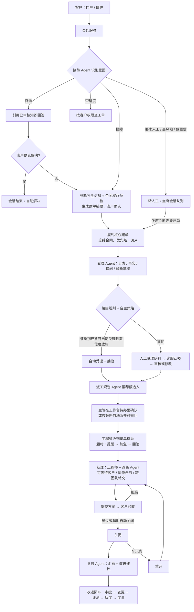
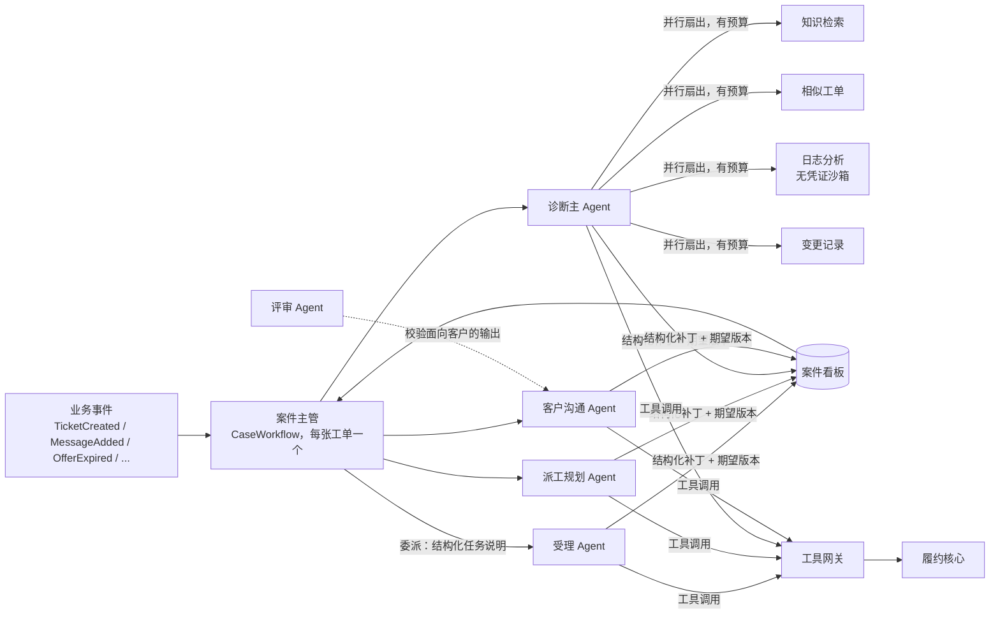
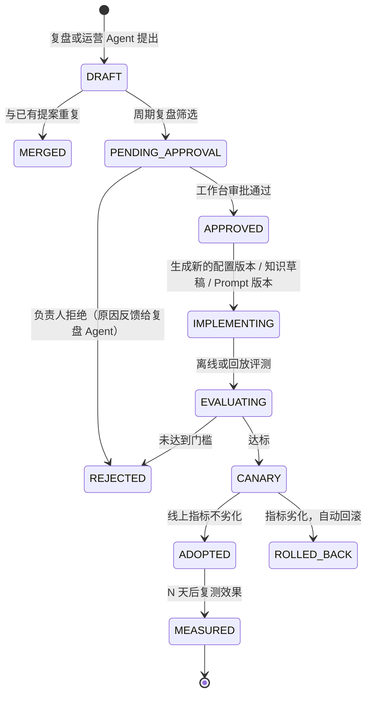

# ServiceFlow AI 目标架构：企业级多租户、多 Agent 服务履约平台

状态：**提案 v0.2，待确认**。日期：2026-10-22。

本文描述下一阶段的目标架构。确认前，[开发需求规格说明书](./ServiceFlow_AI_Requirements.md) 与 [AGENTS.md](../../AGENTS.md) 中的现行约束（模块化单体、不引入 MQ/Redis、模型工具调用 0 轮、AI 不参与派工等）仍然有效；确认后，再把需求性内容并入规格书，本文只保留架构说明。

**v0.2 已定事项**

| 事项 | 决定 |
|---|---|
| 多租户 | 平台 → 服务商（租户）→ 客户企业 → 联系人 |
| 产品定位 | 按真实产品设计，分阶段交付 |
| AI 前台边界 | AI 可以直接回复客户；只能引用已审核的知识，标明 AI 身份，客户随时可转人工 |
| AI 回复是否计入合同首响 | **不计入** |
| 模型数据驻留 | 不强制只用国内或本地模型；模型网关支持多厂商 |
| 消息队列 | **Kafka**（理由见第 15.1 节） |
| 飞书 | **暂缓**。先用自建的“通知与待办”最小设计打通流程（第 7 节），飞书以后作为一个渠道适配器接入（第 7.9 节） |
| 缓冲建单的 SLA 起点 | 从核心实际受理时开始计时；另记 `customerSubmittedAt`，用于报表和赔付判断 |
| 验收超时 / 重开期限 | 验收超时 7 天自动关闭；关闭后 14 天内可以重开；均可按合同覆盖 |
| 部署 | 初期自建小规模（k3s，见第 15.3 节），以后再考虑迁到云托管 |
| 客户渠道 | 首期只做门户和邮件 |
| 仓库结构 | 见第 18 节 |

---

## 0 结论摘要

- **两种语言，两个故障域**
  - Java 履约核心是业务事实的唯一权威，负责工单、任务、SLA、权限、审计。
  - TypeScript Agent 平台是外围的多 Agent 工作体系，只能通过工具网关调用核心的命令接口，从不直接写业务库。
  - Agent 平台整体宕机时，工单自动进入人工队列，派单、提醒、验收照常运转。
- **Agent 平台按 Harness 方式构建**，借鉴 Anthropic Managed Agents 的拆分：
  - **会话**：追加式事件日志，是唯一需要持久保存的状态。
  - **Harness**：无状态的执行循环，崩溃后用 `wake(caseId)` 恢复。
  - **工具网关**：Agent 的“手”，凭证只放在这里。
  - 持久化执行用 Temporal（TS SDK）。
- **多 Agent 工作方式**：每张工单有一个“案件主管”，由它唤醒专家 Agent。Agent 之间通过结构化的“案件看板”和事件协作，不自由群聊。可并行的诊断检索才扇出给并行子 Agent。
- **通知与交互先自建**：通知服务把业务事件变成每个人的“待办”（站内实时推送，可选 Webhook 和邮件）。所有操作（接单、确认派工、审批 AI 动作）都在 Vue 工作台里完成，直接调用对应服务的接口。飞书以后作为一个渠道接入，不改业务。
- **三个闭环**：
  1. 业务履约闭环：受理 → 解决 → 验收 → 关闭 → 可重开。
  2. Agent 执行闭环：规划 → 行动 → 观察 → 校验 → 写回看板。
  3. 持续改进闭环：复盘 → 提出改进 → 审批 → 版本化变更 → 评测 → 灰度 → 度量 → 采纳或回滚。

### 0.1 需求追踪

| 需求 | 设计位置 |
|---|---|
| 多租户 | 第 10、13 节 |
| AI 先接待，客户可转人工 | 第 5.1、6.4、6.10 节 |
| AI 分流分类，人工受理也分流 | 第 5.2 节，第 6.4 节（受理 Agent），第 11 节（队列认领） |
| 并发：受理、接单、派单 | 第 11 节 |
| 工程师派单与排程 | 第 5.3 节，第 7.6 节（提醒梯度），第 6.4 节（派工规划 Agent） |
| 派单提醒 | 第 7 节（自建最小设计）；飞书后续见第 7.9 节 |
| 流程结束后 Agent 汇总并提出优化建议 | 第 8 节 |
| TS Harness、多 Agent 自主工作循环 | 第 6 节 |
| 微服务，局部故障不导致整体崩溃 | 第 4、12 节 |
| 架构闭环 | 第 0、5、6.2、8 节 |

---

## 1 目标与不做的事

**架构目标**
1. AI 和人工互为后备，任何单个组件故障都不让客户“无人回应”。
2. Agent 的每个动作都可授权、可审计、可回放、可评测。
3. Agent 的自主程度可以按租户、Agent、动作逐级放开，依据是评测数据，而不是主观判断。
4. 每张工单结束后都能沉淀为改进，并形成闭环。

**明确不做**
- Agent 直连业务数据库。
- Agent 持有模型或外部系统的凭证。
- Agent 自行修改生产环境的路由、SLA、Prompt 配置。
- 多个 Agent 之间无结构的自由对话。
- 一个“全能 Agent”包揽所有事。
- 用分布式锁（Redis）代替数据库约束来保证业务正确性。
- 本期不对接飞书或其他 IM 的开放平台（只保留一个可选的出站 Webhook）。

---

## 2 业界调研与取舍

> 下表多数来源是二手资料；直接核对过原文的是 Anthropic 的两篇工程文章和飞书长连接文档。各产品能力以官方文档为准。

| 来源 | 关键做法 | 本架构采纳的方式 |
|---|---|---|
| Anthropic Managed Agents | 会话（追加式日志）、Harness（无状态循环）、沙箱/工具（“手”）三者解耦；`wake(sessionId)` 恢复；凭证不进沙箱，经代理从保险库取 | 案件会话日志 + 无状态 Harness 工作进程 + 工具网关独占凭证；日志分析放在无凭证的沙箱里 |
| Anthropic 长时运行 Harness | 用结构化 JSON 的任务清单和进度文件跨上下文保存状态；每轮先读状态再动手；生成与评估分离；端到端验证后才标完成 | 案件看板用 JSON 而非 Markdown；Agent 每次唤醒先读看板和最新业务快照；评审 Agent 与生成 Agent 分离 |
| Anthropic 多 Agent 研究系统 | 主 Agent 加并行子 Agent，适合广度检索；token 消耗约为普通对话的 15 倍；委派说明必须明确，否则会重复劳动 | 只有诊断阶段扇出并行子 Agent，且有预算；委派用结构化任务说明 |
| OpenAI 构建 Agent 实践指南 | 管理者模式（专家作为工具）与去中心化交接；分层护栏；高风险或连续失败时交给人 | 内部用管理者模式（案件主管）；接待转人工用交接模式；护栏分输入、输出、动作三层 |
| Microsoft Agent Framework | 五种编排模式：顺序、并发、交接、群聊、Magentic | 受理用顺序；诊断用并发；转人工用交接；不用群聊；案件主管借鉴 Magentic 的“计划—分派—停滞时重规划” |
| Google ADK | 确定性工作流 Agent（顺序/并行/循环）+ LLM Agent；会话、状态、记忆分层；通过 A2A 跨框架协作 | 案件主管以确定性规则为主、LLM 规划为辅；记忆分层见第 6.6 节 |
| AWS Bedrock AgentCore | 运行时、网关（把 API 包装成 MCP 工具）、记忆、身份（OAuth）、策略（在模型之外强制执行）、可观测性（OpenTelemetry） | Agent 平台的组件划分基本一一对应；策略在工具网关里强制执行，不靠 Prompt |
| Salesforce Agentforce | 推理引擎 + Trust Layer（脱敏、零留存、注入防护、毒性过滤、审计）；按意图、紧急度、复杂度转人工 | 第 6.8 节信任层；转人工条件见第 5.1 节 |
| ServiceNow AI Agent | 工作流 → 编排器 → Agent → 工具；事件分类 Agent 给建议，人工批准后才更新工单 | 与本文的 L2“建议 + 人工确认”一致，评测达标后再放开 |
| A2A 与 MCP | A2A 负责 Agent 之间的发现和任务委派；MCP 负责 Agent 调用工具和数据 | 平台内部工具统一走 MCP；对外（例如客户自己的 Agent）预留 A2A |
| Temporal | Agent 循环跑在 Workflow 里，模型调用作为 Activity，可持久重试、重放时不重复调用；有 TS 集成 | Agent 运行时的持久化执行底座；人工审批用 Signal，等待用 Timer |
| 飞书开放平台（后续） | 长连接只支持企业自建应用；事件随机投递给其中一个客户端；处理须在 3 秒内完成 | 记录在第 7.9 节，供以后接入时使用 |

---

## 3 架构原则

1. **业务事实只在一处**：工单、任务、SLA、派工的状态只由 Java 履约核心写入。案件看板是 Agent 的工作记忆，不是权威数据；每次决策前重新读取核心快照。
2. **Agent 是受约束的操作者**：每个 Agent 都有身份主体、权限范围、预算和熔断开关。代人操作时，权限取 Agent 范围与被代理人权限的交集。
3. **策略在模型之外执行**：权限、风险分级、审批、幂等、限流都在工具网关和核心里强制执行。模型输出只是“请求”。
4. **确定性优先，LLM 补位**：凡是能写成规则的都写成规则（路由、SLA、提醒梯度、超时回池）。LLM 只处理需要理解语言或判断的部分。
5. **会话与执行解耦**：持久状态在事件日志里，Harness 无状态；工作进程随时可以替换。
6. **失败默认转人工**：任何智能环节超时、失败、超预算或置信度低，都走既定的人工路径；核心从不同步等待 Agent。
7. **人工接管优先**：人工认领或接手后，该案件里的 Agent 自动降为辅助模式，不再直接对客户写入。
8. **通知不承载业务**：通知服务只负责“告诉谁、怎么提醒”，操作一律调用拥有该业务的服务；通知服务宕机不影响任何人干活。
9. **改进必须走闭环**：Agent 只能提出改进建议，生效必须经过审批、版本化、评测和灰度。

---

## 4 总体架构

```
渠道   客户门户（Web / H5）· 员工工作台（Vue3：客服 / 工程师 / 主管 / 运营 / 管理）
       邮件 · 出站 Webhook（可选）· 开放 API
──────────────────────────────────────────────────────────────────────────
边缘   API 网关（JWT 校验 · 租户识别 · 限流 · 灰度 · 降级页）
──────────────────────────────────────────────────────────────────────────
渠道层(TS)  会话服务 conversation-service    通知服务 notification-service
──────────────────────────────────────────────────────────────────────────
Agent 平台(TS)
  控制面：Agent 注册与版本 · Prompt 版本 · 租户自主策略 · 熔断开关 · 审批 · 改进提案
  数据面：agent-api（入口 / 事件消费）
          agent-runtime 执行池（接待 | 受理 | 诊断 | 派工 | 批处理）
          tool-gateway（MCP · 策略 · 审批 · 幂等 · 凭证）
          model-gateway（多模型 · 配额 · 脱敏 · 计量）
          retrieval（知识 / 相似工单 / 混合检索）
          eval-service（离线评测 · 回放评测 · 线上指标）
──────────────────────────────────────────────────────────────────────────
业务核心(Java)  iam-service（租户、用户、角色、Agent 主体、JWT 与令牌交换）
               fulfillment-core（工单 · 受理 · 路由 · 队列 · 任务 · 派单邀约 ·
                                 方案验收 · SLA/升级 · 人力排程 · 主数据 · 知识审核）
──────────────────────────────────────────────────────────────────────────
数据与基础设施
  MySQL（按服务分库，MGR 高可用）· Kafka · Redis · Elasticsearch · 对象存储
  Temporal 集群 · Vault · OpenTelemetry/Prometheus/Grafana/Loki · Langfuse
```

### 4.1 服务清单

| 服务 | 语言 | 职责 | 拥有的数据 | 宕机影响 |
|---|---|---|---|---|
| api-gateway | — | 鉴权、路由、限流、降级 | 无 | 至少 2 个实例；全部宕机则外部入口不可用 |
| iam-service | Java | 租户、用户、角色、Agent 主体、签发 JWT 与令牌交换 | iam_db | 新登录受影响；已签发的 JWT 在本地验签，存量会话不受影响 |
| fulfillment-core | Java | 全部业务事实与规则（内部保持模块化单体，见 4.2） | core_db | 业务写入停止；Agent 平台和会话服务进入缓冲或降级模式 |
| notification-service | TS | 事件 → 收件人 → 待办和通知；站内实时推送（SSE）；提醒升级；Webhook 和邮件投递 | notification_db | 实时提醒中断；工作台退回到直接查核心的“我的任务 / 待派工 / 待受理”列表 |
| conversation-service | TS | 客户会话、消息、附件、转人工、坐席会话分配、WebSocket | conversation_db | 客户聊天入口不可用；门户仍可直接提交工单 |
| agent-api | TS | 消费业务事件、启动和唤醒案件流程、审批入口、对外 A2A（预留） | — | Agent 停止响应；核心超时后转人工 |
| agent-runtime-* | TS | Harness 执行池，按 Agent 类型分池部署 | 无状态 | 只影响该池对应的 Agent |
| tool-gateway | TS | MCP 工具注册、策略、审批、幂等、凭证代理、审计 | agent_db（工具调用记录） | 所有 Agent 无法行动，等同 Agent 平台降级 |
| model-gateway | TS | 多模型路由、主备切换、配额、脱敏、缓存、计量 | 用量记录 | 切换备用模型；全部不可用则 Agent 降级 |
| retrieval | TS | 知识与相似工单检索，按租户、产品、版本过滤适用范围 | Elasticsearch 索引 | Agent 只能回答“证据不足”，并转人工 |
| agent-control-plane | TS | Agent/Prompt 版本、租户策略、熔断开关、审批记录、改进提案 | agent_db | 无法改配置；运行中的 Agent 使用缓存的最后版本 |
| eval-service | TS | 离线评测、路由回放、灰度对比、指标计算 | eval_db | 改进无法上线；业务不受影响 |

### 4.2 为什么履约核心不再往下拆

一张工单的验收、整改、SLA、活动、审计和幂等，必须在同一个事务里提交。现有的 `ResolutionService.decide` 就是这样实现的。

派单时的容量检查，也必须和任务写入在同一把锁下完成。如果把工单、任务、SLA、人力排程拆成独立服务，就只能用 Saga 做最终一致，“不超派”“不重复关闭”这类不变量会变成补偿逻辑，风险远大于收益。

因此，核心内部按包继续保持模块化，用 ArchUnit 守住模块间的依赖方向；部署上是一个服务、多个实例。

---

## 5 业务履约闭环（端到端）



全程有一个规则驱动的 SLA 引擎：用掉 75% 或 90% 的时限时预警，超时后逐级升级，并经通知服务提醒。它不依赖 Agent。

### 5.1 接待与转人工

- **意图分类**：咨询、报障、查进度、投诉、要求人工、其他。
- **转人工的触发条件**（任一满足即转）：
  - 客户明确要求人工。
  - 识别到投诉或负面情绪。
  - 命中高风险词，例如“生产中断”“数据丢失”。
  - 同一问题连续 3 轮没有进展。
  - 置信度低于租户阈值。
  - 接待 Agent 超时或出错。
  - 工具网关拒绝了动作。
- **交接内容**：会话摘要、已收集的事实、已尝试的回答、转人工原因，作为结构化交接单写入会话。坐席不需要重新问一遍。
- **代客户建单**：
  - 接待 Agent 只能生成建单草稿；客户点击“确认提交”就视为批准。
  - 真正建单时，用 iam 签发的“代理令牌”调用核心：`sub` 是客户，`act` 是接待 Agent。
  - 合同、优先级、SLA 仍由核心决定。
- **首响口径（已定）**：AI 回复**不计入**合同 SLA 的首次响应，首响仍以人工公开答复为准（沿用现有规则）。客户可见的 AI 回复一律标明“AI 助手”。

### 5.2 受理与分流

- **受理 Agent**：由 `TicketCreated` 或客户补充消息触发。生成草稿时带上读取时的工单版本，沿用现有规格 AI-07～AI-10 的“草稿生命周期”。
- **路由规则**是确定性的版本化配置：
  - 输入：确认后的分类（或 AI 建议的分类）、产品、客户等级、优先级、语言。
  - 输出：受理队列和技能组。
  - 匹配不到时进入默认队列。
- **自主策略**：按租户、分类配置为 `MANUAL`（全部人工确认）、`AUTO_WITH_SAMPLING`（自动受理并按比例抽检）或 `DISABLED`。只有评测达标的分类才能设为自动，见第 8 节。
- **人工受理队列**：
  - 按“优先级 → SLA 剩余时间 → 进入时间”排序。
  - 两种分配方式：客服自取（抢占式认领），或系统推送（按技能和在线状态轮询）。
  - 认领有租期，超时自动释放。
  - 客服修改分类后会重新路由；跨队列转移会留下记录。

### 5.3 派工与排程

- **候选集**（确定性）：团队成员 ∩ 技能满足 ∩ 当前在岗（系统内排班表）∩ 容量未满 ∩ 不在请假中。
- **打分**由派工规划 Agent 给出可解释的推荐，参考技能匹配度、当前负载、SLA 紧迫度、同类问题的历史解决情况和客户熟悉度。输出 Top 3 及理由。
- **派单邀约**：派工会生成一个有有效期的“邀约”，工程师需要接受。超时或拒绝后，按第 7.6 节的梯度提醒，最终回到候选池重新推荐。
- **容量**：每个工程师按优先级加权计算当前在手量，上限可按人配置。检查容量和写入任务在同一事务里完成，加锁顺序见第 11 节。

### 5.4 处理、等待客户、协作、转交

- 新增工单状态 `WAITING_CUSTOMER`：等待客户提供信息时暂停解决时钟，规则在契约里固定。客户回复后自动恢复。超过 N 天无回复，客户沟通 Agent 先提醒，仍无回复则按策略关闭。
- **协作任务**：不阻塞工单状态，可以和主任务并行，例如让 DBA 协助查日志。
- **跨团队转交**：由主管发起、对方团队主管接收；转交后工单的负责团队变化，并记录完整历史。
- **P1 协同**：P1 工单的相关人员（工程师、主管、客服）自动订阅该工单的所有内部动态，在工作台里看到同一条时间线。

### 5.5 验收、关闭、重开

- 沿用现有的“方案 → 创建者验收 → 拒绝后整改”的轮次机制。
- 新增：验收超时后自动关闭，默认 7 天，可按合同覆盖；期间客户沟通 Agent 会提醒。
- 新增：关闭后 14 天内允许重开（可按合同覆盖），进入新的处理轮次。建议的 SLA 口径（待写入契约）：恢复同一 SLA 实例的解决时钟，累计耗时接着算，原来关闭时的达标结论作废，到再次关闭时重新结算。
- 关闭时触发满意度调查和复盘（第 8 节）。

---

## 6 Agent 平台（TypeScript Harness）

### 6.1 组件

| 组件 | 对应业界概念 | 说明 |
|---|---|---|
| 案件会话 Case Session | Managed Agents 的会话 | 每个案件一份追加式事件日志：业务事件、Agent 步骤、工具调用、人工决定 |
| 案件看板 Case Board | 长时运行 Harness 的 JSON 任务清单 | 结构化的工作记忆，带版本号，按分区写入 |
| Harness 内核 | Harness | 无状态循环：组装上下文 → 调模型 → 调工具 → 校验 → 写回 |
| 执行池 | AgentCore 运行时 | 按 Agent 类型分开部署和扩缩容，实现舱壁隔离 |
| 工具网关 | AgentCore 网关 + 策略 + 身份 | MCP 服务器；策略、审批、幂等、凭证、审计都在这里执行 |
| 模型网关 | — | 屏蔽不同模型厂商的差异 |
| 检索服务 | 记忆 / RAG | 隔离租户、过滤适用范围 |
| 控制面 | 注册中心 | 所有 Agent 定义、Prompt、策略都有版本，可以灰度 |
| 评测服务 | 评测 | 离线、回放、线上三种评测 |

### 6.2 Harness 内核循环（Agent 执行闭环）

```ts
// agent-runtime/src/kernel/run-agent.ts（示意）
export async function runAgent(def: AgentDefinition, input: RunInput, ctx: RunContext): Promise<RunResult> {
  const session = await ctx.sessions.load(input.caseId);              // 追加式事件日志
  const snapshot = await ctx.tools.read('core.ticket_snapshot', input); // 每次都重读权威数据
  let messages = ctx.context.assemble(def, session, snapshot, input);  // 选择、压缩、脱敏、标注不可信内容
  for (let step = 0; step < def.limits.maxSteps; step++) {
    ctx.budget.assertWithin();                                         // token、费用、时长
    const reply = await ctx.models.complete(def.model, messages, def.tools); // Temporal Activity：可重试、可熔断
    await ctx.sessions.append(input.caseId, { type: 'model_reply', runId: ctx.runId, step, usage: reply.usage });
    if (reply.final) {
      const verdict = await ctx.verify(def, reply.final, snapshot);    // Schema、引文、适用性、评审 Agent
      if (!verdict.ok) return ctx.fallback(def, verdict);              // 校验不过就转人工，不部分执行
      await ctx.board.patch(input.caseId, def.boardSection, verdict.patch, input.boardVersion);
      return { status: 'DONE', output: verdict.output };
    }
    for (const call of reply.toolCalls) {
      const result = await ctx.tools.invoke(call, {                    // 工具网关：策略、审批、幂等、审计
        principal: ctx.principal,
        onBehalfOf: input.onBehalfOf,
        idempotencyKey: `${ctx.runId}:${step}:${call.id}`,
        observedVersion: snapshot.ticketVersion,
      });
      messages = ctx.context.observe(messages, call, result);          // 被拒绝、待审批也作为观察结果返回
    }
  }
  return ctx.fallback(def, { reason: 'STEP_LIMIT' });
}
```

- **Hook**（借鉴 Claude Agent SDK 的 PreToolUse/PostToolUse 和 canUseTool）：
  - `beforeModel`：脱敏、注入检测。
  - `beforeTool`：策略、审批。
  - `afterTool`：审计、输出扫描。
  - `onFinal`：评审 Agent。
- **持久化执行**：
  - 每次 Agent 调用都是一个 Temporal 子工作流；模型调用和工具调用都是 Activity。
  - 工作进程崩溃后，Temporal 重放执行历史并从断点继续；已完成的 Activity 不会重复执行。
  - 工具调用另外用幂等键兜底，因为 Activity 可能“已执行但结果没记上”。
- **Harness 的假设会过时**（Anthropic 的经验）：上下文压缩、步数限制等参数都放进 Agent 定义里做版本化配置，不写死在代码里。

### 6.3 多 Agent 协作：案件主管 + 专家 Agent + 案件看板



**案件主管**是一个长期运行的 Temporal 工作流，每张工单一个，用 continue-as-new 控制执行历史的长度。

- 输入：业务事件（Signal）、人工决定（Signal）、定时器。
- 决策方式：先查确定性的“事件 → 动作”规则表（例如 `TicketCreated → 受理`，`TicketTriaged → 派工规划`）。只有规则表覆盖不到的情况（例如诊断策略、多次整改后的重新规划），才调用 LLM 规划。
- 停滞检测（借鉴 Magentic）：同一阶段超过时长、或连续两次专家输出被人工否决，就重新规划或直接转人工。

**案件看板（JSON，带版本号）**

```json
{
  "caseId": "c_...", "ticketId": "...", "boardVersion": 12, "phase": "DIAGNOSING",
  "facts":        [{ "id": "f1", "text": "升级到 11.2 后连接超时", "source": { "messageId": "...", "quote": "..." }, "confirmedBy": "SUPPORT:u_12" }],
  "hypotheses":   [{ "id": "h1", "text": "连接池上限过低", "evidence": ["kb:...@v3"], "status": "OPEN" }],
  "openQuestions":[{ "field": "errorLog", "askedAt": "...", "answered": false }],
  "plan":         [{ "stepId": "s3", "owner": "agent:diagnosis", "action": "分析客户上传日志", "status": "RUNNING" }],
  "decisions":    [{ "by": "human:u_7", "what": "改派给数据库组", "why": "...", "at": "..." }],
  "pendingApprovals": [{ "approvalId": "...", "tool": "core.assign_task", "requestedBy": "agent:dispatch" }],
  "risks":        [{ "type": "SLA", "detail": "解决时限已用 78%" }]
}
```

写入规则：
- 每个 Agent 只能写自己的分区（`plan` 只有主管能写）。
- 写入必须带期望版本，冲突则重读后重试。
- 看板不保存工单状态、负责人这类权威字段，需要时一律从核心读取。

**为什么不用“群聊式”多 Agent**：
1. 群聊式不可复现、难以审计。
2. 广度检索之外的工作，相互依赖强，并行收益低、token 成本高（约 15 倍）。
3. 业务动作都要经过人或策略把关，结构化看板比自然语言对话更容易校验。

### 6.4 Agent 名录

| Agent | 触发 | 主要工具 | 输出 | 默认自主级别 | 预算（示例） | 失败时 |
|---|---|---|---|---|---|---|
| 接待 Reception | 客户消息 | `kb.search` `ticket.query_mine` `contract.precheck` `ticket.draft_create` `conv.reply` `conv.handoff` | 回答、建单草稿、转人工 | 回复 L1（仅引用已审核知识）；建单 L2（客户确认即批准） | 8 步，30 秒 | 显示“提交工单 / 转人工” |
| 案件主管 Supervisor | 任何案件事件 | `board.*` `agent.delegate` `case.schedule` | 计划、委派 | 只做编排 | 每次 LLM 规划 4 步 | 走默认规则路径（人工队列） |
| 受理 Triage | `TicketCreated`、客户补充 | `ticket.snapshot` `kb.search` `similar.search` `core.submit_triage_proposal` `conv.ask_followup` | 分类、事实、追问、诊断草稿 | 草稿 L1；确认受理 L2 | 10 步，60 秒 | 进人工受理队列 |
| 诊断 Diagnosis | 工单进入处理、工程师请求 | 并行子 Agent：知识、相似工单、日志沙箱、变更记录 | 诊断报告写入看板，并推送待办给工程师 | L0/L1，只出建议 | 并行最多 4 个，每个 6 步，总 token 上限 | 工程师自行排查 |
| 派工规划 Dispatch Planner | `TicketTriaged`、`OfferExpired`、改派请求 | `workforce.candidates` `workforce.load` `workforce.availability` `core.recommend_dispatch` `core.assign_task` | Top 3 推荐及理由 | 推荐 L1；派工 L2 | 6 步 | 主管手动派 |
| 客户沟通 Customer Comms | 状态变化、等待客户的定时器 | `conv.reply` `ticket.public_message` | 进度通知、催办、方案说明 | 模板化进度通知 L1；技术性内容 L2（工程师确认） | 4 步 | 只发模板通知 |
| 评审 QA Evaluator | 低置信度的 L1 对外输出（同步）；工单关闭（批量） | 只读 | 评分、问题清单 | 只读 | 4 步 | 同步场景下改为人工确认 |
| 复盘 Retrospective | 工单关闭（P1、异常、抽样）；每周 | `case.timeline` `metrics.query` `report.publish` `improvement.propose` | 复盘报告、改进提案 | 报告 L1；提案进入审批 | 12 步 | 推迟执行 |
| 知识沉淀 Knowledge Curator | 验收通过的方案 | `kb.draft` | 知识草稿 | 必须人工审核后发布 | 6 步 | 推迟执行 |
| 运营规划 Workforce Planner | 每周 | `metrics.query` `workforce.roster` | 排班和技能缺口建议 | 只出提案 | 10 步 | 推迟执行 |

### 6.5 工具网关与权限模型

- **身份主体**：`agent:{tenantId}:{agentName}@{version}`，由 iam 签发短期 JWT。代人操作时做令牌交换（RFC 8693 风格），得到带 `sub`（被代理人）和 `act`（Agent）的令牌。核心按 `sub` 校验业务权限，并把 `act` 写入审计。
- **工具定义**：

  ```ts
  export const submitTriageProposal = defineTool({
    name: 'core.submit_triage_proposal',
    risk: 'L1',
    scopes: ['ticket:triage:propose'],
    input: TriageProposalSchema,          // zod；拒绝未知字段，沿用规格 AI-06
    idempotent: true,
    requiresObservedVersion: true,
    handler: core.post('/internal/agent/v1/tickets/{ticketId}/triage-proposals'),
  });
  ```

- **风险分级与执行方式**：

  | 级别 | 例子 | 执行方式 |
  |---|---|---|
  | L0 只读 | 检索、查快照、查候选人 | 自动执行，结果按被代理人权限过滤 |
  | L1 低风险写 | 提交草稿、发追问、发引用已审核知识的回复、内部备注、推荐 | 自动执行，标明 AI 来源，可撤回、可抽检 |
  | L2 业务写 | 建单、确认受理、派工、对客户的技术答复 | 默认生成审批待办等人工确认；租户可按 Agent × 工具 × 分类放开为自动，前提是评测达标 |
  | L3 禁止 | 改合同/SLA/优先级/权限、代客户验收、关闭工单、生产环境操作 | 根本不注册为工具 |

- **审批**（不依赖飞书）：
  1. L2 动作在控制面生成审批记录，发出 `ApprovalRequested` 事件。
  2. 通知服务为有审批权的人生成待办。
  3. 审批人在工作台点击，调用 `POST /agent/v1/approvals/{id}/decision`。
  4. agent-api 校验审批人权限后发 Signal 给 Temporal 工作流，工作流继续执行或放弃。
  5. 审批超时视为拒绝。
- **熔断开关**：可以按租户、Agent、案件三个粒度暂停。工具网关在每次调用前都检查。
- **凭证**：模型 API Key 等只存在于 Vault 和工具网关、模型网关里。执行池、沙箱拿不到任何凭证。

### 6.6 上下文工程与记忆

| 记忆类型 | 载体 | 说明 |
|---|---|---|
| 工作记忆 | 案件看板 | 跨多次唤醒持续存在，压缩时不会丢 |
| 情景记忆 | 案件会话日志 + 相似工单检索 | 只检索同一租户的数据 |
| 语义记忆 | 已审核的知识库 | 按产品和版本过滤适用范围，沿用规格 AI-03/AI-04 |
| 客户画像 | 核心主数据（只读） | 合同等级、产品、历史工单统计；不做推测性画像 |
| 程序性记忆 | Agent 定义 / Prompt / 规则的版本 | 只能通过改进闭环修改 |

上下文组装顺序：
1. 系统策略。
2. Agent 指令。
3. 看板。
4. 最新业务快照。
5. 检索到的证据，带 ID 和版本。
6. 近期事件摘要。

客户输入、知识正文、日志都用不可信数据的定界符包起来，并显式标注为数据，不作为指令。租户隔离由检索服务和工具网关强制执行，不靠 Prompt。

### 6.7 模型网关

- **多厂商**：主力用 Claude 5 系列（强模型 Opus/Sonnet 用于诊断、复盘、规划；快速模型 Haiku 用于意图识别、摘要、评审初筛），另配一个其他厂商的模型作为备用；本地 Ollama 用于开发和离线评测（沿用现有实验）。不强制数据驻留，但保留按租户限制可用模型的配置项。
- **其他**：超时、熔断、重试只针对 429/5xx（沿用实验口径）；Prompt 缓存；按租户和 Agent 计量 token 与费用；调用外部模型前做 PII 脱敏。

### 6.8 信任层（护栏）

| 层 | 检查内容 |
|---|---|
| 输入 | 注入检测、PII 识别与脱敏、附件扫描 |
| 输出 | Schema 严格校验；引文必须真实存在于来源中；知识状态和适用范围（复用核心现有的 `validateEvidence` 规则并前移一份）；毒性检测；对客户内容做评审 |
| 动作 | 工具网关的策略、风险、审批；核心的授权和版本校验 |
| 事后 | 抽检、质检、线上指标异常告警 |

### 6.9 持久化执行与恢复

| 工作流 | 生命周期 | Signal / Timer |
|---|---|---|
| `ConversationWorkflow` | 一次客户会话 | 客户消息、坐席接入、闲置超时 |
| `CaseWorkflow`（案件主管） | 建单到关闭后复盘结束 | 业务事件、人工决定、跟进定时器 |
| `AgentRunWorkflow` | 一次 Agent 调用 | 审批结果 |
| `RetrospectiveWorkflow` / `WeeklyReviewWorkflow` | 批处理 | 定时 |

**Temporal 不可用时**：
- agent-api 拒绝启动新的运行，核心的超时机制把工单转人工。
- 事件留在 Kafka 里，恢复后由案件主管补处理。如果此时人工已经接手，则只做辅助性工作。

### 6.10 人机协作规则

- 工单有 `aiMode` 字段：`AUTO` 或 `ASSIST`。人工认领、人工发出对外消息、工程师接单后，自动变为 `ASSIST`。在 `ASSIST` 下，核心拒绝 Agent 写入对客户可见的内容，只允许内部草稿。
- 每条活动和消息都记录来源：`HUMAN` / `AI` / `SYSTEM`。是 AI 时同时记录 `agentRunId`。
- 人工对 AI 草稿的修改（编辑距离、被否决的字段）进入评测数据，作为放开自主级别的依据。

---

## 7 通知与交互（最小设计，替代飞书）

### 7.1 目标与边界

**只解决四件事**：
1. 通知到人：该谁处理，就让谁看到。
2. 能直接操作：看到后能一键处理。
3. 超时会升级：没人处理会逐级催促。
4. 可以追溯：谁在什么时候收到、什么时候处理。

**不做**：IM 开放平台对接、群聊、富文档、日历同步。

### 7.2 组成

```text
fulfillment-core ─┐                         ┌─► 待办 / 通知（notification_db）
agent-platform  ──┼─ Kafka 事件 ─► notification-service ─┼─► SSE 实时推送 ─► Vue 工作台（浏览器桌面通知 + 提示音）
conversation    ──┘   （只消费，不写业务）     └─► 出站投递发件箱 ─► Webhook（可选）/ 邮件（可选）

操作：工作台 ──► 直接调用拥有该业务的服务（核心 / agent-api）──► 业务事件 ──► 通知服务关闭对应待办
```

- 通知服务**只读事件、只写自己的库**，从不调用业务写接口。
- 按钮背后的操作由工作台直接调用业务服务，所以通知服务宕机时，所有人仍能在工作台的业务列表里干活。

### 7.3 通知规则（数据驱动，按租户可覆盖）

| 事件 | 收件人 | 生成的待办或通知 | 可执行动作 → 调用的接口 |
|---|---|---|---|
| `TicketQueued` | 该队列技能组的在岗客服 | 待受理（谁先认领谁处理） | 认领 → `POST /queue-items/{id}/claim` |
| `TriageProposalStored` | 认领人 | AI 受理草稿待审核 | 打开受理页 |
| `DispatchRecommended` | 负责团队的主管 | 派工确认（附 Top 3 推荐和理由） | 派给某人 → `POST /tasks/{id}/assignments` |
| `TaskOffered` | 被邀约的工程师 | 接单待办（带倒计时） | 接单 / 拒单 → `POST /tasks/{id}/accept`、`/decline` |
| `OfferReminderDue` | 工程师；升级时加主管 | 催办 / 加急 | 同上 |
| `ApprovalRequested` | 有审批权的人 | AI 动作审批 | 同意 / 拒绝 → `POST /agent/v1/approvals/{id}/decision` |
| `SlaWarning` / `SlaBreached` | 当前处理人 + 主管 | 风险提醒 | 打开工单 |
| `ResolutionProposed` | 工单创建者（客户，在门户里） | 待验收 | 验收 → `POST /resolutions/{id}/acceptance` |
| `ImprovementProposed` | 对应类别的审批人 | 改进提案待审批 | 打开提案页 |
| `RetrospectivePublished` | 主管、相关处理人 | 复盘报告已生成 | 打开报告 |

- **收件人解析**：事件里已经带出的人员 ID 直接使用（例如被邀约的工程师）；按角色确定的人（例如团队主管、在岗客服），通过核心的只读接口查询，结果缓存 1 分钟。核心不可用时延迟重试。

### 7.4 待办项模型

```json
{
  "id": "inb_...", "tenantId": "...", "userId": "...", "kind": "TASK_OFFER",
  "title": "新派单：数据库连接超时（P1）", "refType": "TASK", "refId": "...",
  "groupKey": "TASK_OFFER:task_123",
  "actions": [
    { "key": "accept",  "label": "接单", "service": "core", "method": "POST", "path": "/api/v1/tasks/task_123/accept",
      "body": { "expectedTicketVersion": 5, "expectedTaskVersion": 1 } },
    { "key": "decline", "label": "拒单", "service": "core", "method": "POST", "path": "/api/v1/tasks/task_123/decline",
      "requiresInput": ["reason"] }
  ],
  "status": "OPEN", "priority": "P1", "expiresAt": "...", "createdAt": "..."
}
```

- **幂等键**：工作台执行动作时，幂等键用 `{inboxItemId}:{actionKey}`；重复点击只生效一次。
- **关闭待办**：多人收到同一组待办（相同 `groupKey`）时，业务服务处理成功后发出事件（例如 `TaskAccepted`），通知服务把这一组待办全部关闭，并标注“已由 X 处理”。在关闭事件到达前就点击的人，会收到业务服务的 409，工作台提示“已被他人处理”。
- **版本**：动作里带的期望版本只是生成待办时的快照，最终以业务服务的校验为准。

### 7.5 推送与离线

- 工作台登录后建立 SSE 连接，实时收到新的待办和通知；断线重连后用 `GET /inbox?since=` 补齐。
- 收到 P1 待办时，浏览器桌面通知加提示音（需要用户授权）。
- 通知服务不可用时，工作台检测到 SSE 失败，退回“我的任务 / 待派工 / 待受理”这些由核心直接提供的列表，每 30 秒轮询一次。

### 7.6 提醒升级梯度（确定性规则，按优先级配置）

| 时间点 | P1 | P2 | P3 |
|---|---|---|---|
| T0 | 接单待办 + 实时推送 | 同左 | 同左 |
| 第一次提醒（重新推送 + 桌面通知） | +5 分钟 | +30 分钟 | +2 小时 |
| 加急（标红置顶；有配置时同时发 Webhook 或邮件） | +10 分钟 | — | — |
| 回池重新推荐，通知主管 | +15 分钟 | +60 分钟 | +4 小时 |
| 升级到上级主管 | 第二次回池 | 第二次回池 | — |

- 邀约的到期和提醒时间点由**核心**里的邀约调度器扫描（多实例用 `SKIP LOCKED`），发出 `OfferReminderDue` / `OfferExpired` 事件。通知服务只负责呈现。
- 整个梯度不依赖 Agent 平台。非工作时间只向排班表里的值班人员派单。

### 7.7 出站投递（可选）

- **Webhook**：每个租户可以配置若干 Webhook 地址，按事件类型和优先级过滤。消息体是通用 JSON（带签名头），可以直接指向任何 IM 群机器人的 Webhook 地址（包括飞书、企业微信的群机器人），以零对接成本把 P1 提醒发到群里。这是只出不进的单向通知，操作仍回到工作台完成。
- **邮件**：用于客户侧通知（方案待验收、进度更新），以及 P1 的兜底提醒。
- 所有出站投递都先写发件箱，失败按指数退避重试；超过有效期的提醒直接丢弃，不补发过时消息。

### 7.8 数据表（notification_db）

| 表 | 说明 |
|---|---|
| `notification_rule` | 事件类型 → 收件人规则 → 模板 → 渠道 → 有效期；有平台默认值和租户覆盖 |
| `inbox_item` | 待办和通知，包含 `group_key`、`status`、`actions_json`、`expires_at` |
| `delivery_attempt` | 出站发件箱及每次投递结果 |
| `consumed_event` | 按事件 ID 去重 |
| `user_channel_pref` | 个人的免打扰时段、渠道偏好 |
| `webhook_endpoint` | 租户的 Webhook 地址；密钥只存 Vault 路径 |

### 7.9 以后接入飞书：只加适配器，不改业务

通知服务内部定义两个接口，飞书接入时只需实现它们：

```ts
interface ChannelAdapter {          // 出站：把待办或通知投递到某个渠道
  send(item: InboxItem, recipient: ChannelIdentity): Promise<DeliveryResult>;
  update(item: InboxItem, change: 'DONE' | 'EXPIRED'): Promise<void>;   // 例如把卡片更新为“已由 X 处理”
}
interface InboundTranslator {       // 入站：把渠道里的点击翻译成同一个业务动作
  translate(raw: unknown): Promise<{ userId: string; inboxItemId: string; actionKey: string; input?: object }>;
}
```

届时需要补的内容，以及已查到的飞书约束：
- 身份绑定：`open_id` / `union_id` ↔ `app_user`；SSO 登录；通讯录事件同步员工离职。
- 长连接只支持企业自建应用；每个应用最多 50 个连接，事件随机投递给其中一个客户端；处理须在 3 秒内完成，否则重推。卡片回调须在 3 秒内返回 200；延时更新卡片的令牌有效期 30 分钟、只能用 2 次。
- 待办可以映射为卡片、飞书任务、消息加急（应用内或电话）；排班可以参考日历忙闲；复盘报告可以写入云文档。
- 卡片点击后，按相同的 `{inboxItemId}:{actionKey}` 幂等键调用相同的业务接口，业务层不需要任何改动。

---

## 8 持续改进闭环：复盘与优化建议

### 8.1 单案复盘

- **触发范围**：所有 P1；以及有异常的工单（SLA 超时、被重开、改派 2 次以上、验收被拒、AI 草稿被大幅修改、满意度低）；其余按比例抽样。
- **输入**：案件会话日志（所有业务事件、Agent 步骤、人工决定）、SLA 时钟、派工历史、满意度。
- **输出**（JSON + 可读报告）：

  ```json
  {
    "ticketId": "...",
    "stages": [{ "stage": "TRIAGE_QUEUE_WAIT", "durationMs": 1860000, "baselineP50Ms": 600000, "flag": "SLOW" }],
    "bottlenecks": ["受理队列等待超过基线 3 倍：数据库组当班无人在线"],
    "aiAssessment": { "triageCategoryCorrect": false, "draftEditRatio": 0.62, "dispatchTop1Accepted": true },
    "humanOverrides": [{ "eventId": "...", "what": "客服把分类从 CONFIGURATION 改为 DATABASE_CONNECTION" }],
    "suggestions": [{
      "category": "ROUTING_RULE", "title": "为 COMS 11.x 连接超时类问题增加数据库组技能路由",
      "evidence": ["evt_...", "evt_..."], "expectedImpact": "受理等待预计减少 20 分钟", "confidence": 0.6
    }]
  }
  ```

- **发布**：写入工单的内部备注；报告存入 agent_db 和对象存储，在工作台的工单页和“复盘中心”里查看；主管收到“复盘已生成”的通知；建议写入改进提案池。

### 8.2 周期复盘（周）

单张工单给出的建议噪声大，真正的改进来自跨工单的模式。周期复盘负责：
- 聚合一周的指标和提案，合并重复项，识别反复出现的问题（例如同类分类连续被人工纠正）。
- 生成运营周报（在工作台查看，可导出），包括 SLA 达成率、各阶段耗时、AI 的采纳率和纠错率、费用。
- 输出按影响排序的 Top N 改进提案。

### 8.3 改进提案生命周期



| 提案类别 | 审批人 | 变更方式 | 上线前评测 |
|---|---|---|---|
| 知识缺口 | 知识负责人 | 知识草稿 → 审核 → 发布新版本 | 检索评测：能否被命中、适用范围是否正确 |
| 路由规则 | 服务经理 | 路由规则新版本 | **回放评测**：用历史工单重跑新规则，比较误派率和等待时间 |
| Agent / Prompt | AI 负责人 | Agent 定义或 Prompt 新版本 | 离线数据集（现有 `experiments/s1-ai` 演进而来）+ 回归 |
| 排班与技能 | 主管 | 排班或技能标签调整 | 用历史负载做仿真 |
| 流程或 SLA 策略 | 运营负责人（双人审批） | 契约或配置变更 | 人工评审，不自动上线 |
| Agent 自主级别 | AI 负责人 + 租户管理员 | 租户策略新版本 | 该分类近 N 单的采纳率和准确率达到门槛，再灰度 |

灰度的粒度：按租户、按分类、按工单比例。评测服务对比灰度组和对照组；关键指标劣化超过阈值时自动回滚并通知负责人。

### 8.4 指标体系

| 类别 | 指标 |
|---|---|
| 业务 | 首响时长（仅人工）、解决时长、SLA 达成率、重开率、改派率、验收拒绝率、满意度 |
| AI | 自助解决率、转人工率（按原因分）、AI 首条回复时长（单独统计，不计入合同首响）、受理分类准确率（以人工最终确认为准）、草稿采纳率和编辑幅度、派工 Top 1 接受率、评审发现的问题率、每单费用、各 Agent 延迟 |
| 运营 | 各队列等待时间、工程师利用率、提醒和加急次数、待办平均处理时长 |
| 改进 | 提案数、采纳率、上线后的效果、回滚次数 |

---

## 9 服务间契约

### 9.1 同步接口

| 调用方 → 被调方 | 协议 | 要点 |
|---|---|---|
| 工作台 / 门户 → 核心 | REST（OpenAPI） | 沿用现有约定：幂等键、期望版本、ID 用字符串 |
| 工作台 → agent-api | REST | 审批决定、查看 Agent 运行和复盘报告 |
| 工作台 → 通知服务 | SSE + REST | 订阅待办、查询和补齐待办 |
| 工具网关 → 核心 | REST `/internal/agent/v1/**` | Agent JWT（带 `act`）、`Idempotency-Key: {runId}:{step}:{callId}`、`X-Observed-Version`；版本不符返回 409 `STALE_OBSERVATION` |
| 通知服务 → 核心 | REST `/internal/v1/**`（只读） | 解析收件人：团队主管、在岗客服 |
| 执行池 → 工具网关 | MCP（Streamable HTTP） | 按工具名路由；返回结果，或返回“待审批 / 被拒绝” |
| 执行池 → 模型网关 | 内部 HTTP（统一的补全接口） | 携带租户、Agent、运行 ID，用于计量 |
| 外部 Agent ↔ 平台 | A2A（预留） | 后期再开放 |

### 9.2 事件

**事件信封**：

```json
{ "eventId": "...", "tenantId": "...", "type": "TaskOffered", "aggregateType": "TICKET", "aggregateId": "...",
  "aggregateVersion": 7, "occurredAt": "...", "traceparent": "00-...", "payload": { } }
```

- 分区键：`tenantId:ticketId`，保证同一张工单的事件按顺序消费。
- 消费方按 `eventId` 去重；遇到乱序时，按 `aggregateVersion` 丢弃旧事件或回查核心。

**Kafka 主题**

| 主题 | 生产者 | 主要消费者 |
|---|---|---|
| `sf.core.ticket.v1` | 核心 | Agent 平台、通知服务、分析 |
| `sf.conversation.v1` | 会话服务 | Agent 平台、通知服务 |
| `sf.agent.v1` | Agent 平台 | 通知服务、分析 |
| `sf.dlq.*` | 各消费者 | 运维排查与重放 |

**事件目录**

| 来源 | 事件 |
|---|---|
| 核心 | `TicketCreated` `TicketMessageAdded` `TriageProposalStored` `TicketTriaged` `TicketQueued` `TicketClaimed` `DispatchRecommended` `TaskCreated` `TaskOffered` `OfferReminderDue` `OfferExpired` `TaskAssigned` `TaskAccepted` `TaskDeclined` `TaskStarted` `TaskCompleted` `TicketWaitingCustomer` `ResolutionProposed` `AcceptanceDecided` `TicketClosed` `TicketCancelled` `TicketReopened` `SlaWarning` `SlaBreached` `EscalationRaised` |
| 会话 | `ConversationStarted` `HandoffRequested` `ConversationEnded` |
| Agent 平台 | `AgentRunCompleted` `AgentRunFailed` `ApprovalRequested` `ApprovalDecided` `RetrospectivePublished` `ImprovementProposed` `PolicyVersionPublished` |

契约统一放在 `contracts/` 目录（OpenAPI、事件 JSON Schema），分别生成 Java 和 TS 类型，CI 中做兼容性检查。

---

## 10 数据架构

| 库 | 主要表（新增或变化） |
|---|---|
| iam_db | `tenant` `app_user`（增加 `tenant_id`）`agent_principal` `refresh_token` |
| core_db | 所有现有表增加 `tenant_id`，唯一约束都带上 `tenant_id`；新增：`work_queue` `queue_item`（认领人、租期）`routing_rule_version` `skill` `engineer_skill` `roster_shift` `engineer_capacity` `dispatch_offer` `dispatch_recommendation` `escalation_record` `ticket_wait_period` `outbox_event`；`service_ticket` 增加 `ai_mode` 和 `WAITING_CUSTOMER` 状态；活动表增加 `source` 和 `agent_run_id` |
| conversation_db | `conversation` `conversation_message` `handoff_ticket` `pending_ticket_submission`（核心不可用时的缓冲） |
| notification_db | 见第 7.8 节 |
| agent_db | `agent_definition_version` `prompt_version` `tenant_agent_policy` `case_session_event`（追加式）`case_board`（带版本）`agent_run` `run_step` `tool_call` `approval_request` `improvement_proposal` `retrospective_report` |
| eval_db | `eval_dataset_version` `eval_run` `eval_case_result` `canary_experiment` |
| Elasticsearch | `knowledge-{tenant}`、`ticket-{tenant}`（混合检索；索引按租户分隔，或用别名加过滤） |
| 对象存储 | 附件、日志、复盘原文；按租户分前缀，用 KMS 加密 |
| 分析库（后期） | 通过 Kafka Connect / Debezium 汇入 Doris 或 ClickHouse，用于报表 |

- **多租户隔离**：
  - MyBatis-Plus 租户插件统一追加过滤条件，再加一条 ArchUnit 或测试规则：不允许绕过插件的原生 SQL。
  - 大租户以后可以独立分库。
- **数据保留**：会话和 Agent 运行记录按租户策略保留，例如 180 天。审计只能追加，保留期遵循合同约定。

---

## 11 一致性与并发

| 场景 | 机制 |
|---|---|
| 核心内的写操作 | 加锁顺序扩展为：**工单 → 幂等记录 → 任务 → 派单邀约 → 工程师容量**，所有入口必须一致；工单和任务双版本；同一事务写发件箱 |
| 客服认领 / 抢单 | `UPDATE queue_item SET claimed_by=?, lease_until=? WHERE id=? AND (claimed_by IS NULL OR lease_until < now)`，只有一人成功 |
| 容量 | `SELECT ... FOR UPDATE` 锁住工程师容量行后再判断和写入，与任务在同一事务；数据库再加检查约束兜底 |
| 后台调度（邀约到期、SLA 扫描、超时释放认领） | 多实例运行，`FOR UPDATE SKIP LOCKED` 分批处理 |
| Agent 与人工同时写入 | Agent 的写入必须带观察时的版本，不一致返回 409，由案件主管重新评估；`aiMode=ASSIST` 时拒绝 Agent 写入客户可见内容 |
| 待办重复点击、多人同时处理 | 幂等键 `{inboxItemId}:{actionKey}`；核心按版本只放行第一个；通知服务按 `groupKey` 关闭其余待办 |
| 跨服务流程 | 本地事务 + 发件箱 + 幂等消费，不用分布式事务。需要补偿的场景：核心不可用时缓冲的建单，恢复后用同一个幂等键补建 |
| 缓冲建单时 SLA 从何时算 | **已定**：SLA 从核心实际受理时开始，同时记录 `customerSubmittedAt` 用于报表和赔付判断 |

---

## 12 可靠性与故障隔离

### 12.1 舱壁

- 执行池按 Agent 类型拆分部署，对应不同的 Temporal 任务队列。批处理池（复盘、质检、知识沉淀）优先级最低，可以随时限流，不影响面向客户的接待池和受理池。
- 每个池有独立的模型配额、并发上限和熔断。
- 核心对 Agent 平台只做异步投递，从不同步等待。核心对受理设置超时：工单创建 X 分钟内没有收到有效草稿，就直接进入人工受理队列。
- 通知服务与业务操作分离：操作不经过它，它宕机只影响“提醒”，不影响“处理”。

### 12.2 故障矩阵

| 故障 | 客户 | 客服 / 工程师 | 自动处置 |
|---|---|---|---|
| 某个执行池故障 | 对应 Agent 不可用，其余正常 | 相应草稿或建议缺失 | 案件主管把该步骤标为失败，走人工路径 |
| Agent 平台整体故障 | 门户直接显示“提交工单 / 转人工” | 纯人工流程，派单和提醒照常 | 核心的受理超时转人工；事件积压在 Kafka，恢复后补处理 |
| 模型厂商故障 | 切换到备用模型；全部不可用则同上 | 同上 | 模型网关熔断，切换主备 |
| Temporal 故障 | 同“Agent 平台整体故障” | 同上 | 拒绝启动新运行 |
| 通知服务故障 | 门户的验收提醒延迟，可在“我的工单”里看到 | 实时提醒中断；工作台退回业务列表轮询 | 恢复后从 Kafka 位点继续，过期提醒丢弃 |
| Webhook 或邮件目标故障 | 无 | 只影响可选的外部提醒 | 发件箱退避重试 |
| 核心一个实例故障 | 无感知 | 无感知 | 负载均衡切换 |
| 核心全部故障 | 接待 Agent 只回答知识类问题，建单进入缓冲 | 业务操作暂停 | 告警；恢复后补建缓冲的工单 |
| Kafka 故障 | 无感知 | 提醒延迟 | 各服务的发件箱在本地积压 |
| MySQL 主库故障 | 短暂写入失败 | 同左 | MGR 自动切换 |

### 12.3 SLO（初始目标，上线后用实测数据修正）

- 核心 API 可用性 99.9%。
- Agent 平台 99.5%，可降级。
- 待办从事件产生到推送到工作台 p95 < 3 秒。
- 受理草稿 p95 < 60 秒。
- 接待首条回复 p95 < 5 秒（流式输出）。

---

## 13 安全与合规

- **服务间零信任**：服务之间用 mTLS；对外和内部令牌分开签发。
- **Agent 主体**：最小权限，令牌短期有效；代理令牌必须带 `act`，并全链路审计。
- **凭证**：存放在 Vault，按租户隔离；执行池和沙箱里没有任何凭证。日志分析沙箱无网络、无凭证，读取完即销毁。
- **模型数据**：调用外部模型前做 PII 脱敏；保留按租户限制可用模型和零留存的配置项。
- **防提示注入**：不可信内容加定界符并标注；工具权限与模型输出无关；高风险工具根本不注册。
- **Webhook**：出站请求带 HMAC 签名和时间戳，只投递到租户登记过的地址；消息里不放客户原文。
- **审计**：业务审计（核心）+ Agent 审计（工具调用、审批、策略版本），都只能追加，可按工单全链路回放。

---

## 14 可观测性

- **全链路追踪**：OpenTelemetry 贯穿 Java 和 TS。`traceparent` 写入 HTTP 头和事件信封；`ticketId`、`caseId`、`runId` 作为 baggage 传递。从客户的一条消息可以一直追到模型调用和核心命令。
- **Agent 追踪**：Langfuse 记录每次运行的 Prompt 版本、输入输出、token、费用、延迟和评测得分。
- **指标和告警**：Prometheus + Grafana。告警通过 Webhook 和邮件发出。
- **日志**：Loki，按租户打标签，日志里不写客户原文。

---

## 15 部署与技术选型

### 15.1 消息队列选 Kafka 的理由

1. **两种语言都有官方维护的客户端**：Java 用 Spring Kafka；Node 用 Confluent 官方的 `@confluentinc/kafka-javascript`。RocketMQ 的 Node 客户端成熟度明显不如前者，而 Agent 平台和通知服务都是 TS。
2. **事件可以保留和回放**：Agent 平台或通知服务宕机恢复后，从消费位点继续；新加的消费者（复盘、分析）可以回放历史。这正是“积压后补处理”的设计前提。
3. **单工单有序**：按 `tenantId:ticketId` 分区即可保证。
4. **生态**：后期用 Kafka Connect 或 Debezium 把数据汇入分析库，不需要另外搭管道。
5. **RocketMQ 的优势用不上**：它擅长延时消息和事务消息，而本架构的定时由数据库调度器和 Temporal 负责，事务一致性由发件箱保证。

**部署**：使用 KRaft 模式（不需要 ZooKeeper）；本地开发用单节点容器；生产优先用云厂商的托管 Kafka。

### 15.2 技术选型总表

| 领域 | 选型 | 说明 |
|---|---|---|
| Java 服务 | Java 21、Spring Boot 3.5、MyBatis-Plus、Flyway、MySQL 8（沿用现有） | 认证改为 JWT 资源服务器，或 Sa-Token 的 JWT 模式 |
| TS 服务 | Node 22 LTS、TypeScript 5、Fastify（或 NestJS）、zod | 工具 Schema、事件 Schema 都从契约生成 |
| Agent 内核 | 自研轻量 Harness | 参考 Claude Agent SDK 的 Hook、权限回调、子 Agent 上下文隔离；需要读写文件的诊断沙箱可以直接用 Claude Agent SDK |
| 持久化执行 | Temporal（自托管或 Temporal Cloud，TS SDK） | Agent 循环、审批等待、定时器 |
| 工具协议 | MCP（`@modelcontextprotocol/sdk`） | 平台内部工具统一走 MCP |
| 模型 | Claude 5 系列为主，另配一个其他厂商的模型作备用，Ollama 用于开发和评测 | 经模型网关统一接入 |
| 消息 | Kafka（KRaft） | 见 15.1 |
| 实时推送 | SSE（待办）、WebSocket（客户会话） | — |
| 缓存与限流 | Redis | 不参与业务正确性 |
| 检索 | Elasticsearch 8（BM25 + 向量混合） | 同时支撑工单全文搜索 |
| 可观测 | OpenTelemetry、Prometheus、Grafana、Loki、Langfuse | — |
| 部署 | Kubernetes；按领域分命名空间（edge / core / channel / agent / data / obs）；HPA 按执行池扩缩容 | 有状态组件（MySQL、Kafka、Temporal、ES）可以用托管服务 |
| 前端 | Vue3：客户门户、员工工作台（含待办中心）、主管看板、复盘中心、管理后台 | — |
| 仓库 | 单仓多模块：`backend/`（Java 多模块）、`agents/`（pnpm workspace，含通知服务和会话服务）、`contracts/`、`frontend/` | 契约变更在一个 PR 内同时更新两侧 |

**小团队首期的合并部署**：工具网关、模型网关、agent-api 可以先作为同一进程里的模块部署，但执行池必须独立；通知服务和会话服务各自独立。代码边界按最终的服务划分，部署单元以后再拆。

### 15.3 初期自建小规模部署

| 组件 | 初期自建方案 | 以后迁到云托管时 |
|---|---|---|
| 编排 | k3s，3 个节点；清单用 kustomize，和以后的标准 K8s 通用 | 托管 K8s，清单基本不变 |
| MySQL | 8.0，1 主 1 从（半同步复制），按服务分库；有书面的手动切换预案 | 托管 RDS（高可用版） |
| Kafka | KRaft 模式，3 节点（每个节点同时承担 broker 和 controller） | 托管 Kafka |
| Temporal | 单个 Temporal Server，持久化存到 MySQL 的独立库 | Temporal Cloud 或托管集群 |
| Elasticsearch | 单节点；索引可以从业务库重建 | 托管 ES / OpenSearch |
| Redis | 单节点；只做缓存和限流，丢失可以接受 | 托管 Redis |
| 凭证 | K8s Secrets + SOPS 加密后进仓库；暂不部署 Vault | Vault 或云 KMS / 凭证管理 |
| 可观测 | OpenTelemetry Collector + Prometheus + Grafana + Loki，单副本 | 托管可观测服务 |
| Agent 追踪 | 先用 agent_db 的运行记录加 OTel 链路；Langfuse 等规模起来再部署 | Langfuse 自托管或云版 |
| 备份 | MySQL 每日全量 + binlog；Kafka 主题设 7 天保留；对象存储用 MinIO 单节点加异地备份 | 云厂商备份 |

**本地开发**：`deploy/compose` 一键拉起 MySQL、Kafka（单节点）、Redis、ES、Temporal、OTel，各服务在 IDE 里直接运行。

---

## 16 与现有代码的关系和路线图

**现有资产的去向**

| 现有内容 | 去向 |
|---|---|
| 工单、任务、方案验收、SLA、幂等、审计及 116 项集成测试 | fulfillment-core 的基础，全部保留 |
| `ai_triage_run` / `ai_triage_proposal` 表及规格 AI-07～AI-14 | 受理 Agent 的草稿协议，基本沿用 |
| `experiments/s1-ai` 的数据集、校验器、A0～A3 | 评测服务的第一批数据集和基线；历史证据和冻结快照不修改 |
| `TicketService.validateEvidence` | 核心侧继续校验；TS 侧前移一份同样的规则，用于更早失败 |

**路线图**（每个阶段可以独立演示，并有明确的完成标准）

| 阶段 | 内容 | 完成标准 |
|---|---|---|
| 1 底座 | 加 `tenant_id`；iam 拆出并改用 JWT；核心多实例；发件箱 + Kafka；契约目录；OpenTelemetry | 现有测试全部通过；新增多实例并发测试和租户隔离测试 |
| 2 派单与待办（无 AI） | 人力排程（技能、排班、容量）、派单邀约与升级梯度、受理队列与认领；通知服务（规则、待办、SSE、Webhook）；工作台待办中心 | 待办重复点击和多人同时处理测试；通知服务停掉后仍可通过业务列表完成派单闭环；容量并发不超派、无死锁 |
| 3 Agent 平台骨架 | Harness 内核、Temporal、工具网关（L0/L1）、模型网关、审批流、Langfuse；受理 Agent（迁移 A3 的逻辑）；评测服务接入现有数据集 | 停掉 Agent 平台后，工单在设定时间内进入人工队列；草稿版本失效测试通过 |
| 4 分流与派工推荐 | 路由规则版本化、派工规划 Agent（L1 推荐） | 路由回放评测可以运行；推荐进入主管待办 |
| 5 接待与会话 | 会话服务、客户门户、接待 Agent、转人工、坐席会话 | 停掉 Agent 平台后客户仍能建单和转人工；注入测试集通过 |
| 6 改进闭环 | 复盘 Agent、周期复盘、改进提案与审批、灰度与回滚、质检、知识沉淀 | 一条路由类提案能从提出走到回放评测、灰度、采纳的全过程 |
| 7 扩展 | 按数据放开 L2；等待客户、协作任务、跨团队转交、重开；飞书适配器（第 7.9 节）；A2A | 各分类的放开都有评测记录支撑；飞书只增加适配器，不改业务接口 |

阶段 2 不依赖 AI，却能最先打通人工的派单闭环，建议放在 Agent 平台之前。

---

## 17 待确认事项与风险

**待确认**
1. 重开后的 SLA 口径：第 5.5 节给出了建议，写入契约前需要确认。
2. 是否接受第 18 节的仓库结构，以及先“只搬不改”的重整顺序。

**风险**
- **运维复杂度**：最终约 12 个服务，加上 Temporal、Kafka、ES。小团队应按第 15.2 节合并部署，并优先使用托管服务。
- **多 Agent 成本**：并行扇出的 token 消耗是普通对话的数倍，必须有每单和每租户的预算，以及费用看板。
- **AI 质量未经验证**：现有实验的人工语义评审还没完成。在评测达标之前，所有 L2 动作保持人工确认，接待 Agent 只引用已审核的知识。
- **提醒触达**：没有 IM 对接时，员工不在工作台就可能错过提醒。缓解办法：浏览器桌面通知、P1 走 Webhook 或邮件，以及阶段 7 的飞书适配器。
- **两种语言**：Java 和 TS 之间的契约漂移，靠 `contracts/` 生成类型并在 CI 中做兼容性检查来防止。

---

## 18 仓库结构与重整步骤

单仓库，两套构建：Java 用 Maven（`backend/pom.xml` 聚合），TS 和前端用 pnpm 工作区（根目录的 `pnpm-workspace.yaml`）。跨服务只通过 `contracts/` 交互，任何服务都不直接引用另一个服务的代码。

### 18.1 顶层

```text
ServiceFlow-AI/
├── AGENTS.md  README.md  .editorconfig  .gitignore  .gitattributes
├── package.json  pnpm-workspace.yaml  tsconfig.base.json   # TS 工作区根
├── contracts/        # 跨服务契约的唯一来源（OpenAPI、事件 Schema）
├── backend/          # Java：iam、履约核心、公共库、历史实验模块
├── agent-platform/   # TS：Agent 平台各服务、执行内核、Agent 定义、Prompt
├── channels/         # TS：通知服务、会话服务
├── packages/         # TS：所有 TS 服务共用的包
├── frontend/         # Vue3：员工工作台、客户门户
├── evals/            # 新的评测资产：数据集、套件、基线
├── experiments/      # 历史实验：只读归档，证据和冻结快照不改
├── deploy/           # 本地 compose、自建 k3s 清单、有状态组件配置
├── scripts/          # 根级入口：统一测试、代码生成、本地环境
├── docs/             # 架构与 ADR、需求规格、运维手册、交接、验证
└── tools/            # 本机 JDK、Maven 缓存（Git 忽略，保持现状）
```

`backend/` 沿用原名，因为现有脚本、文档和历史映射都引用这个路径。

### 18.2 contracts/

```text
contracts/
├── README.md                        # 版本规则：只增不改；破坏性变更开新版本 v2
├── openapi/
│   ├── core-public.v1.yaml          # 工作台、门户调用的业务接口
│   ├── core-internal-agent.v1.yaml  # /internal/agent/v1，供工具网关调用
│   ├── core-internal-read.v1.yaml   # /internal/v1 只读，供通知服务解析收件人
│   ├── iam.v1.yaml
│   ├── agent-api.v1.yaml            # 审批、运行查询、复盘报告
│   ├── notification.v1.yaml         # 待办查询、SSE
│   └── conversation.v1.yaml
├── events/
│   ├── envelope.v1.schema.json
│   ├── core/                        # ticket-created.v1.schema.json、task-offered.v1.schema.json …
│   ├── conversation/
│   └── agent/
└── codegen/                         # 生成 Java（backend/libs/sf-contracts）和 TS（packages/contracts）的配置
```

生成的代码在构建时产生，不提交进仓库。CI 检查兼容性：OpenAPI 用 diff 工具检测破坏性变更，事件 Schema 只允许新增可选字段。

### 18.3 backend/（Java，Maven 多模块）

```text
backend/
├── pom.xml                          # 聚合与依赖管理（Spring Boot BOM）
├── libs/
│   ├── sf-common/                   # 错误模型、BusinessException、全局异常处理、长整型 ID 转字符串、Clock
│   ├── sf-security/                 # JWT 资源服务器、Actor、代理声明 act、服务间认证
│   ├── sf-tenant/                   # 租户上下文、MyBatis-Plus 租户插件、防绕过规则
│   ├── sf-idempotency/              # 请求幂等（现 IdempotencyService）
│   ├── sf-outbox/                   # 发件箱写入、Kafka 投递器、事件信封
│   ├── sf-contracts/                # 由 contracts/ 生成的 DTO 和事件类型
│   └── sf-test-support/             # 隔离 MySQL、Kafka 测试容器、测试用 JWT、并发测试工具、ArchUnit 规则
├── services/
│   ├── iam-service/
│   │   └── src/main/java/com/serviceflow/iam/
│   │       └── tenant/  user/  auth/  token/  agent/
│   └── fulfillment-core/
│       ├── src/main/java/com/serviceflow/core/
│       │   ├── access/       # 客户归属、主管团队范围、当前任务归属
│       │   ├── masterdata/   # 客户、合同、权益、SLA 策略、用户投影
│       │   ├── ticket/       # 工单聚合：创建、消息、取消、列表、等待客户、重开
│       │   ├── triage/       # 人工受理、AI 草稿接收与确认
│       │   ├── routing/      # 路由规则版本
│       │   ├── queue/        # 受理队列、认领、租期
│       │   ├── task/         # 任务状态机、协作任务
│       │   ├── dispatch/     # 派单邀约、推荐接收、改派、跨团队转交
│       │   ├── workforce/    # 技能、排班、容量
│       │   ├── resolution/   # 方案、验收、整改轮次、验收超时
│       │   ├── sla/          # 双时钟、预警、违约
│       │   ├── escalation/   # 升级规则与记录
│       │   ├── knowledge/    # 知识版本与审核
│       │   ├── audit/        # 业务审计
│       │   ├── scheduler/    # 邀约到期、SLA 扫描、认领租期、验收超时（SKIP LOCKED）
│       │   ├── agentapi/     # /internal/agent/v1 适配层，只调用各领域的 Service
│       │   └── readapi/      # /internal/v1 只读查询
│       ├── src/main/resources/db/migration/   # V1～V4 原样迁入，V5 起新增
│       ├── src/main/resources/db/demo/
│       └── src/test/java/com/serviceflow/core/
├── tools/
│   └── s1-ai-experiment/            # 现有 Java 实验代码和测试，独立模块，不进入任何服务
└── scripts/                         # Test-LocalMySql.ps1、Run-S1Ai.ps1
```

**每个领域包内部**沿用现有风格：`XxxController`（对外接口）、`XxxCommands`、`XxxService`、`XxxMapper`。

### 18.4 agent-platform/（TS）

```text
agent-platform/
├── services/
│   ├── agent-api/          # 消费事件 → 启动或唤醒工作流；审批接口；运行和报告查询
│   ├── agent-runtime/      # Temporal Worker；用 --pool 参数启动不同的执行池
│   ├── tool-gateway/       # MCP 服务器：工具注册、策略、审批、幂等、审计、凭证代理
│   ├── model-gateway/      # 模型路由、主备、配额、脱敏、计量
│   ├── retrieval/          # 知识与相似工单检索、索引同步
│   ├── control-plane/      # Agent/Prompt 版本、租户策略、熔断开关、改进提案
│   └── eval-service/       # 离线评测、路由回放、灰度对比
├── packages/
│   ├── harness/            # 执行循环、Hook、预算、上下文组装、校验管线
│   ├── workflows/          # Temporal 工作流：案件主管、会话、单次运行、复盘
│   ├── agents/             # 每个 Agent 一个目录：定义、输出 Schema、测试
│   │   └── supervisor/ reception/ triage/ diagnosis/ dispatch-planner/
│   │       customer-comms/ qa-evaluator/ retrospective/ knowledge-curator/ workforce-planner/
│   ├── tools/              # 工具定义：core.* kb.* workforce.* conv.* report.*（zod Schema + 风险级别）
│   ├── board/              # 案件看板 Schema、分区写权限、补丁合并
│   ├── guardrails/         # 注入检测、PII、引文和知识适用性校验（与核心规则对齐）
│   └── policy/             # 风险分级、租户自主策略求值
└── prompts/                # <agent>/<version>.md；已发布的版本文件不再修改，改动一律新建版本
```

### 18.5 channels/、packages/、frontend/

```text
channels/
├── notification-service/   # 规则、待办、SSE、Webhook/邮件发件箱；src/adapters/ 预留飞书适配器
└── conversation-service/   # 会话、消息、附件、转人工、坐席分配、WebSocket、缓冲建单

packages/                   # 所有 TS 服务共用
├── contracts/              # 生成的类型和 zod 校验
├── service-kit/            # Fastify 启动、配置加载、健康检查、JWT 校验、错误模型
├── kafka/                  # 生产与消费、事件信封、去重、死信
├── observability/          # OpenTelemetry 初始化、traceparent 透传、日志
└── test-kit/               # 测试容器、假时钟、契约测试工具

frontend/
├── apps/
│   ├── workbench/          # 员工工作台：待办中心、受理、派工、处理、复盘中心、管理后台
│   └── portal/             # 客户门户：报障、会话、进度、验收
└── packages/
    ├── ui/                 # 组件库
    └── api-client/         # 由 OpenAPI 生成的请求客户端
```

### 18.6 evals/、experiments/、deploy/、scripts/、docs/

```text
evals/
├── datasets/<name>/<version>/   # 新数据集带版本和清单；从 experiments 派生时记录来源和摘要
├── suites/                      # triage、reception、dispatch-replay、injection、grounding
└── baselines/                   # 各套件的基线结果，只追加

experiments/s1-ai/               # 原样保留：历史数据、证据、冻结快照，只读

deploy/
├── compose/                     # 本地开发一键环境
├── k8s/
│   ├── base/<service>/          # Deployment、Service、HPA、ConfigMap
│   └── overlays/dev|staging|prod/
├── infra/                       # 自建 MySQL、Kafka、Temporal、ES、Redis 的配置与初始化脚本
└── docker/                      # Java、Node 服务的通用 Dockerfile

scripts/
├── Test-Project.ps1             # 保留；扩展为 Java + TS 的统一回归入口
├── Start-DevEnv.ps1             # 启动 compose 依赖
└── Invoke-Codegen.ps1           # 从 contracts 生成代码

docs/
├── architecture/                # 本文迁入此处；adr/ 每个关键决定一篇
├── design/                      # 需求规格、SQL 历史（保持）
├── runbooks/                    # 降级开关、死信重放、熔断、扩容、MySQL 切换
└── handoff/ implementation/ verification/ study/   # 保持
```

首批 ADR：
1. Java 核心 + TS Agent 平台的拆分。
2. 选用 Kafka。
3. 选用 Temporal。
4. 飞书暂缓，先做通知与待办。
5. AI 回复不计入首响。
6. 初期自建 k3s。

### 18.7 依赖方向（由工具在 CI 中强制）

- 所有模块都可以依赖 `contracts` 生成的代码；服务之间不互相引用代码。
- Java：
  - `services → libs`，`libs` 不能依赖 `services`。
  - 核心内部：`agentapi`、`readapi` 只能调用领域的 Service；领域之间只通过 Service 调用，不跨领域直接用 Mapper。
  - 以上规则用 ArchUnit 测试守住。
- TS：
  - `services → packages`；`agent-platform/packages` 不能依赖任何服务。
  - `agents` 不能直接发 HTTP 请求，只能通过 `tools`。
  - 以上规则用 dependency-cruiser 守住。
- 前端只依赖 `api-client` 和 `ui`。

### 18.8 现有文件的去向

| 现在 | 新位置 |
|---|---|
| `backend/pom.xml` | 改为聚合 POM；业务模块的 POM 在 `services/fulfillment-core/pom.xml` |
| `shared/*` | `libs/sf-common` |
| `audit/IdempotencyService`、`IdempotencyMapper` | `libs/sf-idempotency` |
| `audit/AuditMapper` | `core/audit` |
| `identity/IdentityService.currentActor` | `libs/sf-security`（改为从 JWT 取身份） |
| `identity/IdentityService.requireCustomer`、`manages` | `core/access` |
| `identity/AuthController` 与登录 | `services/iam-service/auth`（第二步才拆） |
| `contract/*` | `core/masterdata` |
| `ticket/Ticket*` | `core/ticket`；其中的人工受理拆到 `core/triage` |
| `ticket/Resolution*` | `core/resolution` |
| `task/*` | `core/task`；派工部分以后拆到 `core/dispatch` |
| `sla/*` | `core/sla` |
| `experiment/*`、`ExperimentTest`、`HybridTriageTest` | `backend/tools/s1-ai-experiment` |
| `db/migration/V1～V4` | 核心模块资源目录；**文件名和内容逐字节不变**（Flyway 校验和取决于内容和版本号） |
| `db/demo/*` | 核心模块资源目录 |
| S1、S2、Resolution、TicketOperations 集成测试 | 核心模块测试目录，按领域分包 |
| `MySqlTestSupport` | `libs/sf-test-support` |
| `docs/design/ServiceFlow_AI_Target_Architecture.md` | `docs/architecture/` |

### 18.9 重整步骤（每一步都可以独立验证和回退）

1. **准备环境**
   - 安装 JDK 21：本机目前只有 8 和 24，而 pom 要求 [21,22)。
   - Docker 运行起来，或者安装本机 MySQL 8。
   - 执行 `corepack enable` 启用 pnpm。
2. **只搬不改**
   - 建立 Maven 多模块，用 `git mv` 移动文件以保留历史；包名统一加上 `com.serviceflow.core` 前缀。
   - 业务逻辑零改动，迁移文件逐字节不变。
   - 现有全部测试通过后，单独提交。
   - 新增一份本轮的路径映射，沿用 2026-10-20 目录整理的做法；不改写历史证据。
3. **抽公共库**：`sf-common`、`sf-idempotency`、`sf-test-support`；测试通过后提交。
4. **搭 TS 和契约骨架**
   - pnpm 工作区和 `packages/service-kit`。
   - 各 TS 服务的空壳能启动，并通过健康检查。
   - `deploy/compose` 能拉起全部依赖。
5. **进入阶段 1 的功能改造**：`tenant_id`、iam 拆分与 JWT、发件箱 + Kafka、多实例测试。

本机生成的 `docs/study/` 导读引用了旧的类路径，重整后需要随之更新。

---

## 附录：参考来源

- Anthropic, [Scaling Managed Agents: Decoupling the brain from the hands](https://anthropic.com/engineering/managed-agents)
- Anthropic, [Effective harnesses for long-running agents](https://www.anthropic.com/engineering/effective-harnesses-for-long-running-agents)
- Anthropic, [How we built our multi-agent research system](https://www.anthropic.com/engineering/multi-agent-research-system)
- InfoQ, [Anthropic three-agent harness](https://infoq.com/news/2026/04/anthropic-three-agent-harness-ai/)
- OpenAI《A practical guide to building agents》摘要：[maginative](https://www.maginative.com/article/how-to-build-ai-agents-a-detailed-practical-guide-from-openai/)
- Microsoft, [Agent Framework orchestrations](https://learn.microsoft.com/agent-framework/workflows/orchestrations)
- Google ADK 概述：[atlan](https://atlan.com/know/ai-agent/ai-agent-applications/what-is-google-adk/)
- AWS AgentCore 概述：[Mantel Group](https://community.mantelgroup.com.au/articles/post/aws-bedrock-agentcore-controls-governance-and-the-architectural-7MKgetZXmYfevDQ)
- Salesforce Agentforce：[salesforce.com blog](https://salesforce.com/blog/?p=99559)
- ServiceNow AI Agent Orchestrator：[destinationCRM](https://www.destinationcrm.com/Articles/CRM-News/CRM-Across-the-Wire/ServiceNow-Unveils-AI-Agent-Orchestrator-and-AI-Agent-Studio-167799.aspx)
- Linux Foundation, [A2A 一周年](https://linuxfoundation.org/press/a2a-protocol-surpasses-150-organizations-lands-in-major-cloud-platforms-and-sees-enterprise-production-use-in-first-year)
- Temporal, [OpenAI Agents SDK TypeScript 集成](https://docs.temporal.io/develop/typescript/integrations/openai-agents.md)
- 飞书开放平台，[事件订阅：长连接模式](https://open.feishu.cn/document/server-docs/event-subscription-guide/event-subscription-configure-/request-url-configuration-case)
- 飞书开放平台，[延时更新消息卡片](https://open.larkoffice.com/document/ukTMukTMukTM/uMDO1YjLzgTN24yM4UjN.md)
